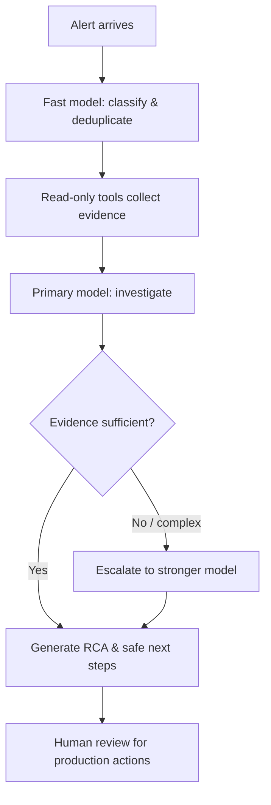

# LLM Model Comparison for Engineering Workloads

> **Purpose:** Select models for DevOps automation, AIOps, coding, incident response, and production AI agents.
>
> Model names, capabilities, availability, context limits, and prices change frequently. Treat model names below as examples of model families and verify current IDs and pricing on provider documentation before deploying.

## 1. How to choose a model

Do not select an LLM by benchmark scores alone. Evaluate the model against your actual workload:

- Reasoning quality on your task.
- Tool/function calling reliability.
- Structured output reliability (JSON/schema).
- Context-window size and how well long contexts are used.
- Latency, throughput, and rate limits.
- Input/output pricing, caching, and batch options.
- Data residency, retention, privacy, and enterprise controls.
- Availability, version stability, and provider support.
- Hosted API versus self-hosted deployment.
- Evaluation results on your own test set.

## 2. Major model families

| Provider / family | Typical strengths | Consider for | Trade-offs |
|---|---|---|---|
| Anthropic Claude | Strong reasoning, analysis, coding, tool workflows | Complex RCA, coding agents, investigation | Proprietary API; costs can rise with large context/output |
| OpenAI GPT | Broad capabilities, structured outputs, tools, multimodal ecosystem | General agents, coding, workflow orchestration | Model choice and price tiers vary; validate API features |
| Google Gemini | Large-context and multimodal options, fast model tiers | Telemetry/doc analysis, high-volume workloads | Performance and pricing vary by model/tier |
| Meta Llama | Open-weight ecosystem and self-hosting flexibility | Private inference, customization, local experiments | Infrastructure, serving, evaluation, and operational costs |
| DeepSeek | Cost-focused hosted models and open model options, depending on release | Budget reasoning/coding experiments | Verify deployment/data terms and current capabilities |
| Mistral | Hosted and open-weight options | European/private deployments, coding, compact models | Compare each model’s actual tool and reasoning performance |

## 3. Capability tiers

| Tier | Typical use | Routing example |
|---|---|---|
| Small / fast | Classification, extraction, deduplication, simple summaries | Default for high-volume routine tasks |
| Mid-tier | Coding, log analysis, moderate RCA, tool use | Main operational agent |
| Flagship / reasoning | Complex, ambiguous, cascading incidents | Escalate only when needed |
| Local open-weight | Private tasks, offline or controlled environments | Use when hardware and quality are adequate |

## 4. Example model-selection matrix

| Task | Model characteristics to prioritize |
|---|---|
| Alert classification | Low latency, low cost, reliable structured output |
| Log summarization | Long-context support, grounded summaries |
| Kubernetes incident RCA | Tool use, reasoning, evidence discipline |
| CI/CD failure diagnosis | Coding knowledge, log comprehension |
| Terraform review | Code reasoning, structured review |
| Security triage | Accurate interpretation, grounded evidence, careful uncertainty |
| Runbook Q&A | RAG retrieval quality and source citation |
| Remediation planning | Reasoning, constrained output, safety |
| Postmortem drafting | Summarization, consistent report format |

## 5. Example: Kubernetes incident model routing

Suggested routing:
- Routine alert classification → small/fast model.
- Common pod or deployment issue → mid-tier model.
- Multi-service, network, or ambiguous incident → flagship model.
- Production write action → independent policy and approval gate; never rely on model confidence alone.

## 6. Model comparison worksheet

Test the same prompts and tool results across candidate models. Score each from 1–5.

| Metric | Score (1–5) | Notes |
|---|---:|---|
| Correct diagnosis | | |
| Evidence references | | |
| Tool selection | | |
| Tool argument correctness | | |
| Structured output validity | | |
| Safe action recommendations | | |
| Latency | | |
| Cost per task | | |

Calculate task cost using actual token usage:

`Cost = (input_tokens / 1,000,000 × input_price) + (output_tokens / 1,000,000 × output_price)`

Add cached input, tool execution, infrastructure, and retries when relevant.

## 7. API pricing comparison

Prices are dynamic and depend on provider, model, region, context tier, cached tokens, batch processing, and service level. This repository intentionally avoids hard-coding a universal price ranking.

Before choosing a model, record:
- Provider and exact API model ID.
- Date price checked.
- Input price per million tokens.
- Output price per million tokens.
- Cache price and cache eligibility.
- Batch discount/availability.
- Context and output limits.
- Region and data-handling terms.

Use provider pricing pages:
- [Anthropic API pricing](https://docs.anthropic.com/en/docs/about-claude/pricing)
- [OpenAI API pricing](https://openai.com/api/pricing/)
- [Google Gemini API pricing](https://ai.google.dev/gemini-api/docs/pricing)
- [Meta Llama](https://www.llama.com/)

## 8. Decision checklist

- [ ] Have we tested representative production examples?
- [ ] Does the model reliably call our tools?
- [ ] Can it produce validated structured output?
- [ ] Are failures, uncertainty, and missing evidence handled well?
- [ ] Are token and latency budgets defined?
- [ ] Are sensitive data and retention requirements understood?
- [ ] Is there a fallback model or degraded mode?
- [ ] Are tool permissions enforced outside the model?
- [ ] Are results monitored and re-evaluated after model changes?

## 9. Key takeaways

The best model is the one that reliably solves your workload within your latency, cost, safety, and governance constraints. Use model routing and task-specific evaluation instead of sending every request to the most expensive model.
