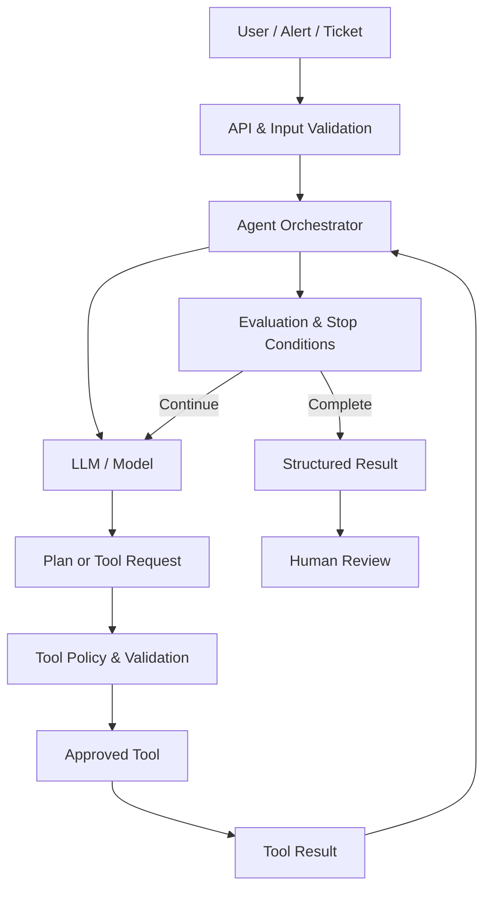

# AI Agent Architecture

## 1. Overview

Agent architecture describes how model reasoning, tools, state, orchestration, and safety controls interact to complete a task. Production agents should be designed as controlled software systems, not as unrestricted model loops.

## 2. Logical Architecture

## 3. Architecture Components

### Input layer
- API endpoint, chat UI, alert, ticket, or scheduled job
- Authentication, schema validation, rate limits
- Task ID and audit metadata

### Orchestrator
- Controls state transitions
- Enforces maximum iterations and timeouts
- Handles retries and errors
- Determines when to stop or ask a human

### Model layer
- Reasoning and summarization
- Intent and context interpretation
- Tool selection among permitted options
- Structured output generation

### Tool layer
- Read-only queries
- Narrowly scoped APIs
- Command wrappers with input validation
- Explicit permission boundaries

### State and context
- Current task state
- Tool observations
- Relevant history and retrieval results
- Redacted secrets and sensitive data

### Safety and policy
- Tool allowlists
- Argument schemas
- Authorization checks
- Approval gates
- Output validation
- Audit logging

## 4. Control Flow

A typical controlled loop:

1. Orchestrator receives validated task.
2. Build context from task and trusted sources.
3. Ask model for response or tool request.
4. Validate tool name and arguments.
5. Authorize the requested action.
6. Execute tool with timeout and resource limits.
7. Return tool result to model as an observation.
8. Check completion, iteration limit, and policy.
9. Deliver structured answer or route for approval.

## 5. Recommended DevOps Agent Architecture

Start with a **Kubernetes Incident Investigation Agent**:

- **Frontend/API:** FastAPI
- **Agent runtime:** A framework or a small custom state machine
- **LLM:** Hosted model or local model behind a provider abstraction
- **Tools:** Read-only Kubernetes, Prometheus, logs, Git metadata
- **Context retrieval:** Runbooks, incident history, service ownership
- **State:** Redis or a database if tasks must survive restarts
- **Observability:** OpenTelemetry traces, metrics, structured logs
- **Approval:** Separate approval service or explicit workflow state

## 6. Reliability Patterns

- Timeout every external call.
- Retry only transient failures; use bounded retries and backoff.
- Make writes idempotent where possible.
- Use circuit breakers for unreliable dependencies.
- Preserve tool outputs as evidence.
- Distinguish missing data from a negative finding.
- Stop when the task is complete or when budget limits are reached.

## 7. Architecture Decisions

| Decision | Starting recommendation |
|---|---|
| Single vs multi-agent | Single agent for first project |
| Tools | Read-only, narrowly scoped |
| Workflow | Explicit state machine |
| Context | Small and task-relevant |
| Model | Route by task complexity and cost |
| Output | Schema-validated incident report |
| Production writes | Human approval and independent authorization |
| Evaluation | Golden test cases and trace review |

## 8. Hands-on Lab

Draw and implement an architecture for an incident agent that receives an alert, queries Kubernetes and Prometheus, retrieves a runbook, and returns an evidence-based report.

Document:
- Trust boundaries
- Tool permissions
- Failure paths
- Timeouts
- Stop conditions
- Data retention
- Approval point

## 9. Checklist

- [ ] Input validation
- [ ] Authentication
- [ ] Orchestration state
- [ ] Tool registry and allowlist
- [ ] Tool argument validation
- [ ] Timeouts and retry limits
- [ ] Agent loop limit
- [ ] Audit trail
- [ ] Observability
- [ ] Evaluation suite
- [ ] Approval workflow
