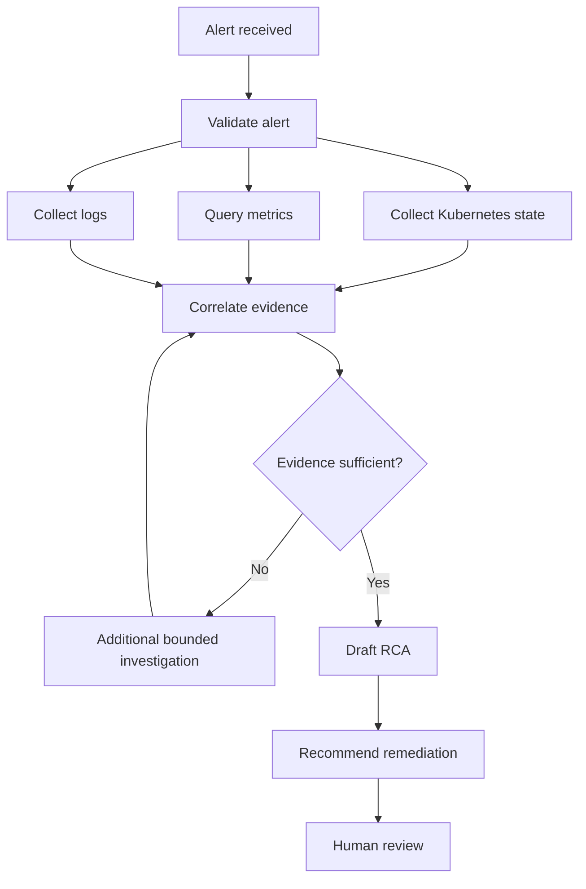

# Agentic Workflows

## 1. What Is an Agentic Workflow?

An agentic workflow is a process where an AI model can make context-dependent decisions within a defined workflow. It may select tools, interpret results, branch, request additional information, or route work to another component.

Agentic does not mean unrestricted autonomy. A reliable workflow combines model-driven decisions with deterministic orchestration and policy enforcement.

## 2. Workflow Patterns

### Sequential workflow
Steps happen in a fixed order.

Example: retrieve alert → collect metrics → collect logs → summarize.

### Conditional workflow
A rule or model chooses a branch.

Example: if deployment-related signals are found, inspect recent rollout; otherwise investigate node or dependency health.

### Loop
Repeat a bounded action until a condition is met.

Example: query additional telemetry until sufficient evidence is collected or the tool budget is exhausted.

### Human-in-the-loop
Pause for a person to review or approve.

Example: agent recommends rollback; operator reviews evidence and approves the change.

### Parallel data collection
Independent read-only queries can run concurrently, then results are correlated. Use concurrency limits and avoid overwhelming systems.

## 3. Example: Incident Investigation Flow

## 4. CI/CD Failure Analysis Workflow

1. Receive failed workflow URL or run ID.
2. Verify repository and workflow identity.
3. Retrieve failing job and step logs.
4. Inspect relevant configuration and recent commits.
5. Classify failure (dependency, test, build, auth, network, runner).
6. Collect supporting evidence.
7. Generate likely cause and suggested fix.
8. Optionally draft a patch in a branch.
9. Require review before merge or pipeline changes.

## 5. Workflow Design Principles

- Keep deterministic steps deterministic.
- Give the model only decisions it needs to make.
- Define success criteria before execution.
- Make every loop bounded.
- Use explicit error states.
- Add fallbacks when model or tools fail.
- Record each step for traceability.
- Separate recommendations from execution.

## 6. State Machine Example

Possible states:

`RECEIVED → VALIDATED → INVESTIGATING → EVIDENCE_READY → REPORT_GENERATED → REVIEW_REQUIRED → COMPLETED`

Error states may include:

`INVALID_INPUT`, `TOOL_ERROR`, `TIMEOUT`, `BUDGET_EXCEEDED`, `NEEDS_HUMAN`.

## 7. Hands-on Lab

Create a CI failure workflow that:
- Accepts a failed GitHub Actions run ID
- Retrieves logs through a limited tool/API
- Detects the first failing step
- Summarizes evidence
- Suggests a fix
- Produces a patch proposal but does not push or merge

Test against at least five failure categories and record accuracy.

## 8. Workflow Metrics

Track:
- Workflow completion rate
- Tool success/failure rate
- Time to investigation result
- Number of tool calls
- Retry count
- Human approval rate
- Incorrect recommendations
- Cost per workflow

## 9. Production Checklist

- [ ] Explicit states and transitions
- [ ] Validated input
- [ ] Tool timeouts
- [ ] Retry/backoff policy
- [ ] Loop and cost budget
- [ ] Fallback behavior
- [ ] Audit logs
- [ ] Human approval for impactful actions
- [ ] Evaluation scenarios
