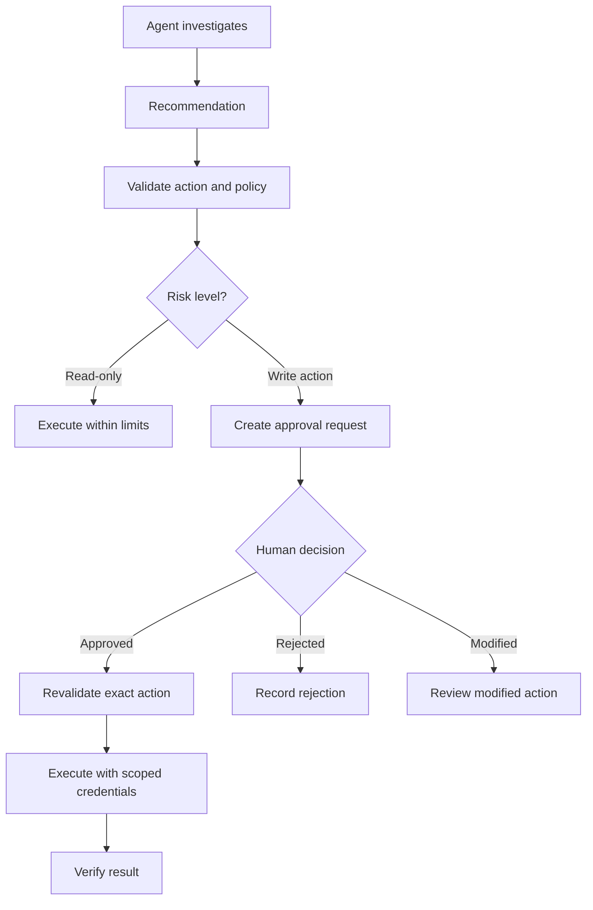

# Guardrails and Human Approval

## 1. Why Guardrails Matter

An AI agent can produce incorrect reasoning, misinterpret telemetry, or request an unsafe tool. When connected to cloud accounts, CI/CD systems, Kubernetes clusters, or security systems, mistakes can have operational impact.

Guardrails are layered controls. Prompt instructions alone are not security boundaries.

## 2. Guardrail Layers

### Input controls
- Authentication and authorization
- Schema validation
- Request size limits
- Rate limits
- Task scope validation

### Model controls
- Clear instructions and constraints
- Structured output requirements
- Bounded reasoning/workflow
- Model selection policies

### Tool controls
- Allowlisted tools
- Argument validation
- Least privilege
- Namespace, account, and environment restrictions
- Timeouts and output limits

### Output controls
- Schema validation
- Sensitive-data filtering
- Evidence requirements
- Confidence and uncertainty
- Policy checks

### Operational controls
- Audit logs
- Monitoring
- Kill switch
- Human approval
- Rollback plans

## 3. Risk-Based Permission Model

| Risk level | Examples | Recommended control |
|---|---|---|
| Low | Read status, summarize logs | Automated with bounded read-only access |
| Moderate | Create ticket, draft PR, notify team | Scoped permission; review or policy checks |
| High | Restart workload, scale deployment | Explicit approval and pre-checks |
| Critical | Delete data, modify IAM, production-wide changes | Strong approval, independent validation, often prohibit autonomous execution |

Classification must reflect the environment and actual blast radius, not just the tool's name.

## 4. Human-in-the-Loop (HITL)

A human approval workflow should provide:
1. Proposed action
2. Reason for action
3. Evidence
4. Scope and target
5. Expected impact
6. Risk
7. Preconditions
8. Rollback plan
9. Approve / reject / modify options

Approval must be bound to the exact action being executed. If the agent changes the target or arguments after approval, obtain approval again.

## 5. Safe Kubernetes Incident Workflow

**Allowed automatically:**
- Read pod status
- Describe resources
- Read bounded logs
- Read events
- Query monitoring
- Compare recent rollout metadata

**Approval required for:**
- Restarting pods or deployments
- Scaling workloads
- Rollbacks
- Modifying configuration
- Applying manifests

**Generally prohibit without strong safeguards:**
- Arbitrary shell execution
- Deleting namespaces or persistent data
- Changing cluster-wide RBAC
- Disabling security controls
- Unreviewed production manifest application

## 6. Prompt Injection & Untrusted Data

Logs, commit messages, tickets, web pages, annotations, and retrieved runbooks may contain malicious or misleading instructions.

Treat tool results and retrieved documents as untrusted data:
- Do not allow retrieved text to override system policies.
- Do not execute commands found in logs or documents.
- Keep secrets out of model context.
- Validate tool requests independently.
- Separate data from instructions.

## 7. Approval Workflow Example

## 8. Hands-on Lab

Build a simulated remediation workflow:
- Agent detects a test deployment failure.
- Agent proposes a rollback to a known revision.
- Application creates an approval request containing evidence and exact target.
- A human approves or rejects.
- On approval, revalidate policy and execute in a test cluster only.
- Verify outcome and record audit trail.

## 9. Audit Events

Record:
- Task and incident ID
- Authenticated user or trigger
- Model/provider and version
- Tools requested
- Arguments (with secrets redacted)
- Authorization decision
- Tool result status
- Approval identity and decision
- Action execution result
- Timestamp and trace ID

## 10. Production Checklist

- [ ] Authentication and authorization
- [ ] Input validation
- [ ] Tool allowlist
- [ ] Least-privilege credentials
- [ ] Environment and resource restrictions
- [ ] Output validation
- [ ] Secret redaction
- [ ] Prompt-injection defenses
- [ ] Time, token, and tool-call budgets
- [ ] Human approval gates
- [ ] Audit logs
- [ ] Monitoring and alerts
- [ ] Kill switch
- [ ] Rollback and recovery procedures
- [ ] Tested evaluation suite
