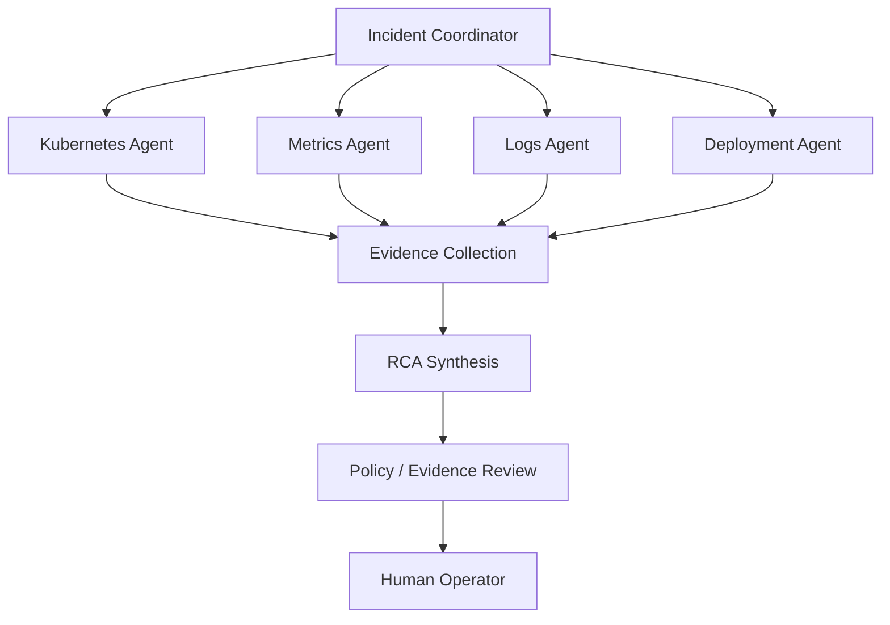

# Multi-Agent Systems

## 1. What Is a Multi-Agent System?

A multi-agent system uses multiple specialized agents or agent-like components to divide a complex task. A coordinator may assign work, collect results, resolve conflicts, and produce a final result.

More agents do not automatically improve accuracy. Multi-agent systems introduce extra latency, cost, complexity, coordination, and failure modes. Start with one agent and add specialization only when measurable benefits justify it.

## 2. Common Patterns

### Coordinator and specialists
A coordinator assigns bounded tasks to specialist agents and synthesizes their outputs.

### Sequential handoff
One agent's validated output becomes another agent's input.

### Parallel specialists
Independent agents investigate separate areas, such as logs, metrics, deployment changes, and security findings.

### Reviewer
A separate evaluator checks a draft for missing evidence, unsupported claims, or policy violations. It is not a substitute for deterministic validation.

## 3. DevOps Incident Response Example



Specialist responsibilities:
- **Kubernetes agent:** Workload, pod, node, events, rollout state.
- **Metrics agent:** CPU, memory, latency, saturation, error rate.
- **Logs agent:** Error patterns, recent changes, timestamps.
- **Deployment agent:** Deployment history, Git changes, image versions.
- **Coordinator:** Correlates evidence, identifies gaps, creates report.

## 4. Agent Contracts

Each specialist should have:
- Narrow goal
- Allowed tools
- Input schema
- Output schema
- Time budget
- Tool-call budget
- Completion criteria
- Error format

Example specialist output:

```json
{
  "specialist": "metrics",
  "status": "completed",
  "observations": ["Elevated API latency from 14:05 to 14:20"],
  "evidence": ["query result identifier or trace link"],
  "limitations": ["Database metrics unavailable"],
  "next_recommendation": "Compare DB connection utilization with request rate"
}
```

## 5. Coordination Risks

- Conflicting recommendations
- Duplicate queries
- Agents passing untrusted content to each other
- Context growth
- Excessive recursive delegation
- Hidden or repeated tool calls
- Cost and latency multiplication
- No clear owner for final decisions

## 6. Controls

- Use a fixed roster of agents.
- Do not permit unrestricted agent spawning.
- Bound parallelism and total calls.
- Require structured specialist results.
- Preserve source evidence.
- Have the coordinator identify disagreement and uncertainty.
- Use deterministic checks for policy and final validation.
- Require a human for operational changes.

## 7. Hands-on Lab

Create a multi-agent incident investigator with:
- Coordinator
- Kubernetes specialist
- Metrics specialist
- Logs specialist

Run it against a synthetic incident. Compare its results with a single-agent baseline.

Measure:
- Diagnosis accuracy
- Evidence coverage
- Latency
- Token/API cost
- Tool calls
- Contradiction rate

Only keep the multi-agent architecture if it provides clear improvement.

## 8. Production Checklist

- [ ] Agent responsibilities defined
- [ ] Inputs and outputs validated
- [ ] Delegation bounded
- [ ] Parallelism limited
- [ ] Shared context controlled
- [ ] Conflicts handled
- [ ] Evaluation against baseline
- [ ] Cost and latency measured
- [ ] Audit trail
- [ ] Human approval for changes
