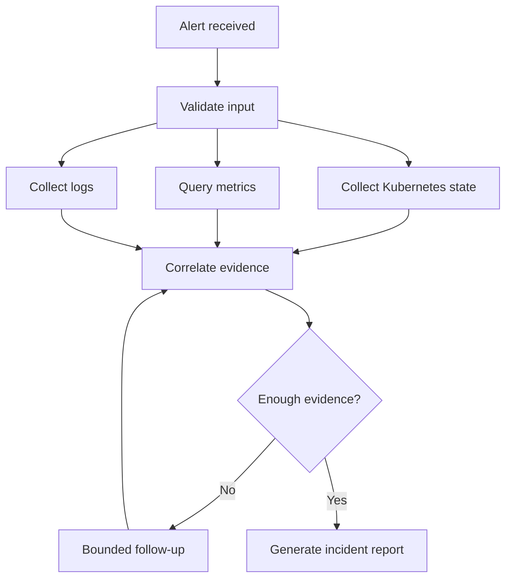

# Google ADK — Workflows

## 1. Why workflows?
Workflow patterns define predictable sequencing, branching, parallel work, delegation, and stop conditions. They reduce the need for a model to decide every transition.

ADK includes workflow-oriented constructs. Confirm names and behavior against your installed version.

## 2. Common patterns
- **Sequential:** Steps run in a defined order.
- **Parallel:** Independent tasks run concurrently.
- **Loop:** Repeat with explicit exit condition and limit.
- **Delegation:** Hand bounded work to a specialist.
- **Conditional:** Select a branch based on state or decision.

## 3. Incident investigation flow

## 4. Workflow vs. agent

| Workflow | Agent |
|---|---|
| Predictable control flow | Context-dependent decisions |
| Fixed sequencing | Chooses among allowed options |
| Easier to test transitions | Requires behavioral evaluation |
| Good for repeatable procedures | Good for interpretation |

A robust system often uses a workflow to control execution and an agent for bounded reasoning.

## 5. Lab
Design an incident workflow:
1. Validate alert
2. Collect Kubernetes state and metrics concurrently
3. Normalize evidence
4. Generate diagnosis
5. Validate report schema
6. Deliver report

Add timeouts, error branches, and stopping conditions.

## 6. Production considerations
- Bound loops and concurrency
- Timeout every step
- Retry transient failures only
- Preserve tool evidence
- Handle partial failure
- Require approval before operational changes
- Test all branches
