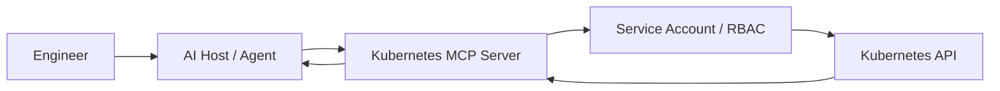

# Kubernetes MCP

## Overview
A Kubernetes MCP server exposes selected Kubernetes operations to an MCP-compatible AI host. It helps an agent investigate workloads through the Kubernetes API without requiring the model to construct arbitrary shell commands.

**Recommended first implementation:** read-only inspection in a dedicated test namespace.

## Architecture


## Useful read-only tools
| Tool | Purpose |
|---|---|
| `list_pods` | List pods in an approved namespace |
| `get_pod` | Read pod status and conditions |
| `get_events` | Read recent namespace events |
| `get_pod_logs` | Retrieve bounded container logs |
| `get_deployments` | Inspect deployment and rollout state |
| `get_services` | Inspect Service configuration |
| `get_endpoints` | Check endpoint readiness |

Use narrow tools with typed parameters. Do not expose unrestricted `kubectl` or shell execution to the model.

## Kubernetes RBAC example
Create a dedicated service account and namespace-scoped read permissions:

```yaml
apiVersion: v1
kind: ServiceAccount
metadata:
  name: mcp-observer
  namespace: mcp-lab
---
apiVersion: rbac.authorization.k8s.io/v1
kind: Role
metadata:
  name: mcp-observer
  namespace: mcp-lab
rules:
  - apiGroups: [""]
    resources: ["pods", "pods/log", "events", "services", "endpoints"]
    verbs: ["get", "list"]
  - apiGroups: ["apps"]
    resources: ["deployments", "replicasets"]
    verbs: ["get", "list"]
---
apiVersion: rbac.authorization.k8s.io/v1
kind: RoleBinding
metadata:
  name: mcp-observer
  namespace: mcp-lab
subjects:
  - kind: ServiceAccount
    name: mcp-observer
    namespace: mcp-lab
roleRef:
  apiGroup: rbac.authorization.k8s.io
  kind: Role
  name: mcp-observer
```

Apply and verify:
```bash
kubectl create namespace mcp-lab
kubectl apply -f mcp-observer-rbac.yaml
kubectl auth can-i list pods --as=system:serviceaccount:mcp-lab:mcp-observer -n mcp-lab
kubectl auth can-i delete pods --as=system:serviceaccount:mcp-lab:mcp-observer -n mcp-lab
```
Expected: listing is allowed; deleting is denied. Validate permissions against actual API calls. Do not grant cluster-admin.

## Example incident investigation
For a pod in `CrashLoopBackOff`, the agent can read pod status/restart count, retrieve events, read bounded previous logs, inspect the owning Deployment/ReplicaSet, compare evidence with a runbook, and produce observed facts plus likely causes and next checks.

It should not automatically delete pods, patch deployments, or change configuration.

## Production safety
- Restrict namespaces and resource types.
- Use a dedicated identity per environment.
- Never return Secret values.
- Bound log size and time range.
- Redact tokens, passwords, and personal data.
- Treat logs, annotations, labels, and events as untrusted content.
- Require approval for restart, scale, rollout, or manifest changes.
- Revalidate targets immediately before approved writes.

## Lab
1. Create `mcp-lab` and deploy a test application.
2. Configure a Kubernetes MCP server with read-only credentials.
3. Expose pod status, events, and logs tools.
4. Ask an agent to investigate a simulated failure.
5. Verify tool calls and RBAC decisions.
6. Confirm write operations are denied.

## Troubleshooting
| Issue | Checks |
|---|---|
| Forbidden | Service account, RoleBinding, namespace, verbs |
| Connection refused | API endpoint and network connectivity |
| TLS error | Cluster CA and certificate configuration |
| Empty logs | Correct pod/container and time range |
| Excessive output | Limits, pagination, filtering |
| Wrong cluster | Verify context and credentials |

## References
- https://kubernetes.io/docs/reference/access-authn-authz/rbac/
- https://kubernetes.io/docs/concepts/overview/kubernetes-api/
- https://modelcontextprotocol.io/docs/learn/architecture
