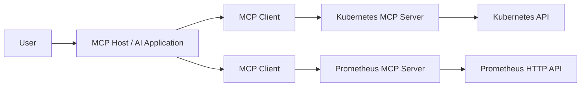
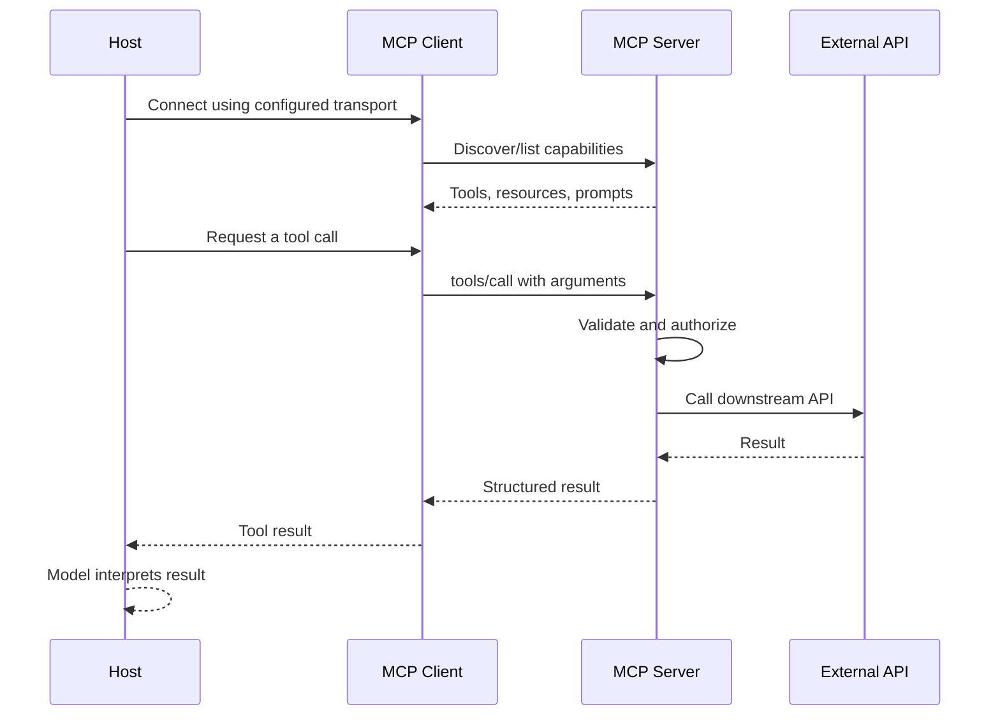

# MCP Architecture

## High-level architecture
MCP uses a host-client-server model. The host is the AI application; its MCP client communicates with a server that exposes capabilities backed by an external system.

## Responsibilities
- **Host:** Manages user interaction/model calls, configures servers, applies host-side policy and approval UX.
- **Client:** Connects, discovers capabilities, sends requests, receives results, handles transport details.
- **Server:** Publishes tools/resources/prompts, validates inputs, enforces authorization, calls downstream systems.
- **External system:** Actual API or data source, such as Kubernetes, Prometheus, GitHub, or cloud provider.

## Data and transport layers
- **Data layer:** JSON-RPC-based messages, lifecycle/capability behavior, tools, resources, prompts, notifications.
- **Transport layer:** Carries messages, including stdio and Streamable HTTP, plus transport-related authorization.

## Capability flow

Exact lifecycle and discovery details depend on protocol revision and SDK. Follow the current specification.

## Local vs remote servers
| Local server | Remote server |
|---|---|
| Often launched as subprocess | Runs as network service |
| Commonly uses stdio | Commonly uses Streamable HTTP |
| Host manages process lifecycle | Service lifecycle managed separately |
| Local trust boundary | Network authentication and authorization required |

## Architecture decisions
- Separate servers when credentials or trust boundaries differ.
- Keep tools small and domain-specific.
- Prefer structured outputs over large unfiltered text.
- Set timeouts and response-size limits.
- Avoid arbitrary shell, SQL, or URL-fetch tools.
- Use separate credentials for dev, staging, and production.
- Version tools and document compatibility.

## Lab
Design two servers: Kubernetes (pod status, events, deployment state) and Prometheus (approved metrics queries). Document transports, credentials, network boundaries, RBAC, and audit events.

## References
- https://modelcontextprotocol.io/docs/learn/architecture
- https://modelcontextprotocol.io/specification/
