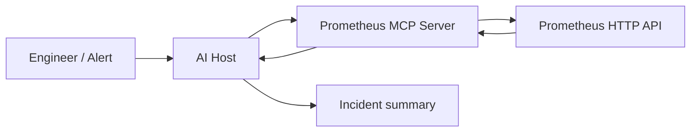

# Prometheus MCP

## Overview
A Prometheus MCP server exposes selected Prometheus query capabilities to an MCP-compatible AI host. An agent can retrieve metrics to investigate latency, error rates, saturation, resource pressure, and target health.

This note describes a design pattern; it does not claim that a particular third-party Prometheus MCP server is officially maintained by Prometheus.

## Architecture


## Useful read-only tools
| Tool | Purpose |
|---|---|
| `query_instant` | Run an approved instant PromQL query |
| `query_range` | Query a bounded time range |
| `list_metric_names` | Discover allowed metric names |
| `get_targets_summary` | Inspect scrape target health |
| `get_alerts` | Retrieve active alerts, if exposed by backend |
| `get_rule_groups` | Inspect configured rule groups |

Avoid exposing an unrestricted proxy to arbitrary internal URLs or unbounded PromQL.

## Prometheus API examples
Instant query:
```bash
curl -G "http://localhost:9090/api/v1/query" \
  --data-urlencode 'query=up'
```

Range query:
```bash
curl -G "http://localhost:9090/api/v1/query_range" \
  --data-urlencode 'query=rate(http_requests_total[5m])' \
  --data-urlencode 'start=2026-11-18T10:00:00Z' \
  --data-urlencode 'end=2026-11-18T10:15:00Z' \
  --data-urlencode 'step=30s'
```
Use timestamps appropriate to the test environment. Protect the endpoint with network controls and authentication where supported.

## Safe query design
- Allowlist metric families or query templates where possible.
- Validate query length and parameters.
- Restrict range duration and step size.
- Enforce response-size limits and timeouts.
- Prevent arbitrary URL access.
- Redact sensitive labels.
- Return timestamps, units, and query metadata.

## DevOps incident use cases
- **High CPU:** Compare CPU usage with requests, limits, and traffic.
- **High latency:** Compare request duration, rate, errors, and dependency metrics.
- **Pod restarts:** Correlate restart counts with deployment changes, memory, and node pressure.
- **Target down:** Inspect scrape health and related service/network signals.

Metrics alone rarely prove root cause. Correlate with logs, traces, events, and deployment history.

## Lab
1. Start a Prometheus test environment.
2. Expose `query_instant` with a restricted query set.
3. Expose `query_range` with a short maximum time window.
4. Ask an agent to investigate an API latency alert.
5. Require query names, time range, observations, and limitations in its answer.

## Troubleshooting
| Issue | Checks |
|---|---|
| Connection error | URL, DNS, network policy |
| 401/403 | Authentication and authorization |
| Empty result | Metric name, labels, scrape health, time range |
| Slow query | Range, step, cardinality, complexity |
| Huge response | Limits and narrower time range |
| Incorrect interpretation | Units, aggregation, counter vs gauge |

## References
- https://prometheus.io/docs/prometheus/latest/querying/api/
- https://prometheus.io/docs/prometheus/latest/querying/basics/
