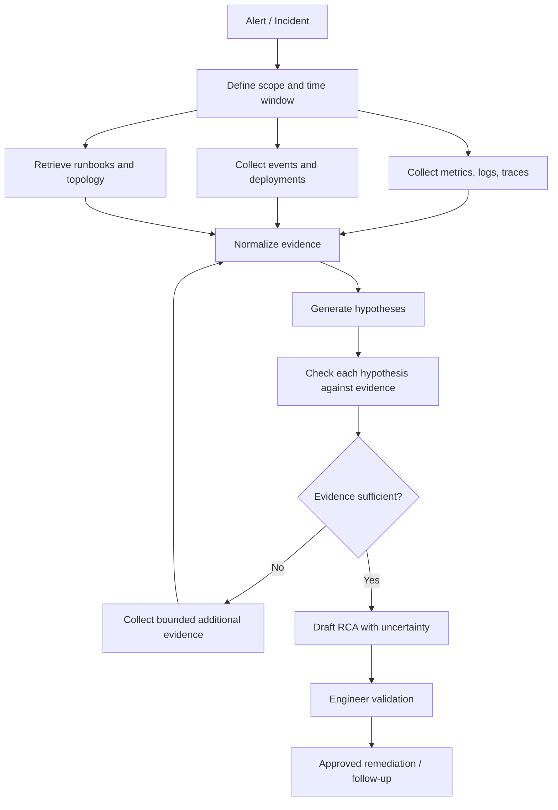

# AI-Driven Root Cause Analysis (RCA)

## 1. What is AI-driven RCA?

AI-driven Root Cause Analysis uses operational telemetry, service topology, deployment history, runbooks, and AI-assisted reasoning to help identify likely causes of incidents.

AI can accelerate evidence collection and hypothesis generation. It cannot guarantee a correct root cause. Engineers must validate conclusions against system behavior and reliable evidence.

## 2. RCA vs symptom detection

- **Detection:** Identifies that something unusual is happening.
- **Correlation:** Groups signals that may be related.
- **Diagnosis:** Generates and tests possible explanations.
- **Root cause analysis:** Determines the underlying cause supported by evidence.
- **Remediation:** Selects and executes a corrective action.

Do not label an unverified hypothesis as a confirmed root cause.

## 3. AI-assisted RCA workflow



## 4. Evidence sources

| Source | What it can establish |
|---|---|
| Metrics | Timing, magnitude, saturation, traffic trends |
| Logs | Application errors and execution details |
| Traces | Request path and dependency timing |
| Kubernetes events | Scheduling, image, probe, eviction, and lifecycle events |
| Deployment history | Version and configuration changes |
| Cloud events | Infrastructure and control-plane changes |
| Service topology | Dependency relationships |
| Runbooks | Approved investigation and recovery procedures |
| Incident history | Similar past symptoms and validated resolutions |

## 5. Example: API latency incident

Symptoms:
- API p95 latency increases.
- HTTP 5xx rate rises.
- Database connection utilization approaches its limit.
- No corresponding CPU saturation is observed in the API pods.

Possible hypothesis: database connection saturation is contributing to API latency.

Validation steps:
1. Align metric timestamps.
2. Inspect traces for database spans.
3. Check connection pool wait time and database health.
4. Review recent traffic and deployment changes.
5. Compare with known-good periods.
6. Check for other plausible causes, such as network latency.

Only conclude database saturation is the root cause if the evidence supports it. Otherwise report it as a leading hypothesis.

## 6. Role of an LLM or agent

An AI agent can:
- Choose among approved read-only investigation tools.
- Summarize large log and event outputs.
- Correlate timestamps and service names.
- Retrieve relevant runbooks.
- Generate competing hypotheses.
- Identify missing evidence.
- Draft an incident timeline and RCA report.

It should not fabricate observations, silently change production, or treat text found in logs as instructions.

## 7. RCA report template

```markdown
# Incident RCA

## Summary
What happened and which service was affected?

## Impact
Users, requests, regions, and duration affected.

## Timeline
Key events with timestamps and time zone.

## Observed Evidence
Metrics, logs, traces, events, and deployment references.

## Root Cause
Confirmed cause, or leading hypothesis if not confirmed.

## Contributing Factors
Conditions that increased likelihood or impact.

## Resolution
What action restored service?

## Preventive Actions
Owners, priorities, and target dates.

## Confidence and Limitations
What is confirmed, what remains uncertain, and what data was unavailable.
```

## 8. Safety and reliability controls

- Use read-only access during investigation.
- Limit log volume and redact secrets.
- Treat retrieved content as untrusted.
- Keep evidence references and timestamps.
- Separate facts, hypotheses, and recommendations.
- Validate model output against schemas and source data.
- Require approval for remediation.
- Audit all tool calls and approvals.

## 9. Evaluation

Build a test set from historical or synthetic incidents with known outcomes.

Measure:
- Correct cause identification
- Evidence precision and completeness
- Unsupported-claim rate
- Hypothesis ranking quality
- Investigation time
- Human acceptance
- Cost per investigation

A fluent report is not necessarily a correct report.

## 10. Hands-on project: Kubernetes RCA Agent

Build an agent that receives an incident ID and:
1. Reads pod and deployment status.
2. Retrieves recent events and bounded logs.
3. Queries Prometheus for CPU, memory, latency, and restart metrics.
4. Checks recent deployment history.
5. Retrieves a relevant runbook.
6. Produces an RCA draft with evidence links and uncertainty.
7. Requests human review before any remediation.

Start with a test cluster and read-only credentials. Add approved remediation only after evaluation and safety review.

## References

- Google SRE: https://sre.google/workbook/incident-response/
- OpenTelemetry: https://opentelemetry.io/docs/
- Prometheus: https://prometheus.io/docs/
