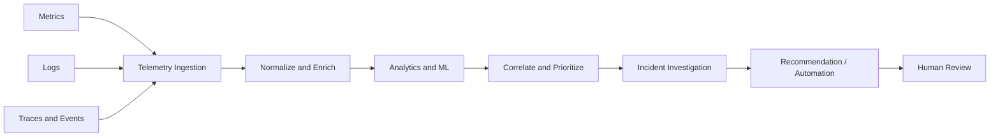

# AIOps Fundamentals

## 1. What is AIOps?

AIOps (Artificial Intelligence for IT Operations) applies machine learning, statistical analysis, automation, and increasingly generative AI to operational data. The goal is to help teams detect abnormal behavior, reduce alert noise, investigate incidents, and improve service reliability.

AIOps is not a single product or a replacement for observability. It is a set of practices and capabilities built on operational data, analytics, automation, and human expertise.

## 2. Why AIOps?

Modern systems produce large volumes of telemetry:
- Metrics from applications, infrastructure, and Kubernetes
- Logs from services, containers, and operating systems
- Distributed traces across microservices
- Events from deployments, cloud platforms, and orchestration systems
- Alerts from monitoring and security platforms

Manual analysis becomes difficult when signals are noisy, distributed, and time-sensitive. AIOps can help correlate these signals and prioritize investigation.

## 3. Core AIOps capabilities

| Capability | What it does | Example |
|---|---|---|
| Anomaly detection | Identifies unusual behavior | Sudden increase in API latency |
| Event correlation | Groups related events | Multiple alerts caused by one node failure |
| Noise reduction | Suppresses duplicates or low-value alerts | Deduplicate repeated pod alerts |
| Predictive operations | Estimates future resource or capacity needs | Predict disk exhaustion |
| Root cause analysis | Ranks likely causes using evidence | Link latency spike to DB saturation |
| Intelligent automation | Recommends or triggers approved actions | Open incident and attach diagnostics |

## 4. AIOps data pipeline

## 5. AIOps vs. observability

Observability provides the ability to understand internal system behavior from outputs such as metrics, logs, and traces. AIOps uses operational data and analytics to help identify patterns, anomalies, relationships, and likely causes.

They complement each other:
- Observability collects and presents evidence.
- AIOps analyzes evidence and helps prioritize or investigate.
- Automation executes approved, controlled actions.

## 6. DevOps and SRE use cases

- Kubernetes pod crash and restart analysis
- Node resource pressure detection
- CI/CD failure pattern analysis
- Application latency and error-rate investigation
- Cloud cost anomaly detection
- Capacity forecasting
- Alert deduplication and correlation
- Incident timeline and postmortem generation

## 7. AIOps architecture building blocks

- **Telemetry sources:** OpenTelemetry, Prometheus, logs, traces, cloud events
- **Storage/search:** Metrics, log, trace, and event backends
- **Analytics:** Rules, statistics, ML models, time-series forecasting
- **AI layer:** LLMs and agents for summarization, investigation, and tool use
- **Workflow layer:** Incident management, ticketing, automation
- **Governance:** Access control, evaluation, audit, approval, retention

## 8. AIOps implementation maturity

1. Centralize telemetry and improve data quality.
2. Establish service ownership and useful alert rules.
3. Reduce duplicate and noisy alerts.
4. Add anomaly detection to selected signals.
5. Correlate telemetry with deployments and infrastructure events.
6. Introduce evidence-based AI incident summaries.
7. Add controlled remediation workflows with human approval.
8. Measure outcomes and continuously evaluate quality.

## 9. Hands-on lab

Create a small AIOps investigation for an API service:
1. Collect request rate, error rate, latency, CPU, and memory.
2. Generate a synthetic latency spike.
3. Detect the unusual interval using a threshold or baseline.
4. Correlate it with deployment and database events.
5. Produce an incident summary containing evidence and uncertainty.
6. Compare the result with a manual investigation.

## 10. Key metrics

Track:
- Mean time to detect (MTTD)
- Mean time to acknowledge (MTTA)
- Mean time to resolve (MTTR)
- Alert volume and duplicate rate
- False-positive and false-negative rates
- Incident recurrence
- Recommendation acceptance rate
- Automation success and rollback rate
- Cost per investigation

## 11. Best practices

- Start with reliable telemetry and service context.
- Use AIOps to augment—not replace—engineering judgment.
- Separate observed facts from model-generated hypotheses.
- Evaluate models against known incidents.
- Keep remediation permissions narrow.
- Require approval for high-impact changes.
- Measure operational outcomes, not AI usage alone.

## References

- OpenTelemetry: https://opentelemetry.io/docs/
- Prometheus: https://prometheus.io/docs/
- Google SRE Workbook: https://sre.google/workbook/table-of-contents/
