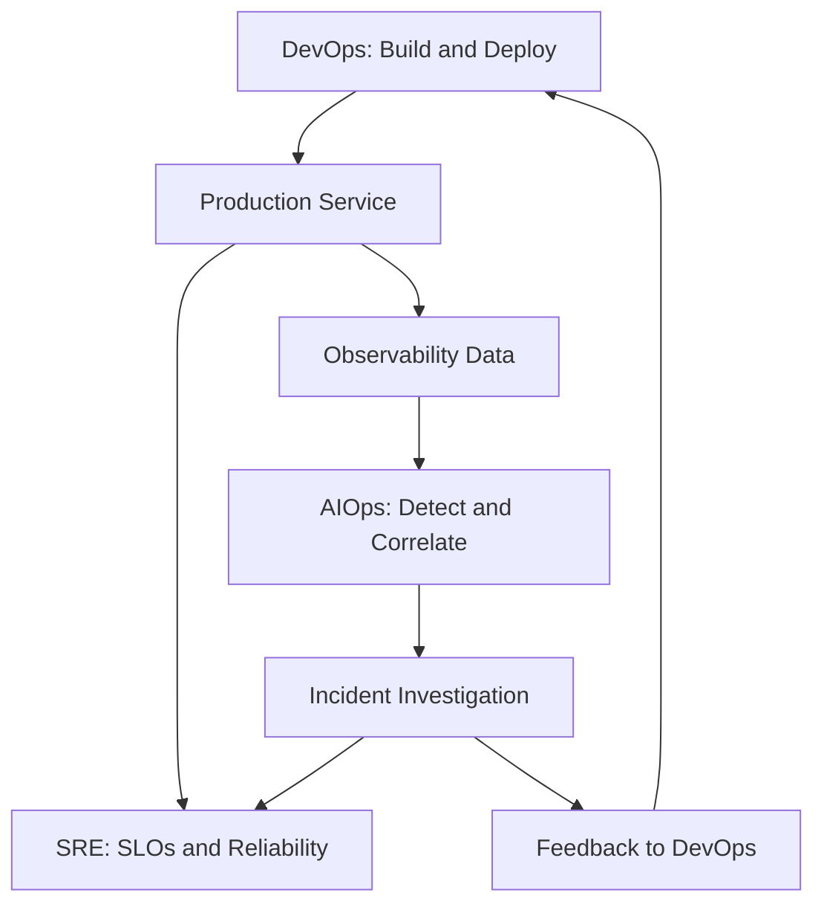

# AIOps vs DevOps vs SRE

## 1. Overview

DevOps, Site Reliability Engineering (SRE), and AIOps are related but solve different parts of the software delivery and operations problem.

- **DevOps** is a culture and set of practices that improve collaboration and automate software delivery and operations.
- **SRE** applies software engineering and measurable reliability practices to operate services.
- **AIOps** applies analytics, machine learning, and AI to operational data to improve detection, investigation, and response.

AIOps can support DevOps and SRE; it does not replace either discipline.

## 2. Comparison

| Area | DevOps | SRE | AIOps |
|---|---|---|---|
| Primary focus | Delivery and collaboration | Reliability and service health | Operational intelligence |
| Main question | How do we deliver safely and frequently? | How reliable is the service? | What patterns and relationships exist in operational data? |
| Practices | CI/CD, IaC, automation, GitOps | SLOs, error budgets, incident response, toil reduction | Anomaly detection, event correlation, predictive analytics |
| Typical data | Source, builds, deployments, infrastructure | SLIs, SLOs, incidents, capacity, telemetry | Metrics, logs, traces, events, changes |
| Common outputs | Repeatable delivery workflows | Reliable services and incident processes | Prioritized alerts, insights, probable causes |
| Success measures | Lead time, deployment frequency, change failure rate | SLO attainment, MTTR, toil, availability | Detection quality, noise reduction, investigation time |

## 3. How they work together

Example:
1. DevOps deploys a new application version through CI/CD.
2. SRE monitors latency and error-rate SLOs.
3. AIOps detects an unusual latency pattern and correlates it with the deployment.
4. The on-call engineer validates the evidence and decides whether to roll back.
5. The team updates tests, deployment safeguards, and runbooks.

## 4. Practical examples

### DevOps example
A GitHub Actions pipeline builds, scans, signs, and deploys a container image to Kubernetes.

### SRE example
The team defines a 99.9% availability SLO, monitors the error budget, and uses an incident process when the budget burns too quickly.

### AIOps example
An analytics workflow detects unusual API latency, groups related alerts, and correlates the signal with a recent deployment and database connection saturation.

## 5. Skills and tools

| Discipline | Useful skills and tools |
|---|---|
| DevOps | Git, CI/CD, Docker, Kubernetes, Terraform, GitOps |
| SRE | SLO/SLI design, incident response, capacity, observability, reliability engineering |
| AIOps | Statistics, time-series analysis, telemetry, ML basics, Python, LLMs, agent workflows |

Tools overlap. Prometheus, Grafana, OpenTelemetry, Kubernetes, and incident-management systems can support all three disciplines.

## 6. When to use each

- Improve build, test, release, and infrastructure workflows: DevOps.
- Define and improve reliability targets, reduce toil, and manage incidents: SRE.
- Detect unusual patterns, correlate signals, and assist investigations across large telemetry volumes: AIOps.

## 7. Interview-ready answer

**DevOps** focuses on collaboration and automation across software delivery and operations. **SRE** applies engineering practices and measurable objectives to maintain service reliability. **AIOps** uses analytics and AI to detect anomalies, correlate events, and accelerate incident investigation. They complement one another: DevOps delivers changes, SRE defines and protects reliability, and AIOps helps teams make better use of operational data.

## 8. Further reading

- Google SRE: https://sre.google/
- DORA: https://dora.dev/
- OpenTelemetry: https://opentelemetry.io/docs/
