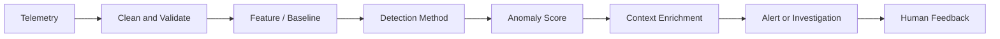

# Anomaly Detection for AIOps

## 1. What is anomaly detection?

Anomaly detection identifies observations that differ meaningfully from expected behavior. In operations, anomalies may indicate a service degradation, resource exhaustion, traffic change, deployment issue, or telemetry problem.

An anomaly is a signal to investigate—not automatically proof of an incident.

## 2. Common anomaly types

- **Point anomaly:** One value is unusual (for example, a sudden CPU spike).
- **Contextual anomaly:** A value is unusual for its context (for example, high traffic at an unexpected hour).
- **Collective anomaly:** A sequence is unusual even if individual values look normal (for example, gradually increasing latency).

## 3. Detection approaches

| Method | Description | Strength | Limitation |
|---|---|---|---|
| Static threshold | Compare value with fixed limit | Simple and explainable | Poorly adapts to changing baselines |
| Dynamic threshold | Compare with moving or learned baseline | Adapts to trends | Can follow bad behavior |
| Z-score | Measure deviation from mean in standard deviations | Useful for stable distributions | Sensitive to outliers and non-normal data |
| Seasonal baseline | Compare with similar time periods | Handles recurring patterns | Needs sufficient history |
| Isolation Forest | ML method that isolates unusual samples | Useful for multivariate data | Needs feature design and evaluation |
| Forecast residual | Compare observed value with forecast | Detects deviation from expected trend | Depends on forecast quality |

## 4. Basic statistical example

For a metric with mean \(\mu\) and standard deviation \(\sigma\), a z-score is:

\[
z = \frac{x-\mu}{\sigma}
\]

A large absolute z-score may indicate an anomaly. The threshold is workload-specific; do not assume one universal cutoff.

## 5. Prometheus examples

CPU usage rate:

```promql
sum by (namespace, pod) (
  rate(container_cpu_usage_seconds_total{container!="",container!="POD"}[5m])
)
```

Memory working set:

```promql
sum by (namespace, pod) (
  container_memory_working_set_bytes{container!="",container!="POD"}
)
```

Request error ratio (adapt metric and labels to your instrumentation):

```promql
sum(rate(http_requests_total{status=~"5.."}[5m]))
/
clamp_min(sum(rate(http_requests_total[5m])), 1)
```

These are examples. Validate metric names, labels, units, and aggregation for your environment.

## 6. Detection pipeline



## 7. Common challenges

- Missing or delayed telemetry
- Seasonality and changing traffic
- High-cardinality labels
- Noisy metrics
- Cold-start services with little history
- Alert fatigue from poorly tuned thresholds
- Concept drift as systems change
- Confusing correlation with causation

## 8. Evaluation

Measure:
- Precision: proportion of flagged anomalies that are meaningful
- Recall: proportion of meaningful anomalies detected
- False-positive rate
- Detection delay
- Alert volume
- Performance across services and traffic patterns

Use labelled historical incidents and controlled synthetic anomalies. Evaluate on data not used to tune the detector.

## 9. Hands-on lab

1. Export a time series such as request latency or CPU.
2. Create a baseline from normal periods.
3. Inject a synthetic spike and gradual drift.
4. Implement a threshold or rolling z-score detector in Python.
5. Plot the metric and detected intervals.
6. Compare detections with known injected anomalies.
7. Tune the method and document false positives.

## 10. Best practices

- Start with simple, explainable baselines.
- Include service and time context.
- Avoid alerting on every isolated anomaly.
- Combine anomaly scores with impact and SLO signals.
- Keep humans in the loop for high-impact decisions.
