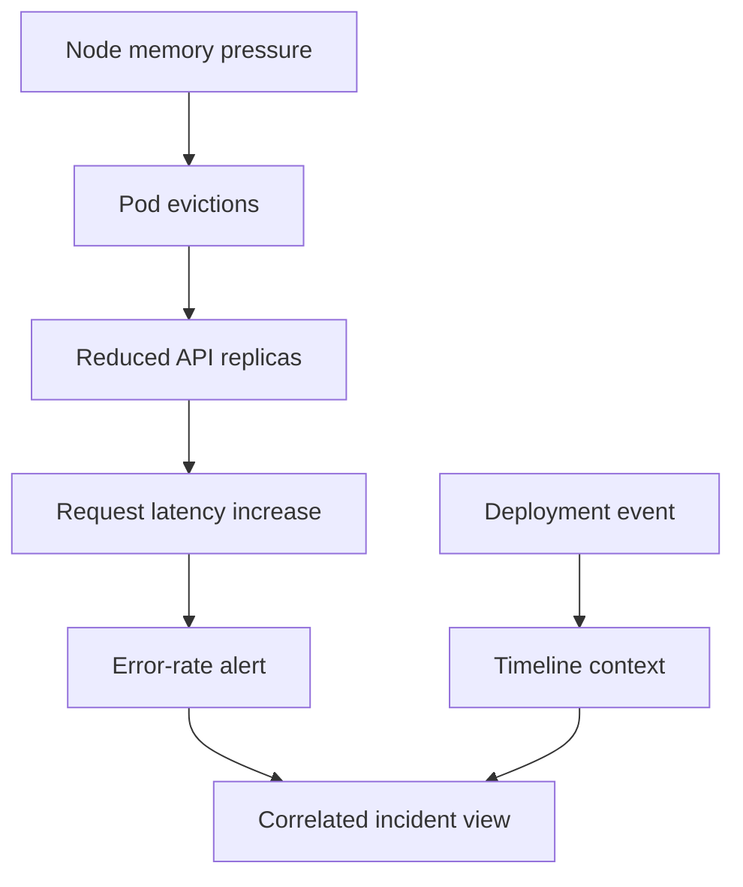

# Event Correlation in AIOps

## 1. What is event correlation?

Event correlation identifies relationships among alerts, logs, metrics, traces, deployments, and infrastructure events. The goal is to group signals that may share a common incident or dependency.

Correlation helps reduce alert noise and speeds investigation, but temporal or statistical correlation alone does not prove causation.

## 2. Why correlate events?

A single production issue may generate many symptoms:
- Pod restarts
- Increased API latency
- Higher error rate
- Database connection saturation
- Node memory pressure
- Alert notifications from several monitoring rules

Treating every signal as an independent incident overwhelms responders. Correlation can group related signals into one investigation.

## 3. Correlation dimensions

- Time proximity
- Shared service, namespace, cluster, or host
- Service dependency topology
- Common deployment or configuration change
- Shared trace or request identifiers
- Similar log patterns
- Related metric behavior
- Common cloud or infrastructure event

## 4. Common techniques

| Technique | How it works | Example |
|---|---|---|
| Time-window grouping | Group events close in time | Alerts within a 5-minute window |
| Topology-based | Use dependency relationships | API and DB alerts on one request path |
| Rule-based | Apply known relationships | Node NotReady plus pod evictions |
| Similarity-based | Compare text or event features | Similar exception messages |
| Statistical | Measure co-movement | Latency and DB saturation rise together |
| Graph-based | Traverse service/resource relationships | Cluster event affects multiple services |

## 5. Example incident

This diagram is an illustrative hypothesis. In a real incident, validate each edge using timestamps, workload relationships, metrics, events, and traces.

## 6. Correlation pipeline

1. Ingest events from monitoring and infrastructure systems.
2. Normalize timestamps, labels, severity, and source.
3. Enrich with service ownership and topology.
4. Deduplicate repeated events.
5. Group by time, topology, and similarity.
6. Rank groups by impact and confidence.
7. Present evidence and missing data to responders.
8. Capture feedback to improve rules and models.

## 7. Practical example: Kubernetes

Correlate:
- `NodeNotReady` event
- Pod eviction events on the same node
- Container restart spikes
- Service latency increase
- Deployment replica changes

Check whether timestamps and affected workloads align. Avoid declaring the node as root cause until evidence supports it.

## 8. Evaluation

- Alert reduction ratio
- Correct grouping rate
- Incorrect merge rate
- Missed correlation rate
- Time to identify incident scope
- Responder acceptance
- Time to acknowledge and resolve

Over-aggressive grouping can hide separate incidents. Preserve the original events and make groups explainable.

## 9. Hands-on lab

Create synthetic events for:
1. A node memory-pressure incident
2. A database connection saturation incident
3. An unrelated certificate-expiry warning

Implement time-window grouping first. Add service labels and topology metadata. Check that related events group together while unrelated events remain separate.

## 10. Best practices

- Preserve source events and timestamps.
- Include service topology and ownership.
- Make grouping logic explainable.
- Distinguish correlation from root cause.
- Allow responders to split incorrect groups.
- Monitor false merges and missed groups.
