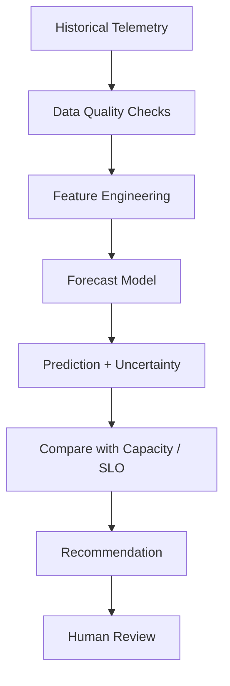

# Predictive Operations

## 1. What is predictive operations?

Predictive operations uses historical and current operational data to estimate future system behavior. It can help teams anticipate capacity pressure, storage exhaustion, traffic demand, and reliability risks.

A forecast is an estimate with uncertainty, not a guarantee.

## 2. Common use cases

- Predict disk capacity exhaustion.
- Forecast CPU and memory demand.
- Estimate traffic peaks.
- Predict queue growth.
- Identify services at risk of breaching an SLO.
- Forecast cloud spend.
- Plan node and cluster capacity.

## 3. Typical workflow

## 4. Forecasting methods

| Method | Suitable scenario | Notes |
|---|---|---|
| Moving average | Smooth short-term noise | Simple baseline |
| Exponential smoothing | Trend and seasonality | Useful for many operational series |
| ARIMA/SARIMA | Time-series with statistical structure | Requires careful model selection |
| Regression | Predict from known drivers | Depends on useful explanatory features |
| Tree-based ML | Multiple interacting features | Needs validation and feature maintenance |
| Neural forecasting | Complex, large datasets | More operational complexity |

Always compare complex models with a simple baseline.

## 5. Example: disk exhaustion estimate

If disk usage is increasing at an approximately stable rate:

\[
\text{Estimated days to full} =
\frac{\text{Available capacity}}{\text{Average daily growth}}
\]

This estimate is only meaningful if growth is reasonably stable and capacity/usage measurements are correct. Account for cleanup, retention, workload changes, and uncertainty.

## 6. Kubernetes capacity signals

Useful metrics include:
- Node CPU and memory utilization
- Pod requests and limits
- Pending pod count
- Node allocatable resources
- Container restarts and OOM kills
- Persistent volume usage
- Network throughput
- HPA desired/current replicas

Do not forecast from utilization alone; combine workload demand, configured requests, limits, scheduling constraints, and scaling behavior.

## 7. Prediction vs. action

A safe workflow:
1. Predict a capacity risk.
2. Explain contributing signals and confidence interval.
3. Recommend a capacity review.
4. Generate a proposed scaling or infrastructure change.
5. Require approval.
6. Apply through standard IaC/GitOps controls.
7. Verify the outcome.

Avoid autonomous infrastructure changes based solely on model forecasts.

## 8. Evaluation

Use time-based train/test splits. Do not randomly mix future and past observations.

Measure:
- MAE (Mean Absolute Error)
- RMSE (Root Mean Squared Error)
- Forecast bias
- Prediction interval coverage
- Warning lead time
- Missed capacity events
- False alarms

## 9. Hands-on lab

Build a disk capacity forecast:
1. Collect daily disk usage for a test volume.
2. Check gaps and outliers.
3. Create a moving-average baseline.
4. Forecast the next 7 days.
5. Estimate when a threshold may be crossed.
6. Compare forecast with actual later observations.
7. Document uncertainty and limitations.

## 10. Best practices

- Keep forecasts tied to operational decisions.
- Show uncertainty and data freshness.
- Retrain or recalibrate when behavior changes.
- Monitor forecast error over time.
- Use simple baselines first.
- Require approval for capacity changes.
