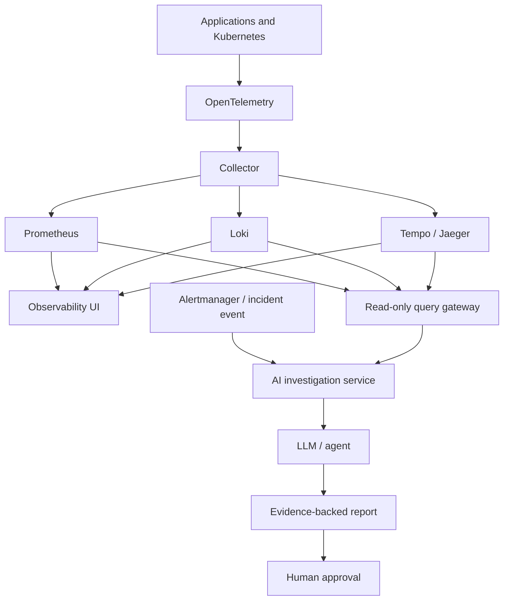

# AI Observability Tools

## 1. What is AI observability?

AI observability applies observability practices to AI-enabled applications and uses AI techniques to improve observability workflows.

These are related but different needs:

- **Observability for AI applications:** inspect model requests, latency, token usage, quality, retrieval, tool calls, and safety.
- **AI for infrastructure observability:** use AI to analyze metrics, logs, traces, alerts, and incidents.

A mature platform may need both.

## 2. Tool categories

| Category | Examples | Primary purpose |
|---|---|---|
| Metrics and alerting | Prometheus, Grafana | Time-series metrics, dashboards, alerts |
| Logs | Loki, OpenSearch, Elasticsearch | Search and analyze application logs |
| Traces | Jaeger, Tempo, Zipkin | Follow requests across services |
| Instrumentation | OpenTelemetry | Vendor-neutral telemetry generation and collection |
| Full-stack observability | Datadog, New Relic, Dynatrace | Integrated metrics, logs, traces, analytics |
| Kubernetes monitoring | kube-prometheus-stack, Pixie | Cluster and workload visibility |
| LLM application tracing/evaluation | Langfuse, Arize Phoenix, LangSmith | Trace LLM calls, prompts, retrieval, and evaluations |
| AI incident assistance | Vendor-specific assistants and custom agents | Summarize alerts, investigate, and recommend actions |

Product features, licensing, hosting models, and integrations change. Validate current capabilities and pricing with each vendor before selecting a tool.

## 3. Selection criteria

Evaluate tools against:
- Supported telemetry sources and OpenTelemetry compatibility.
- Kubernetes and cloud integration.
- Correlation across metrics, logs, and traces.
- LLM tracing, prompt/version tracking, and evaluation support if building AI apps.
- Data residency, retention, encryption, and access controls.
- Query language and API maturity.
- Alerting, incident workflows, and integrations.
- Total cost: ingestion, retention, query, seats, and egress.
- Vendor lock-in and portability.

## 4. Suggested cost-conscious DevOps stack

For a learning or self-managed environment:

| Layer | Example choice |
|---|---|
| Instrumentation | OpenTelemetry SDKs |
| Collection | OpenTelemetry Collector / Grafana Alloy |
| Metrics | Prometheus |
| Dashboards and alerts | Grafana |
| Logs | Loki |
| Traces | Jaeger or Grafana Tempo |
| AI analysis | A small service using an approved LLM API or local model |
| Agent tools | Read-only, allowlisted Prometheus/Loki/trace queries |

A self-managed stack reduces some licensing costs but still requires storage, compute, upgrades, backup, and operational ownership.

## 5. Reference AI observability architecture

## 6. AI agent tool design

Expose narrow tools such as:
- `query_metric_template(service, metric, time_range)`
- `search_logs(service, time_range, pattern, limit)`
- `get_trace(trace_id)`
- `get_recent_deployments(service, time_range)`
- `get_kubernetes_events(namespace, time_range)`

Controls:
- Read-only credentials by default.
- Strict schema validation and query allowlists.
- Maximum time ranges, result counts, and execution time.
- Tenant and namespace authorization.
- Secret and personal-data redaction.
- Audit logs for every tool call.
- Human approval for changes or remediation.

Treat telemetry as untrusted input. A log line or trace attribute must never be allowed to change agent instructions or authorize a command.

## 7. Evaluation checklist

| Dimension | What to measure |
|---|---|
| Detection | Precision, recall, false-positive rate |
| Diagnosis | Evidence accuracy, hypothesis quality |
| Speed | Time to detect and time to useful diagnosis |
| Reliability | Missing telemetry, collector/export failures |
| Cost | Ingestion, storage, model tokens, query compute |
| Safety | Unauthorized actions, data leakage, prompt injection |
| Usability | Engineer acceptance and time saved |

## 8. Hands-on portfolio project: AI Kubernetes Incident Investigator

**Goal:** Build a read-only agent that investigates Kubernetes incidents using metrics, logs, traces, and cluster events.

Suggested milestones:
1. Deploy a microservices demo to a local or cloud Kubernetes cluster.
2. Install Prometheus, Grafana, Loki, and a tracing backend.
3. Instrument services with OpenTelemetry.
4. Create read-only query services for each telemetry backend.
5. Build an agent that receives an alert and gathers relevant evidence.
6. Produce a report with symptom, timeline, evidence, hypotheses, confidence, and verification steps.
7. Add audit logging, redaction, query limits, and human approval.
8. Test incidents such as CrashLoopBackOff, high latency, OOMKilled, and dependency timeout.

**Success criteria:** every factual claim links to a query, log sample, trace, or Kubernetes event; the agent does not execute remediation; and an engineer can reproduce the investigation.

## Further reading

- [OpenTelemetry](https://opentelemetry.io/docs/)
- [Prometheus](https://prometheus.io/docs/)
- [Grafana](https://grafana.com/docs/)
- [Loki](https://grafana.com/docs/loki/latest/)
- [Jaeger](https://www.jaegertracing.io/docs/)
- [Langfuse](https://langfuse.com/docs)
- [Arize Phoenix](https://phoenix.arize.com/)
