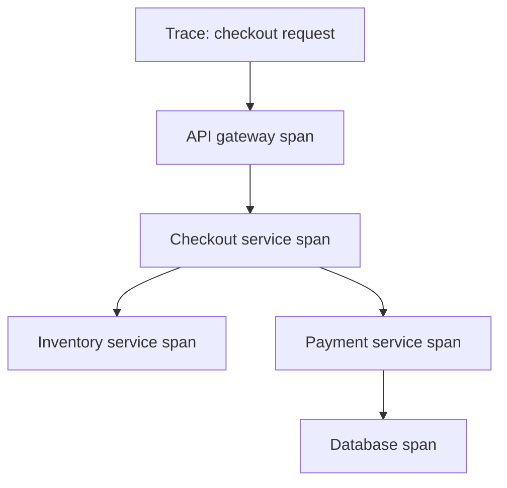

# Distributed Tracing

## 1. What is distributed tracing?

Distributed tracing follows a request as it travels through multiple services and dependencies. A trace is made up of spans. Each span represents an operation and contains timing, attributes, events, and status information.

Tracing is especially useful when a request crosses API gateways, microservices, databases, queues, and third-party services.

## 2. Trace structure

- **Trace ID:** identifies the complete trace.
- **Span ID:** identifies one operation.
- **Parent span ID:** describes the parent-child relationship.
- **Span attributes:** describe the operation, such as service, route, or status.
- **Events:** timestamped annotations within a span.
- **Sampling:** determines which traces are retained.

## 3. Context propagation

Services must propagate trace context across process boundaries. W3C Trace Context is a widely used standard, commonly carried in the `traceparent` header.

If a service does not propagate context correctly, a trace may appear fragmented. Ensure HTTP clients, messaging producers/consumers, and framework instrumentation support propagation.

## 4. Finding latency contributors

A trace can show:
- Which service consumed the most time.
- Whether time was spent waiting on a dependency.
- Whether retries or repeated calls occurred.
- Where errors originated.
- Whether queueing or asynchronous work introduced delay.

Do not assume the longest span is always the root cause. Parent spans often include child time, and overlapping spans require careful interpretation.

## 5. Sampling strategies

| Strategy | Description | Trade-off |
|---|---|---|
| Head sampling | Decision made near trace start | Efficient, but may miss rare errors |
| Tail sampling | Decision made after spans arrive | Can retain errors/slow traces, needs buffering |
| Probabilistic sampling | Retain a configured proportion | Simple, may under-sample rare cases |
| Policy-based sampling | Keep traces matching rules | More targeted, more operational complexity |

Choose sampling based on traffic, cost, retention, and diagnostic requirements.

## 6. AI-assisted trace analysis

An AI assistant can:
1. Retrieve traces for a service and incident time window.
2. Group traces by route, status, or latency band.
3. Compare slow and normal traces.
4. Identify recurring slow spans or error patterns.
5. Correlate spans with deployment and metric changes.
6. Produce ranked hypotheses with trace IDs and span evidence.

A useful output includes trace ID, service, operation, duration, error status, and the exact span that supports a claim.

## 7. Example incident investigation

Symptom: checkout p95 latency increased from 300 ms to 1.8 s.

Investigation:
- Compare representative slow and normal traces.
- Check whether gateway or application processing time increased.
- Inspect child spans for payment, inventory, and database calls.
- Check retries and connection-pool wait time.
- Compare the affected window with deployments and dependency metrics.

Potential finding: payment service spans account for most of the additional latency. This is a lead; validate with payment service metrics and logs before declaring root cause.

## 8. Hands-on lab

1. Instrument two small services with OpenTelemetry.
2. Send a request from service A to service B.
3. Confirm the same trace ID appears in both services.
4. Add an artificial delay to service B.
5. Inspect the trace waterfall and identify the slow span.
6. Add an error and compare error traces with successful traces.
7. Generate a concise AI summary that references trace IDs and span attributes.

## 9. Best practices

- Use consistent service naming and standard semantic conventions.
- Propagate context across synchronous and asynchronous boundaries.
- Avoid sensitive data in span attributes.
- Avoid unbounded or high-cardinality attributes.
- Configure sampling intentionally.
- Preserve trace IDs in structured logs where appropriate.
- Monitor trace ingestion, sampling, and export failures.
- Keep trace access scoped to authorized services and tenants.

## Further reading

- [OpenTelemetry tracing](https://opentelemetry.io/docs/concepts/signals/traces/)
- [W3C Trace Context](https://www.w3.org/TR/trace-context/)
- [OpenTelemetry sampling](https://opentelemetry.io/docs/concepts/sampling/)
