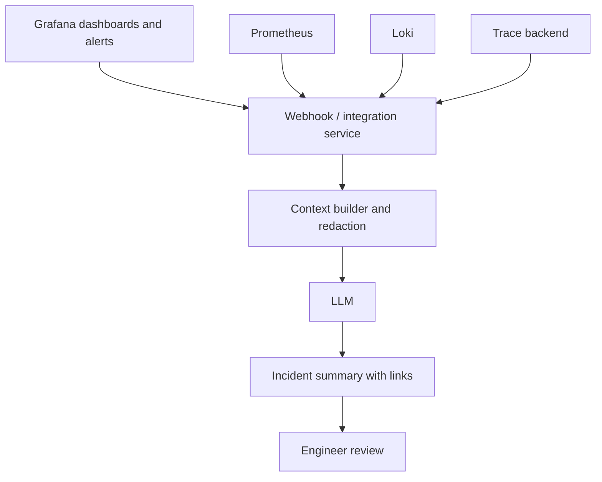

# Grafana AI

## 1. Grafana's role

Grafana is an observability and visualization platform for querying, exploring, alerting on, and visualizing data from supported data sources such as Prometheus, Loki, and tracing backends.

AI capabilities in the Grafana ecosystem and commercial offerings evolve over time. Distinguish native product features from custom integrations that use an external LLM or agent.

## 2. Common AI-assisted workflows

- Natural-language assistance to help construct or explain queries, where supported by the installed product/version.
- Summarization of dashboard patterns and alert context.
- Correlation of metrics, logs, traces, and annotations.
- Drafting incident timelines and investigation notes.
- Helping operators navigate dashboards and identify relevant panels.

Treat generated queries and explanations as suggestions. Validate them in Explore and inspect the underlying data.

## 3. Reference architecture for a custom integration



A custom integration should use narrowly scoped service accounts and supported APIs. Do not place long-lived credentials in prompts or browser code.

## 4. Dashboard design for AI-assisted operations

A useful service dashboard can include:
- Request rate, error ratio, and p50/p95/p99 latency.
- CPU, memory, throttling, and replica count.
- Dependency latency and error rate.
- Recent deployments and configuration changes.
- Relevant logs and trace exemplars.
- SLO status and error-budget burn.

Use consistent variables such as `$cluster`, `$namespace`, and `$service`. Keep labels and dashboard links stable so an incident assistant can navigate reliably.

## 5. Alert-to-investigation workflow

1. Grafana alert fires with a clear service and severity.
2. A webhook sends alert metadata to an integration service.
3. The service authenticates, validates, and enriches the event.
4. It retrieves bounded telemetry for the alert window.
5. The AI produces a concise summary with evidence and uncertainty.
6. An engineer reviews the result and chooses the next action.

Avoid sending full dashboards or unrestricted log histories to the model. Retrieve only relevant panels and time ranges.

## 6. Example incident output

```text
Service: checkout
Window: 10:05–10:20 UTC
Impact: p95 latency rose from 220 ms to 1.1 s.
Evidence:
- Request rate remained near baseline.
- Database dependency p95 increased to 850 ms.
- New deployment began at 10:02 UTC.
Hypotheses:
1. Database connection or query regression (moderate confidence).
2. Application change increased database calls (possible).
Next checks:
- Compare database query metrics before/after deployment.
- Inspect traces for repeated database spans.
No remediation was executed.
```

## 7. Security and governance

- Use service accounts with read-only permissions wherever possible.
- Keep Grafana admin APIs and data-source credentials away from LLM tools.
- Redact secrets and personal data from alert annotations and logs.
- Enforce tenant boundaries and audit every query.
- Require human approval for alert silencing, dashboard changes, or remediation.
- Verify current Grafana edition, version, and feature availability in official documentation.

## 8. Hands-on lab

1. Connect Prometheus and Loki as data sources.
2. Build a Kubernetes service dashboard.
3. Configure an alert for sustained error ratio or latency.
4. Send alert metadata to a small webhook receiver.
5. Retrieve a limited set of Prometheus and Loki results.
6. Generate an evidence-based summary and include Grafana panel links.
7. Compare AI output with a human-written incident report.

## Further reading

- [Grafana documentation](https://grafana.com/docs/grafana/latest/)
- [Grafana alerting](https://grafana.com/docs/grafana/latest/alerting/)
- [Grafana HTTP API](https://grafana.com/docs/grafana/latest/developers/http_api/)
