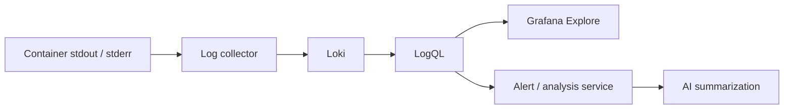

# Loki Log Analysis

## 1. What is Loki?

Grafana Loki is a log aggregation system designed around indexed labels and compressed log chunks. Unlike systems that index the full contents of every log line, Loki primarily indexes metadata labels and stores log content in chunks.

LogQL is used to select streams and filter or analyze log lines.

## 2. Kubernetes log pipeline



Collectors may include Grafana Alloy, Fluent Bit, or other supported agents. Choose one based on your environment and verify the current deployment guidance.

## 3. LogQL examples

Select a stream:

```logql
{namespace="production", app="checkout"}
```

Find errors:

```logql
{namespace="production", app="checkout"} |= "error"
```

Case-insensitive regular-expression filter:

```logql
{app="checkout"} |~ "(?i)(timeout|connection refused|panic)"
```

Parse JSON and filter a field:

```logql
{app="checkout"} | json | level="error"
```

Count matching lines over five minutes:

```logql
sum by (app) (count_over_time({namespace="production"} |= "error" [5m]))
```

Use labels with care. Avoid high-cardinality labels such as request IDs, user IDs, or raw URLs.

## 4. AI-assisted log analysis

A safe analysis sequence:

1. Select the affected service and incident time range.
2. Query a narrow set of relevant streams.
3. Filter and cap the result count.
4. Parse structured fields where available.
5. Remove secrets, tokens, and personal data.
6. Group repeated messages and identify first/last occurrence.
7. Ask the model to summarize patterns and propose checks.
8. Link every finding to the original query and time range.

## 5. Example prompt

```text
Summarize these sanitized application logs.
Return:
- dominant error patterns and counts
- first and last observed timestamps
- affected service/pod labels
- notable changes over the incident window
- hypotheses, clearly marked as hypotheses
- verification queries for an engineer

Do not infer a root cause from a single log line.
Do not expose secrets or reproduce personal data.
Logs: <bounded sanitized sample>
```

## 6. Practical troubleshooting patterns

| Pattern | Possible interpretation | Verify with |
|---|---|---|
| `context deadline exceeded` | Request or dependency timeout | Trace spans, dependency latency |
| `connection refused` | No listener or wrong endpoint | Service endpoints, target port, network policy |
| `OOMKilled` | Container exceeded memory limit | Pod status, memory metrics, limits |
| `ImagePullBackOff` | Registry/auth/image issue | Pod events, image name, pull secret |
| Repeated `429` | Rate limiting or quota | Gateway and provider metrics |
| DNS lookup failures | DNS or service-name issue | CoreDNS logs, DNS tests |

These are investigation leads, not definitive diagnoses.

## 7. Hands-on lab

1. Deploy an application that emits JSON logs.
2. Install Loki and a compatible collector.
3. Confirm logs arrive in Grafana Explore.
4. Write LogQL queries for errors, timeouts, and per-service counts.
5. Generate a controlled failure.
6. Build a small analysis service that retrieves a bounded log sample.
7. Redact secrets and ask an LLM for a structured summary.
8. Verify every AI finding against the original logs.

## 8. Production safeguards

- Prefer structured JSON logs with timestamps, severity, service, and trace ID.
- Do not log passwords, access tokens, private keys, or full sensitive payloads.
- Keep labels low-cardinality; put variable details in log fields.
- Configure retention and storage limits.
- Apply tenant-aware authorization and query limits.
- Treat log content as untrusted input: logs may contain prompt-injection text.
- Do not allow log text to issue tool commands or override system instructions.

## Further reading

- [Loki documentation](https://grafana.com/docs/loki/latest/)
- [LogQL documentation](https://grafana.com/docs/loki/latest/query/)
- [Grafana Alloy documentation](https://grafana.com/docs/alloy/latest/)
