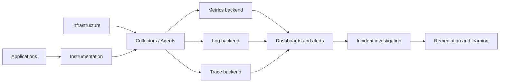

# Observability Fundamentals

## 1. What is observability?

Observability is the ability to understand a system's internal state from the outputs it produces. It helps engineers answer both known questions (for example, "Is the API slow?") and previously unknown questions ("Why did latency increase only for one customer segment?").

Observability is not simply collecting more data. Useful observability combines high-quality telemetry, context, correlation, and workflows that help people investigate and act.

## 2. The three core signals

| Signal | What it describes | Typical questions |
|---|---|---|
| Metrics | Numeric measurements over time | Is error rate rising? How much CPU is used? |
| Logs | Discrete records of events | What error occurred? What did the application report? |
| Traces | A request's path across services | Which dependency added latency? |

Additional useful signals include profiles, events, deployment metadata, and service-level objectives (SLOs).

## 3. Key concepts

- **Golden signals:** latency, traffic, errors, and saturation.
- **RED method:** rate, errors, and duration for request-driven services.
- **USE method:** utilization, saturation, and errors for infrastructure resources.
- **SLI:** a measured indicator of service behavior.
- **SLO:** a target for an SLI over a defined window.
- **Error budget:** the amount of unreliability allowed by the SLO.
- **Cardinality:** the number of unique combinations of label values. Uncontrolled cardinality can make telemetry expensive and slow.

## 4. Telemetry architecture



A common cloud-native pattern uses OpenTelemetry SDKs and Collectors to receive, process, and export telemetry to one or more backends.

## 5. Observability for Kubernetes

Capture context at multiple layers:

- Cluster: node readiness, resource pressure, API server health.
- Namespace/workload: desired versus available replicas, restarts, rollout status.
- Pod/container: CPU, memory, throttling, OOM kills, filesystem usage.
- Service: request rate, latency, error rate, saturation.
- Dependency: database, queue, DNS, external API latency and errors.

Useful commands:

```bash
kubectl get nodes
kubectl get pods -A
kubectl get events -A --sort-by=.lastTimestamp
kubectl top nodes
kubectl top pods -A
kubectl describe pod <pod> -n <namespace>
```

## 6. AI-assisted observability

AI can help with:
1. Summarizing large volumes of logs and traces.
2. Detecting unusual behavior against baselines.
3. Correlating alerts with deployments and infrastructure changes.
4. Ranking likely causes with supporting evidence.
5. Translating natural-language questions into PromQL or LogQL.
6. Drafting incident summaries and follow-up actions.

AI output should be treated as a hypothesis. Verify it against source telemetry, deployment history, and reproducible queries.

## 7. Hands-on lab

1. Deploy a sample application to Kubernetes.
2. Instrument request count, latency, and error metrics.
3. Collect metrics, logs, and traces.
4. Create a dashboard for request rate, p95 latency, and error ratio.
5. Generate load and introduce a controlled failure.
6. Compare the signals and write a short incident timeline.

## 8. Operational best practices

- Define SLOs before creating large alert catalogs.
- Alert on user impact and actionable symptoms, not every metric fluctuation.
- Use stable service names and consistent resource attributes.
- Avoid user IDs, tokens, email addresses, and other sensitive values as metric labels.
- Set retention, sampling, and cardinality budgets.
- Keep dashboards linked to runbooks and service ownership.
- Validate telemetry pipelines and monitor dropped data.

## Further reading

- [OpenTelemetry documentation](https://opentelemetry.io/docs/)
- [Google SRE Book](https://sre.google/sre-book/)
- [Prometheus documentation](https://prometheus.io/docs/introduction/overview/)
