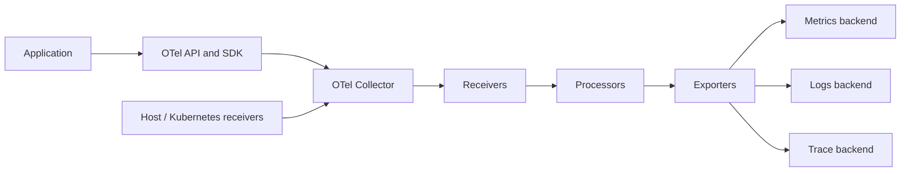

# OpenTelemetry

## 1. Overview

OpenTelemetry (OTel) is an open-source, vendor-neutral observability framework for generating, collecting, processing, and exporting telemetry. It includes APIs, SDKs, semantic conventions, instrumentation, and the OpenTelemetry Collector.

OpenTelemetry is not itself a storage backend or visualization product. It sends telemetry to compatible observability backends.

## 2. Core signals and components

- **Metrics:** numeric measurements over time.
- **Logs:** timestamped event records.
- **Traces:** request execution paths across services.
- **Baggage:** contextual key/value data propagated across process boundaries.
- **Context propagation:** carries trace and span context between services.
- **Collector:** receives, processes, and exports telemetry.

## 3. Architecture



Collector pipelines are configured per signal and typically contain receivers, processors, and exporters.

## 4. Collector configuration example

Illustrative configuration; component availability depends on the Collector distribution and version.

```yaml
receivers:
  otlp:
    protocols:
      grpc:
        endpoint: 0.0.0.0:4317
      http:
        endpoint: 0.0.0.0:4318

processors:
  memory_limiter:
    check_interval: 1s
    limit_mib: 400
  batch:
    timeout: 5s

exporters:
  debug:
    verbosity: basic

service:
  pipelines:
    traces:
      receivers: [otlp]
      processors: [memory_limiter, batch]
      exporters: [debug]
    metrics:
      receivers: [otlp]
      processors: [memory_limiter, batch]
      exporters: [debug]
    logs:
      receivers: [otlp]
      processors: [memory_limiter, batch]
      exporters: [debug]
```

For production, use an authenticated exporter to your selected backend instead of relying on the debug exporter.

## 5. Kubernetes deployment considerations

- Decide between a DaemonSet, Deployment, or sidecar pattern based on receiver and processing needs.
- Use the OpenTelemetry Operator where it simplifies lifecycle and instrumentation management.
- Configure resource requests/limits and memory protection.
- Restrict receiver network exposure.
- Use Kubernetes attributes carefully and avoid excessive metadata enrichment.
- Monitor collector queue size, export failures, dropped telemetry, and memory.
- Secure OTLP endpoints with TLS and authentication when crossing trust boundaries.

## 6. Instrumentation example (Python)

Install the relevant packages for the chosen instrumentation approach and pin tested versions:

```bash
python -m venv .venv
source .venv/bin/activate
pip install opentelemetry-api opentelemetry-sdk opentelemetry-exporter-otlp
```

A minimal manual span example:

```python
from opentelemetry import trace
from opentelemetry.sdk.trace import TracerProvider
from opentelemetry.sdk.trace.export import BatchSpanProcessor
from opentelemetry.exporter.otlp.proto.grpc.trace_exporter import OTLPSpanExporter

provider = TracerProvider()
provider.add_span_processor(BatchSpanProcessor(OTLPSpanExporter()))
trace.set_tracer_provider(provider)

tracer = trace.get_tracer("checkout-service")

with tracer.start_as_current_span("process-order"):
    print("processing order")
```

Set the OTLP endpoint and authentication through environment/configuration appropriate to your Collector. This minimal example is for learning; production applications should configure resource attributes, shutdown/flush behavior, and error handling.

## 7. Semantic conventions

Use standard names and attributes where possible, such as service name, deployment environment, HTTP request method, status code, and database operation. Consistent attributes improve cross-service querying and AI-based correlation.

## 8. AI integration opportunities

- Use trace and resource attributes to assemble incident context.
- Summarize collector health and telemetry gaps.
- Explain spans and latency contributors.
- Correlate trace exemplars with logs and metrics.
- Generate query suggestions based on semantic conventions.

Do not send unrestricted telemetry to a model. Apply access control, sampling, redaction, and bounded retrieval.

## 9. Hands-on lab

1. Instrument a small API with OTel.
2. Run an OTel Collector locally or in Kubernetes.
3. Export traces and metrics to a test backend.
4. Confirm service and environment attributes.
5. Introduce a slow downstream call and inspect the resulting span tree.
6. Add a log record containing the trace ID and correlate it with the trace.
7. Build a small AI summary using sanitized trace metadata.

## Further reading

- [OpenTelemetry documentation](https://opentelemetry.io/docs/)
- [Collector documentation](https://opentelemetry.io/docs/collector/)
- [Semantic conventions](https://opentelemetry.io/docs/specs/semconv/)
