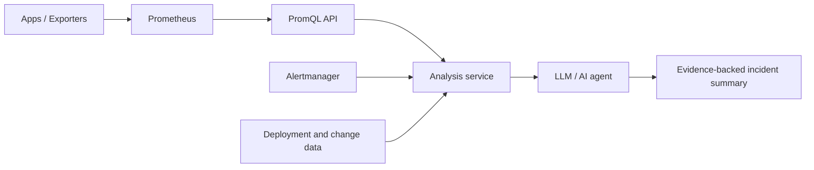

# Prometheus AI Analysis

## 1. Role of Prometheus

Prometheus is a metrics monitoring and alerting system. It scrapes time-series metrics from configured targets, stores samples with labels, and provides PromQL for querying and alert evaluation.

AI does not replace Prometheus. Prometheus provides the measured evidence; an AI layer can help formulate queries, explain results, correlate signals, and summarize incidents.

## 2. Reference architecture



Keep the analysis service between the model and Prometheus. It should validate queries, enforce timeouts, limit result sizes, and redact sensitive data.

## 3. Useful PromQL examples

Request rate:

```promql
sum by (service) (rate(http_requests_total[5m]))
```

Error ratio:

```promql
sum by (service) (rate(http_requests_total{status=~"5.."}[5m]))
/
clamp_min(sum by (service) (rate(http_requests_total[5m])), 1)
```

p95 latency when the application exposes histogram buckets:

```promql
histogram_quantile(
  0.95,
  sum by (le, service) (rate(http_request_duration_seconds_bucket[5m]))
)
```

CPU usage by pod (metric names and labels vary by exporter):

```promql
sum by (namespace, pod) (
  rate(container_cpu_usage_seconds_total{container!=""}[5m])
)
```

Memory working set:

```promql
sum by (namespace, pod) (
  container_memory_working_set_bytes{container!=""}
)
```

Always inspect the actual metric names and labels in your environment before using these examples.

## 4. AI analysis workflow

1. Receive an alert with service, time range, severity, and labels.
2. Retrieve a bounded set of relevant metrics using approved query templates.
3. Compare the incident window with a baseline window.
4. Retrieve related deployment, scaling, and infrastructure events.
5. Ask the model to identify patterns and competing hypotheses.
6. Require each hypothesis to cite the query/result that supports it.
7. Present recommended checks; require approval before any remediation.

## 5. Example analysis prompt

```text
You are assisting an SRE during an incident.

Analyze only the telemetry supplied below.
- State the observed symptom and time window.
- Identify changes relative to the baseline.
- Give up to three hypotheses, ranked by evidence.
- For each hypothesis, cite the exact metric/query result.
- List missing evidence and safe verification steps.
- Do not claim causation from correlation.
- Do not execute remediation.

Incident: API p95 latency increased from 180 ms to 1.4 s.
Telemetry: <bounded query results>
Recent changes: <deployment and infrastructure events>
```

## 6. Query safety controls

- Prefer predefined query templates over unrestricted model-generated PromQL.
- Restrict query range, step, timeout, and maximum returned series.
- Apply tenant and namespace authorization before querying.
- Reject expensive or unbounded queries.
- Never expose Prometheus write/admin endpoints to the model.
- Record the prompt, query, user, time range, and result metadata for audit.

## 7. Hands-on lab

1. Install Prometheus in a test Kubernetes cluster.
2. Confirm targets are healthy at `/targets`.
3. Query `up`, CPU, memory, request rate, and latency.
4. Create a small Python service that calls the Prometheus HTTP API.
5. Add an allowlist of query templates.
6. Pass sanitized results to an LLM and produce a cited incident summary.
7. Test with missing metrics, high-cardinality results, and API timeouts.

## 8. Evaluation

Measure query correctness, evidence citation accuracy, time to useful diagnosis, false conclusions, query cost, and whether the analysis helps an engineer resolve the incident safely.

## Further reading

- [Prometheus overview](https://prometheus.io/docs/introduction/overview/)
- [PromQL basics](https://prometheus.io/docs/prometheus/latest/querying/basics/)
- [HTTP API](https://prometheus.io/docs/prometheus/latest/querying/api/)
