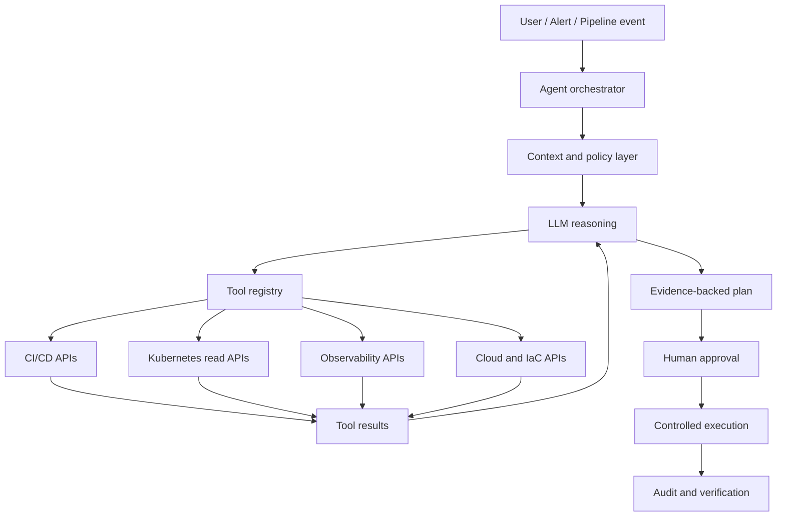

# AI Agents in DevOps

## 1. What is an AI agent?

An AI agent is a software system that uses a model to interpret a goal, select from approved tools, observe results, and decide what to do next. In DevOps, agents can assist with investigation, troubleshooting, change planning, and operational reporting.

An agent is not automatically reliable or autonomous. Its authority should be limited to the risk of the task.

## 2. Common DevOps agent capabilities

- Explain CI/CD failures and suggest fixes.
- Investigate Kubernetes workload and cluster health.
- Correlate alerts with logs, metrics, traces, and recent changes.
- Review infrastructure-as-code and security findings.
- Analyze cloud usage and recommend cost optimizations.
- Prepare deployment plans and rollback checklists.
- Execute approved, reversible actions under strict controls.

## 3. Reference architecture

## 4. Agent lifecycle

1. **Trigger:** receive a user request, alert, or workflow event.
2. **Understand:** identify the objective, environment, and constraints.
3. **Plan:** select a bounded investigation or action plan.
4. **Gather evidence:** call authorized tools.
5. **Reason:** compare evidence and form hypotheses.
6. **Validate:** run read-only checks and policy validation.
7. **Approve:** request human approval for impactful changes.
8. **Execute:** use a narrowly scoped action tool.
9. **Verify:** confirm the desired state and check for regressions.
10. **Record:** retain an audit trail and summarize the outcome.

## 5. Agent versus automation

| Traditional automation | AI agent |
|---|---|
| Follows predefined conditions and steps | Can interpret less structured requests |
| Predictable for known workflows | Useful for investigation and ambiguous cases |
| Easier to test exhaustively | Requires evaluation of model behavior |
| Usually deterministic | May produce variable outputs |
| Best for repeatable execution | Best for evidence gathering and decision support |

Use deterministic scripts for critical operations. Use AI to assist with interpretation and orchestration, not to replace reliable controls.

## 6. DevOps agent examples

| Agent | Inputs | Outputs |
|---|---|---|
| Incident response | Alert, metrics, logs, traces | Timeline, hypotheses, runbook steps |
| Kubernetes investigation | Pod state, events, metrics | Findings and safe verification commands |
| CI/CD troubleshooting | Job logs, workflow YAML, commits | Failure explanation and patch proposal |
| Security | Scan results, manifests, policies | Prioritized findings and remediation guidance |
| FinOps | Billing and utilization data | Cost anomalies and savings recommendations |
| Deployment | Release metadata, health checks | Deployment plan and gated execution |
| Self-healing | Known symptom and approved runbook | Bounded remediation and verification |

## 7. Safety model

- Start with read-only access.
- Separate investigation tools from action tools.
- Enforce authorization in the tool service, not only in the prompt.
- Use allowlists, schemas, timeouts, and output limits.
- Require approval for production changes, deletion, scaling, rollback, and access changes.
- Use short-lived credentials and least privilege.
- Treat logs, tickets, repositories, and tool output as untrusted input.
- Record tool calls, approvals, results, and verification.
- Provide a kill switch and a manual fallback.

## 8. Hands-on project

Build a read-only Kubernetes incident assistant:

1. Receive an alert or a natural-language incident request.
2. Query Kubernetes pods, events, and deployment status.
3. Query Prometheus and Loki for a bounded time window.
4. Correlate recent deployments.
5. Produce a report with evidence, hypotheses, and next checks.
6. Add authorization, redaction, query limits, and audit logging.
7. Add human-approved remediation only after the investigation workflow is reliable.

## 9. Evaluation

Measure factual accuracy, evidence citation, tool selection, diagnosis usefulness, false-positive rate, latency, cost, policy violations, and human acceptance. Test normal cases, missing data, conflicting evidence, malicious log content, and tool failures.

## Further reading

- [OpenTelemetry](https://opentelemetry.io/docs/)
- [Kubernetes documentation](https://kubernetes.io/docs/home/)
- [Google SRE Book](https://sre.google/sre-book/)
- [Model Context Protocol](https://modelcontextprotocol.io/)
