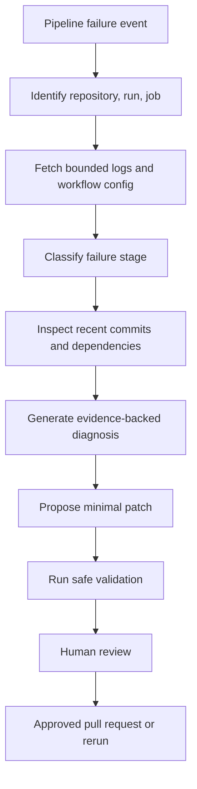

# CI/CD Troubleshooting Agent

## 1. Purpose

A CI/CD troubleshooting agent analyzes pipeline failures, identifies the failing stage, gathers relevant configuration and logs, and proposes a minimal fix. It should not expose secrets or push changes without explicit authorization.

## 2. Common failure categories

- Source checkout and authentication.
- Dependency installation and package registry access.
- Linting, unit tests, and code coverage.
- SAST, dependency, container, and IaC scans.
- Docker build and image push.
- Artifact signing and provenance.
- Cloud authentication and OIDC role assumption.
- Kubernetes deployment and rollout verification.

## 3. Workflow



## 4. Tool design

Examples of bounded tools:

```text
get_workflow_run(repository, run_id)
get_job_logs(repository, run_id, job_id, max_bytes)
get_workflow_file(repository, path, commit_sha)
get_commit_diff(repository, base_sha, head_sha)
get_artifact_metadata(repository, run_id)
validate_yaml(content)
run_local_lint(command_profile, workspace)
```

Avoid generic tools that can run arbitrary shell commands or access all repository secrets.

## 5. Common diagnostics

| Symptom | Investigation |
|---|---|
| `npm ci` fails | Check lockfile consistency, Node version, registry availability |
| Docker login fails | Check registry hostname, token scope, secret reference |
| Trivy not found | Check installation step, PATH, pinned action/tool version |
| OIDC assume-role denied | Check token permissions, issuer, audience, subject trust condition |
| Sonar SSL error | Verify URL scheme, TLS termination, certificate chain, proxy |
| Jenkins cannot find Jenkinsfile | Check branch, repository path, script path, checkout credentials |
| Kubernetes rollout timeout | Inspect rollout status, pod events, readiness, image pull, resource constraints |

These are starting points; use the actual log and environment before proposing a fix.

## 6. Example analysis prompt

```text
Analyze this CI job failure.
Return:
- failing job and step
- first meaningful error and surrounding context
- likely category
- evidence from logs and workflow configuration
- minimal proposed change
- validation steps and possible side effects

Do not reveal secret values.
Do not modify the repository or rerun production deployment.
Logs: <sanitized bounded logs>
Workflow: <relevant YAML>
Recent diff: <relevant changes>
```

## 7. Security controls

- Redact tokens, passwords, private keys, and environment dumps.
- Use read-only repository permissions for diagnosis.
- Never give the model access to deployment secrets.
- Validate proposed workflow changes with linters and policy checks.
- Pin third-party actions to immutable commit SHAs where practical.
- Require pull request review for generated patches.
- Keep production deployment approvals separate.

## 8. Hands-on lab

1. Create a sample GitHub Actions workflow.
2. Intentionally break a test or Docker build step.
3. Send the run ID to a local agent service.
4. Fetch only the failed job's relevant log segment.
5. Ask the agent to identify the first causal error and propose a patch.
6. Validate the patch with YAML linting and tests.
7. Require a human to approve the pull request.

## Further reading

- [GitHub Actions documentation](https://docs.github.com/actions)
- [GitHub Actions security hardening](https://docs.github.com/actions/security-for-github-actions/security-guides/security-hardening-for-github-actions)
- [Jenkins documentation](https://www.jenkins.io/doc/)
