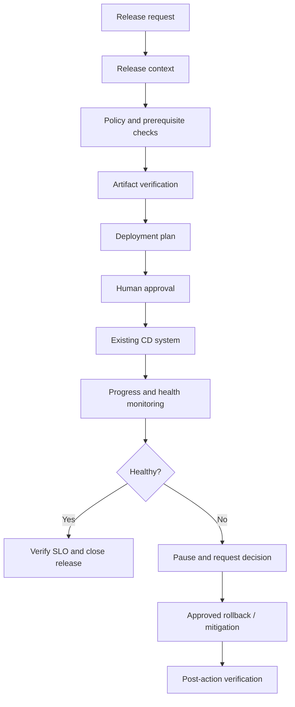

# Deployment Agent

## 1. Purpose

A deployment agent assists with release planning, pre-deployment checks, rollout observation, and post-deployment verification. It should orchestrate existing, tested deployment systems rather than inventing an unreviewed production change.

## 2. Responsibilities

- Summarize release contents and linked changes.
- Verify artifact identity, signature, and provenance.
- Check policy, security scans, and deployment prerequisites.
- Prepare a deployment and rollback plan.
- Monitor rollout status and service-level indicators.
- Stop or request intervention when health checks fail.
- Produce a release record.

## 3. Reference architecture



## 4. Pre-deployment checklist

- Correct environment, cluster, namespace, and release version.
- Artifact digest matches the approved build.
- Image signature and provenance verified where configured.
- Security and policy gates passed.
- Configuration and secret references are valid.
- Database migration and backward compatibility reviewed.
- Capacity and disruption budget checked.
- Monitoring, rollback, and owner contacts available.
- Change window and approval recorded.

## 5. Deployment strategies

| Strategy | Description | Main consideration |
|---|---|---|
| Rolling | Replace instances gradually | Capacity and backward compatibility |
| Blue-green | Switch traffic between two environments | Cost and state compatibility |
| Canary | Route a small percentage to the new version | Metrics and automated analysis |
| Recreate | Stop old version before starting new | Downtime tolerance |

The deployment agent should select only strategies already supported and approved by the platform.

## 6. Safe integration pattern

Use an existing deployment controller such as Argo CD, Flux, or a CI/CD platform. Give the agent read access for status and a separate, gated action interface for approved release requests. Avoid exposing unrestricted cluster-admin credentials or arbitrary shell execution.

## 7. Example release prompt

```text
Prepare a release plan for service <service> version <version>.
Check:
- artifact digest and provenance
- scan and policy status
- current deployment health
- capacity and SLO indicators
- migration compatibility
- rollback method

Return a checklist and risks.
Do not start deployment.
```

## 8. Hands-on lab

1. Deploy a demo service through Argo CD or an existing CI/CD workflow.
2. Build a release metadata record with commit, image digest, and scan results.
3. Let the agent perform read-only preflight checks.
4. Generate a canary plan with success and abort thresholds.
5. Require a human to approve the release.
6. Monitor rollout and SLO signals.
7. Simulate a bad release and verify that the agent pauses and presents the approved rollback option.

## 9. Guardrails

- Separate plan, approval, execution, and verification.
- Use immutable artifact digests.
- Enforce policy outside the LLM.
- Require human approval for production deployments and rollbacks.
- Never report success until the deployment controller and health checks confirm it.
- Record who approved the release and which artifact was deployed.

## Further reading

- [Argo CD documentation](https://argo-cd.readthedocs.io/)
- [Kubernetes Deployments](https://kubernetes.io/docs/concepts/workloads/controllers/deployment/)
- [SLSA framework](https://slsa.dev/)
