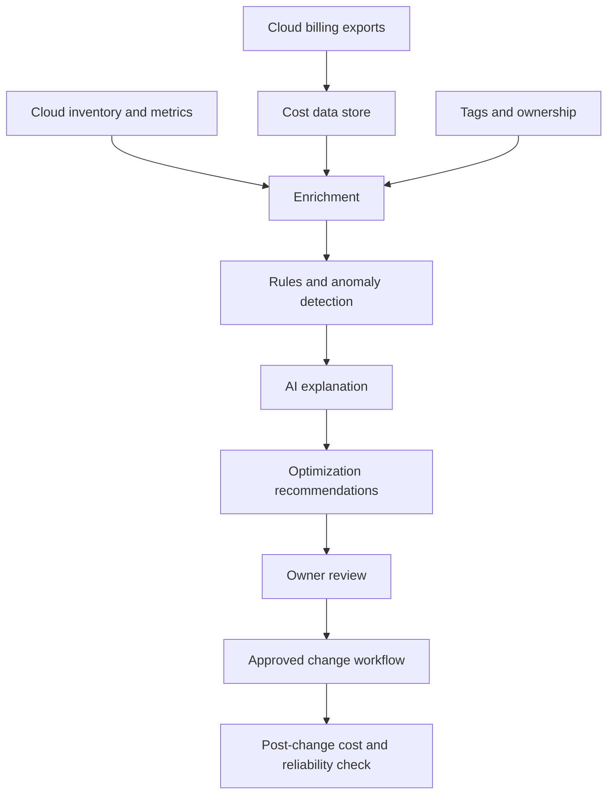

# FinOps Agent

## 1. Purpose

A FinOps agent helps teams understand cloud spend, detect unusual cost changes, connect cost to usage and ownership, and recommend optimization opportunities. Recommendations should balance cost, reliability, security, and performance.

## 2. Common use cases

- Detect daily or hourly spend anomalies.
- Identify idle or underutilized resources.
- Review compute and storage rightsizing opportunities.
- Analyze Kubernetes namespace and workload costs.
- Find unattached volumes, old snapshots, and unused load balancers.
- Compare actual spend with budgets and forecasts.
- Generate team-level cost summaries.

## 3. Architecture



## 4. Data needed

- Billing exports or cost-management APIs.
- Resource inventory and tags.
- Utilization metrics over an appropriate period.
- Environment, owner, application, and criticality.
- Reservations, savings plans, discounts, and commitments.
- Deployment and scaling history.

Cost data can be delayed or amortized differently by provider. Explain the billing basis and time window in every report.

## 5. Example recommendations

| Finding | Potential recommendation | Required validation |
|---|---|---|
| VM low utilization for weeks | Review rightsizing | Peak load, CPU, memory, business cycle |
| Unattached disk | Confirm owner, then consider deletion | Backup and recovery requirements |
| Oversized Kubernetes requests | Tune requests based on history | SLO, peak usage, throttling, headroom |
| Non-production cluster idle overnight | Consider scheduled shutdown | Team schedules and data persistence |
| High object storage cost | Review lifecycle policy | Retention, compliance, restore needs |

Never delete resources based solely on low utilization or an AI-generated recommendation.

## 6. Example analysis prompt

```text
Analyze the supplied cloud cost and utilization data.
Return:
- cost change and comparison period
- affected services and owners
- evidence for each anomaly
- optimization options with estimated savings range
- reliability, security, and operational risks
- validation and rollback plan

State assumptions and data freshness.
Do not execute resource changes.
Data: <billing and utilization records>
```

## 7. Governance and safety

- Use read-only billing and inventory permissions for analysis.
- Keep cost recommendations separate from execution permissions.
- Require resource-owner approval for changes.
- Require additional approval for production, stateful, or shared resources.
- Estimate savings transparently; avoid false precision.
- Track realized savings after implementation.
- Preserve audit records and rollback instructions.

## 8. Hands-on lab

1. Export sample cloud cost data to CSV.
2. Join costs with resource tags and utilization metrics.
3. Detect unusual daily spend using a baseline.
4. Generate an AI summary with top cost drivers.
5. Propose rightsizing or scheduling actions.
6. Have an owner approve one change in a non-production environment.
7. Compare actual spend and service health after the change.

## Further reading

- [FinOps Foundation](https://www.finops.org/introduction/what-is-finops/)
- [AWS Cost Management](https://docs.aws.amazon.com/cost-management/)
- [Azure Cost Management](https://learn.microsoft.com/azure/cost-management-billing/)
