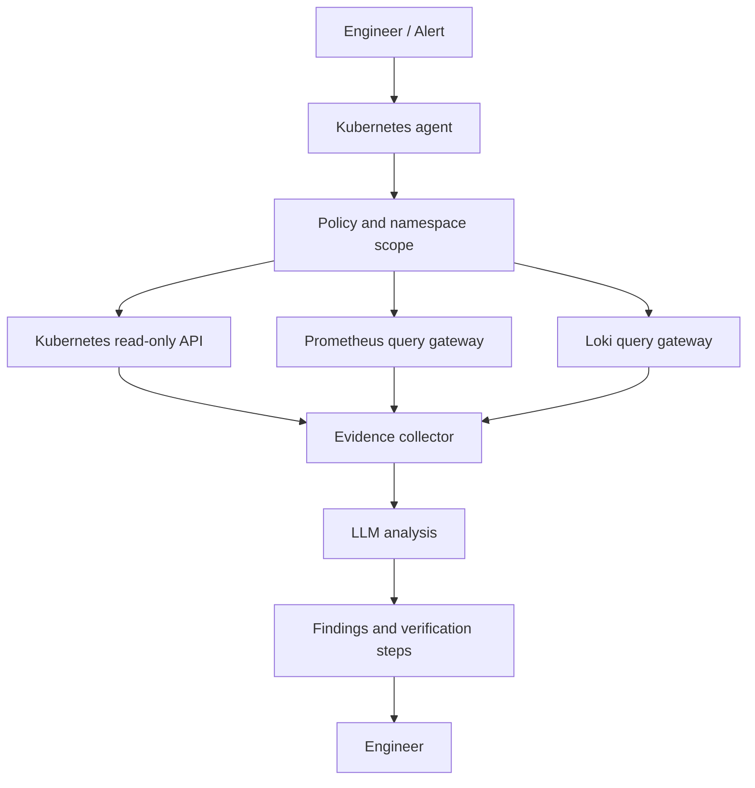

# Kubernetes Investigation Agent

## 1. Purpose

A Kubernetes investigation agent helps engineers understand cluster and workload problems using read-only Kubernetes APIs, events, metrics, and logs. It should explain what it observed and recommend safe checks rather than blindly applying fixes.

## 2. Supported investigations

- Pending pods and scheduling failures.
- CrashLoopBackOff and repeated container restarts.
- ImagePullBackOff and registry authentication problems.
- OOMKilled and CPU throttling.
- Failed readiness or liveness probes.
- Service endpoint and DNS issues.
- Failed deployments and rollout stalls.
- Node pressure and capacity constraints.

## 3. Architecture



## 4. Useful read-only commands

```bash
kubectl get nodes -o wide
kubectl get pods -A -o wide
kubectl get events -A --sort-by=.lastTimestamp
kubectl get deployments -A
kubectl get services,endpoints -A
kubectl describe pod <pod> -n <namespace>
kubectl logs <pod> -n <namespace> --all-containers --tail=200
kubectl rollout status deployment/<deployment> -n <namespace>
kubectl top nodes
kubectl top pods -A
```

Commands may reveal sensitive operational data. Restrict namespaces and sanitize output before sending it to a model.

## 5. Investigation playbooks

### Pending pod
1. Inspect pod events and scheduling conditions.
2. Check node readiness, taints, and allocatable capacity.
3. Inspect requests, limits, affinity, selectors, and PVC binding.
4. Check quota and admission policy.
5. Recommend the smallest verification step.

### CrashLoopBackOff
1. Inspect current and previous container logs.
2. Check exit code, restart count, and termination reason.
3. Review probe configuration and recent rollout.
4. Check configuration, secrets references, and dependency health.
5. Avoid printing secret values.

### ImagePullBackOff
1. Confirm image repository, tag, and architecture.
2. Inspect pull-related events.
3. Check image pull secret reference and service account.
4. Verify registry reachability and image existence through approved tooling.
5. Do not request or expose registry passwords.

## 6. RBAC design

Use a dedicated service account and a namespace-scoped Role where possible. Example read-only permissions:

```yaml
apiVersion: rbac.authorization.k8s.io/v1
kind: Role
metadata:
  name: incident-investigator
  namespace: production
rules:
  - apiGroups: [""]
    resources: ["pods", "pods/log", "events", "services", "endpoints", "configmaps"]
    verbs: ["get", "list", "watch"]
  - apiGroups: ["apps"]
    resources: ["deployments", "replicasets", "statefulsets", "daemonsets"]
    verbs: ["get", "list", "watch"]
```

Do not grant access to Secret objects unless a narrowly justified workflow requires metadata-only access; never pass secret values to the model. Validate permissions:

```bash
kubectl auth can-i list pods \
  --as=system:serviceaccount:production:incident-investigator \
  -n production
```

## 7. Output format

```text
Incident: checkout pods restarting
Scope: production / checkout
Observed:
- 3 pods have restarted repeatedly.
- Previous container logs show connection timeout.
- Deployment changed 8 minutes before the first restart.

Hypotheses:
1. Downstream dependency unavailable (supported by logs).
2. Recent application change increased connection demand (unconfirmed).

Next checks:
- Compare dependency error and latency metrics.
- Inspect traces for failing outbound calls.
- Compare the deployment revision with the previous version.

No changes were made.
```

## 8. Hands-on lab

Deploy a sample service, introduce a bad readiness probe or dependency timeout, and have the agent collect pod status, events, logs, and metrics. Confirm the agent distinguishes observed facts from hypotheses and cannot modify cluster resources.

## 9. Production guardrails

- Default to read-only RBAC.
- Restrict cluster and namespace scope.
- Bound logs by time and line count.
- Redact tokens, environment values, and customer data.
- Do not allow arbitrary `kubectl exec`, shell, or manifest apply tools.
- Require approval and a separate privileged executor for remediation.
- Audit all API requests.

## Further reading

- [Kubernetes troubleshooting](https://kubernetes.io/docs/tasks/debug/)
- [Kubernetes RBAC](https://kubernetes.io/docs/reference/access-authn-authz/rbac/)
- [kubectl reference](https://kubernetes.io/docs/reference/kubectl/)
