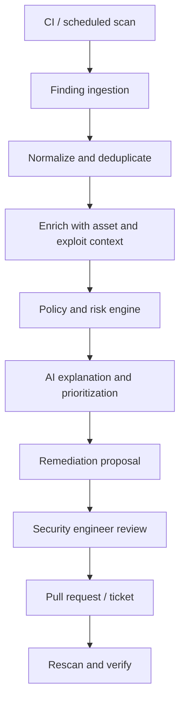

# DevSecOps Security Agent

## 1. Purpose

A security agent helps triage security findings across source code, dependencies, container images, Kubernetes manifests, cloud configuration, and CI/CD pipelines. It can explain risk and suggest remediations, but security decisions and production changes remain governed by policy and human review.

## 2. Supported use cases

- Prioritize SAST and dependency scan findings.
- Explain CVE impact and identify affected components.
- Review container image vulnerabilities and base image choices.
- Analyze IaC and Kubernetes policy violations.
- Detect exposed secrets in repositories.
- Summarize SBOM and image provenance information.
- Draft remediation tickets and verification steps.

## 3. Reference workflow



## 4. Useful integrations

- SAST: Semgrep, SonarQube.
- Dependency scanning: OSV-Scanner, Snyk, OWASP Dependency-Check.
- Container scanning: Trivy.
- Secret scanning: Gitleaks.
- IaC scanning: Checkov.
- SBOM: Syft.
- Image signing: Cosign.
- Policy enforcement: OPA, Kyverno.

Tool availability and feature sets vary by version and license. Treat scanner output as evidence that needs triage, not as a complete security assessment.

## 5. Risk prioritization

Consider more than severity:
- Exploitability and known exploitation.
- Internet exposure and reachable attack path.
- Asset criticality and data sensitivity.
- Runtime presence and deployment status.
- Available mitigations and compensating controls.
- Fix availability and upgrade compatibility.

Do not let an LLM independently downgrade a critical finding. Deterministic policy should define minimum severity and escalation rules.

## 6. Example finding analysis prompt

```text
Review the following sanitized security finding.
Explain:
- affected component and version
- vulnerability summary
- reachable exposure and known context
- severity from the scanner (preserve it)
- recommended remediation and compatibility risks
- validation steps after the fix

Do not invent exploitability details.
Do not generate weaponized exploit code.
Do not change policy or suppress the finding.
Finding: <scanner JSON>
Asset context: <service and environment metadata>
```

## 7. Guardrails

- Keep scanner credentials and cloud secrets out of model context.
- Use read-only access to findings and repository metadata.
- Do not auto-suppress or close findings based only on model reasoning.
- Require security approval for exceptions and risk acceptance.
- Verify generated patches with tests and a fresh scan.
- Preserve provenance and audit records.
- Treat repository content and scanner text as untrusted input.

## 8. Hands-on lab

1. Add Gitleaks, Semgrep, Trivy, and Checkov to a test pipeline.
2. Create controlled sample findings in a disposable repository.
3. Normalize scanner outputs into a common schema.
4. Enrich findings with service ownership and deployment context.
5. Use an LLM to explain findings and propose remediation.
6. Create a draft ticket or pull request for human review.
7. Rescan and verify that the issue is fixed.

## Further reading

- [OWASP Top 10](https://owasp.org/www-project-top-ten/)
- [Trivy documentation](https://trivy.dev/latest/)
- [Semgrep documentation](https://semgrep.dev/docs/)
- [Cosign documentation](https://docs.sigstore.dev/cosign/overview/)
