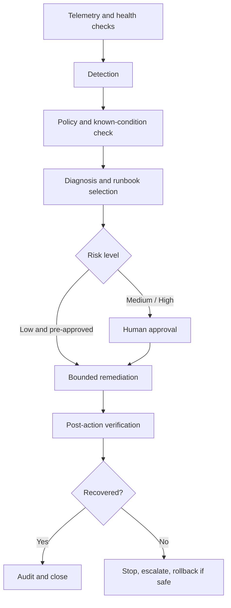

# Self-Healing Infrastructure

## 1. What is self-healing infrastructure?

Self-healing infrastructure detects known failure conditions and restores service through predefined, controlled actions. Examples include restarting an unhealthy process, replacing a failed node, rescheduling a pod, or scaling a workload.

AI can assist with diagnosis and action selection, but deterministic controllers and runbooks should handle well-understood recovery paths.

## 2. Self-healing maturity

1. **Observe:** detect and report abnormal state.
2. **Recommend:** propose a known runbook.
3. **Approve:** obtain human authorization.
4. **Execute:** run a bounded action.
5. **Verify:** confirm recovery and check for side effects.
6. **Learn:** improve thresholds and runbooks from outcomes.

Move toward autonomy only after extensive testing and risk review.

## 3. Architecture

## 4. Examples of safe automation

| Condition | Preferred controller or runbook | AI's useful role |
|---|---|---|
| Container exits | Kubernetes restart policy | Explain repeated failures |
| Pod cannot schedule | Scheduler and autoscaler | Summarize constraints |
| Workload needs more replicas | HPA/KEDA with tested bounds | Explain demand trend |
| Node becomes unhealthy | Cluster lifecycle tooling | Correlate node and workload impact |
| Disk approaches capacity | Alert and approved cleanup runbook | Identify growth source |
| Deployment health degrades | CD controller and rollback policy | Summarize evidence for decision |

Do not create restart loops or repeatedly scale resources without understanding the underlying failure.

## 5. Action risk tiers

- **Tier 0 — Read-only:** query status, logs, metrics, and events.
- **Tier 1 — Low risk:** rerun a safe diagnostic or refresh a cache under a runbook.
- **Tier 2 — Operational change:** restart a workload or adjust replicas; approval and limits required.
- **Tier 3 — High impact:** delete data, change network/security policy, rotate critical credentials, or alter production infrastructure; explicit change process and human execution required.

Risk classification depends on the environment and service. A restart can be high impact for a stateful or singleton workload.

## 6. Example controlled remediation design

For a known stateless workload with a documented failure:
1. Confirm the namespace and deployment are in an approved allowlist.
2. Confirm the symptom matches the runbook.
3. Check disruption budget, replica count, and recent action history.
4. Request approval if required by policy.
5. Invoke a fixed action through a dedicated executor.
6. Verify rollout, readiness, error rate, and SLO.
7. Stop after one attempt if recovery fails; escalate rather than looping.

Do not let the model construct arbitrary shell commands or Kubernetes patches for production.

## 7. Reliability and safety controls

- Use deterministic controllers for routine reconciliation.
- Define action allowlists, rate limits, cooldowns, and retry ceilings.
- Use least-privilege identities and short-lived credentials.
- Require approvals for high-impact actions.
- Maintain idempotency and concurrency protection.
- Keep rollback and break-glass procedures.
- Log trigger, evidence, policy decision, approver, action, and verification.
- Test failure modes in staging and game days.
- Monitor for automation-induced incidents.

## 8. Hands-on lab

1. Deploy a stateless application with readiness and liveness probes.
2. Configure HPA with realistic minimum and maximum replicas.
3. Introduce a controlled pod failure and observe Kubernetes self-healing.
4. Build a read-only agent that explains the event sequence.
5. Add a simulated remediation executor that only supports one allowlisted action.
6. Require approval and verify the outcome.
7. Test repeated failures, missing metrics, and failed remediation.

## 9. Success metrics

Track mean time to recovery, successful remediation rate, repeat incident rate, false action rate, rollback rate, human approval rate, and incidents caused by automation.

## Further reading

- [Kubernetes self-healing](https://kubernetes.io/docs/concepts/architecture/self-healing/)
- [Kubernetes probes](https://kubernetes.io/docs/concepts/configuration/liveness-readiness-startup-probes/)
- [Horizontal Pod Autoscaling](https://kubernetes.io/docs/tasks/run-application/horizontal-pod-autoscale/)
