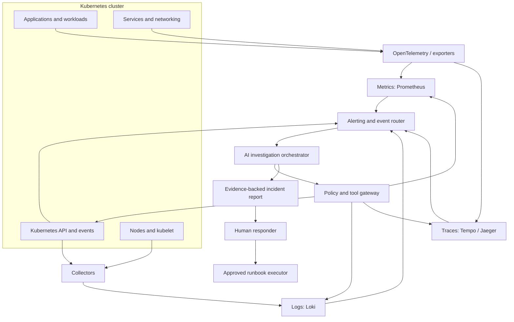

# Kubernetes AIOps Architecture

## 1. Goal

Kubernetes AIOps combines cluster telemetry, event correlation, anomaly detection, and AI-assisted investigation to help platform and SRE teams detect and understand incidents faster.

A sound design keeps Kubernetes controllers and deterministic automation responsible for reconciliation. AI adds context, investigation, and recommendations; it should not become an unrestricted cluster administrator.

## 2. Reference architecture



## 3. Main components

| Component | Responsibility |
|---|---|
| Kubernetes API | Workload, node, event, and controller state |
| Prometheus | Metrics and alert evaluation |
| Loki | Centralized logs |
| OpenTelemetry | Vendor-neutral telemetry instrumentation and collection |
| Tempo / Jaeger | Distributed trace storage and exploration |
| Event router | Normalize, deduplicate, and route alerts |
| AI orchestrator | Coordinate investigation steps and summarize evidence |
| Tool gateway | Enforce identity, scope, query limits, and audit |
| Runbook executor | Perform explicitly approved deterministic actions |

## 4. Data model and context

Normalize incident context around:
- Cluster, environment, namespace, workload, and service.
- Pod, container, node, and owner references.
- Event and telemetry timestamps with timezone.
- Deployment revision, image digest, and recent change metadata.
- SLO impact, severity, and incident identifier.

Use consistent service names and OpenTelemetry semantic conventions. Avoid high-cardinality metric labels and sensitive values.

## 5. Investigation flow

1. Receive and validate an alert.
2. Identify affected cluster, namespace, service, and time window.
3. Gather Kubernetes status and events.
4. Query bounded metrics, logs, and traces.
5. Retrieve recent deployments and infrastructure changes.
6. Correlate evidence and identify telemetry gaps.
7. Produce ranked hypotheses with references to evidence.
8. Recommend safe verification steps.
9. Ask an authorized engineer to approve any remediation.
10. Verify recovery and preserve the audit trail.

## 6. Example read-only Kubernetes permissions

Start with namespace-scoped access. The exact resources should match the agent's tools.

```yaml
apiVersion: rbac.authorization.k8s.io/v1
kind: Role
metadata:
  name: aiops-investigator
  namespace: production
rules:
  - apiGroups: [""]
    resources: ["pods", "pods/log", "events", "services", "endpoints"]
    verbs: ["get", "list", "watch"]
  - apiGroups: ["apps"]
    resources: ["deployments", "replicasets", "statefulsets", "daemonsets"]
    verbs: ["get", "list", "watch"]
```

Do not grant Secret read access by default. Use a separate, tightly controlled identity for any approved action workflow.

## 7. Tool gateway requirements

- Authenticate every request and authorize cluster/namespace scope.
- Expose typed operations, not arbitrary shell access.
- Bound time ranges, log lines, series counts, and API timeouts.
- Redact tokens, credentials, and personal data.
- Treat logs, annotations, and events as untrusted input.
- Audit the requester, tool, arguments, result metadata, and approval.
- Apply rate limits and a kill switch.

## 8. Hands-on project

Build an AI Kubernetes incident investigator:
1. Deploy a microservices demo to a test cluster.
2. Install Prometheus, Grafana, Loki, and a trace backend.
3. Add OpenTelemetry instrumentation.
4. Build read-only Kubernetes and telemetry tools.
5. Trigger a controlled failure and send an alert to the orchestrator.
6. Generate a report containing symptoms, timeline, evidence, hypotheses, and checks.
7. Add human-approved remediation only after read-only diagnosis is reliable.

## Further reading

- [Kubernetes architecture](https://kubernetes.io/docs/concepts/architecture/)
- [Prometheus](https://prometheus.io/docs/)
- [OpenTelemetry](https://opentelemetry.io/docs/)
- [Grafana Loki](https://grafana.com/docs/loki/latest/)
