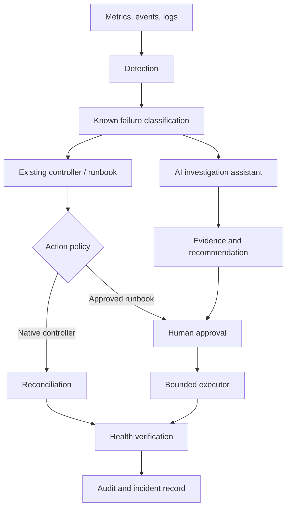

# Kubernetes Self-Healing

## 1. Overview

Kubernetes already has self-healing mechanisms: controllers compare desired and actual state and take action to reconcile them. Examples include restarting containers according to restart policy, replacing failed replicas, rescheduling pods, and autoscaling within configured bounds.

AIOps can add diagnosis and decision support, but should not bypass Kubernetes controllers or safety policy.

## 2. Native Kubernetes mechanisms

| Mechanism | What it does |
|---|---|
| Restart policy | Restarts containers according to pod policy |
| Deployment / ReplicaSet | Maintains desired replica count |
| StatefulSet | Manages ordered identity and lifecycle |
| Liveness probe | Restarts a container when it is unhealthy |
| Readiness probe | Controls whether a pod receives service traffic |
| Startup probe | Allows slow-starting applications time to initialize |
| HPA | Adjusts replicas based on configured metrics |
| Cluster autoscaler / provider node autoscaling | Adds or removes node capacity based on scheduling demand |

These mechanisms require correct configuration and do not solve every application or dependency failure.

## 3. Self-healing architecture with AI assistance



## 4. Design principles

- Prefer native Kubernetes controllers for known state-reconciliation tasks.
- Use probes that reflect actual application health.
- Set resource requests and limits based on measured behavior.
- Configure HPA bounds, stabilization windows, and appropriate metrics.
- Use PodDisruptionBudgets for availability during voluntary disruptions.
- Spread critical replicas across nodes and zones where appropriate.
- Define runbooks for failures that native controllers cannot resolve.
- Keep AI tools read-only until the workflow is proven safe.

## 5. Controlled remediation workflow

1. Detect a known condition.
2. Confirm the workload, environment, and impact.
3. Collect evidence and check recent actions.
4. Match the case to an approved runbook.
5. Evaluate action risk, disruption budgets, capacity, and cooldown.
6. Obtain approval when required.
7. Execute one bounded, idempotent action.
8. Verify pod readiness, rollout, error rate, latency, and SLO.
9. Stop and escalate if verification fails.

Do not allow an LLM to create arbitrary `kubectl` commands, patches, or cloud API requests for production.

## 6. Example HPA manifest

Illustrative autoscaling configuration; tune values to the workload and metrics server setup.

```yaml
apiVersion: autoscaling/v2
kind: HorizontalPodAutoscaler
metadata:
  name: checkout
  namespace: production
spec:
  scaleTargetRef:
    apiVersion: apps/v1
    kind: Deployment
    name: checkout
  minReplicas: 2
  maxReplicas: 10
  metrics:
    - type: Resource
      resource:
        name: cpu
        target:
          type: Utilization
          averageUtilization: 65
```

Verify resource requests are configured because CPU utilization targets are calculated relative to requests.

## 7. Example probe configuration

```yaml
startupProbe:
  httpGet:
    path: /health/startup
    port: 8080
  periodSeconds: 5
  failureThreshold: 30
readinessProbe:
  httpGet:
    path: /health/ready
    port: 8080
  periodSeconds: 5
  failureThreshold: 3
livenessProbe:
  httpGet:
    path: /health/live
    port: 8080
  periodSeconds: 10
  failureThreshold: 3
```

Use separate endpoints with appropriate semantics. A liveness probe should not fail merely because a downstream dependency is temporarily unavailable if restarting the container will not fix that dependency.

## 8. Hands-on lab

1. Deploy a stateless app with multiple replicas.
2. Configure startup, readiness, and liveness probes.
3. Configure an HPA and generate controlled load.
4. Delete one test pod and observe ReplicaSet reconciliation.
5. Introduce a failed readiness probe and inspect endpoint changes.
6. Build an AI assistant that explains the events and metrics.
7. Add a simulated approval-gated remediation tool and test failure handling.

## 9. Safety and observability

- Use cooldowns and retry ceilings to prevent action loops.
- Avoid simultaneous scaling and manual replica changes.
- Respect PodDisruptionBudgets and stateful workload constraints.
- Record every automated action and its trigger.
- Monitor remediation success, regressions, and automation-caused incidents.
- Keep a manual override and break-glass process.

## Further reading

- [Kubernetes self-healing](https://kubernetes.io/docs/concepts/architecture/self-healing/)
- [Liveness, readiness, and startup probes](https://kubernetes.io/docs/concepts/configuration/liveness-readiness-startup-probes/)
- [Horizontal Pod Autoscaling](https://kubernetes.io/docs/tasks/run-application/horizontal-pod-autoscale/)
- [Pod disruptions](https://kubernetes.io/docs/concepts/workloads/pods/disruptions/)
