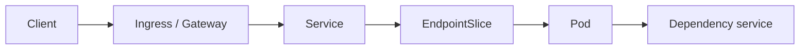

# Kubernetes Network Troubleshooting Agent

## 1. Purpose

A network troubleshooting agent investigates connectivity failures between pods, services, nodes, and external dependencies. It should combine Kubernetes objects, DNS checks, network policy, CNI telemetry, logs, and traces.

## 2. Common symptoms

- Service name does not resolve.
- DNS resolves but connection times out.
- Connection is refused.
- Service has no ready endpoints.
- Traffic works from one namespace but not another.
- Ingress or gateway returns 4xx/5xx errors.
- Intermittent packet loss or elevated network latency.

## 3. Traffic path



Actual paths depend on the CNI, kube-proxy replacement, service mesh, ingress controller, and cloud networking implementation.

## 4. Read-only checks

```bash
kubectl get svc -n <namespace>
kubectl get endpointslices -n <namespace>
kubectl describe svc <service> -n <namespace>
kubectl get networkpolicies -A
kubectl get pods -n <namespace> -o wide
kubectl get events -n <namespace> --sort-by=.lastTimestamp
```

If an approved diagnostic pod exists, test DNS and TCP connectivity from the same namespace and network-policy context as the failing workload:

```bash
nslookup <service>.<namespace>.svc.cluster.local
nc -vz <service>.<namespace>.svc.cluster.local <port>
```

Use only approved diagnostic images and tools in production environments.

## 5. Investigation sequence

1. Confirm source pod, destination service, port, protocol, and time.
2. Check service selector and ready EndpointSlices.
3. Verify target pod readiness and container listening port.
4. Test DNS resolution from the source context.
5. Review NetworkPolicies affecting source and destination.
6. Inspect ingress/gateway routes and service mesh policies if present.
7. Review CNI, CoreDNS, node, and cloud network telemetry.
8. Compare traces and application logs for timeout/refusal details.
9. Check recent network policy, deployment, and infrastructure changes.

## 6. Symptom interpretation

| Symptom | Possible causes | Evidence to gather |
|---|---|---|
| DNS NXDOMAIN | Wrong service name or namespace | DNS query, service objects |
| No endpoints | Selector mismatch or unready pods | Service selector, EndpointSlices |
| Connection refused | No listener or wrong target port | Container port, app logs |
| Timeout | Policy drop, routing, overloaded dependency | Network policy, CNI metrics, traces |
| Ingress 502/503 | Upstream unavailable or misconfigured | Gateway logs, endpoints, health |
| Intermittent failures | Endpoint churn, packet loss, saturation | Pod/node changes, network metrics |

## 7. Agent tool contracts

```text
get_service_and_endpoints(namespace, service)
get_pod_network_context(namespace, pod)
list_network_policies(namespace)
get_dns_health(time_range)
get_gateway_errors(service, time_range)
query_network_metrics(scope, time_range, template)
```

Do not expose packet capture, host networking, firewall modification, or arbitrary `kubectl exec` as unrestricted agent tools.

## 8. AI output requirements

Return the exact source and destination, observed failure, checks performed, evidence and timestamps, competing hypotheses, missing evidence, and safe next tests. Never claim a NetworkPolicy is responsible without evidence that it selects the relevant pods and blocks the traffic direction.

## 9. Hands-on lab

1. Deploy two services in separate namespaces.
2. Confirm service discovery and connectivity.
3. Add a NetworkPolicy that intentionally blocks a path.
4. Observe the failure from the source pod.
5. Gather service, EndpointSlice, policy, DNS, and application evidence.
6. Have the agent identify the likely policy path and suggest a minimal policy correction.
7. Apply changes manually and verify connectivity.

## Further reading

- [Kubernetes Services](https://kubernetes.io/docs/concepts/services-networking/service/)
- [Network Policies](https://kubernetes.io/docs/concepts/services-networking/network-policies/)
- [DNS for Services and Pods](https://kubernetes.io/docs/concepts/services-networking/dns-pod-service/)
