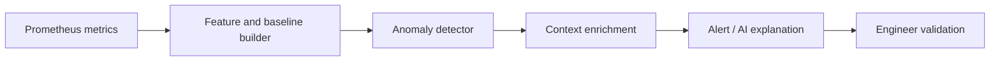

# Kubernetes Resource Anomaly Detection

## 1. Objective

Detect unusual resource behavior in Kubernetes workloads and nodes, such as unexpected CPU or memory growth, throttling, disk pressure, network saturation, or replica demand changes.

An anomaly is not automatically an incident. Validate it against workload patterns, deployments, SLO impact, and capacity policy.

## 2. Signals to monitor

- CPU usage, requests, limits, and throttling.
- Memory working set, limits, and OOM kills.
- Pod restarts and replica count.
- Node allocatable capacity and pressure conditions.
- Filesystem and ephemeral storage usage.
- Network throughput, errors, and retransmits.
- Request rate, latency, and error ratio.

## 3. Example PromQL

CPU usage by pod:

```promql
sum by (namespace, pod) (
  rate(container_cpu_usage_seconds_total{container!="", image!=""}[5m])
)
```

Memory working set:

```promql
sum by (namespace, pod) (
  container_memory_working_set_bytes{container!="", image!=""}
)
```

CPU throttling ratio (metric availability and labels vary):

```promql
sum by (namespace, pod) (
  rate(container_cpu_cfs_throttled_periods_total[5m])
)
/
clamp_min(
  sum by (namespace, pod) (
    rate(container_cpu_cfs_periods_total[5m])
  ),
  1
)
```

Restart increases over 15 minutes:

```promql
sum by (namespace, pod) (
  increase(kube_pod_container_status_restarts_total[15m])
)
```

Validate metric names and labels against your Prometheus installation and exporters.

## 4. Detection methods

| Method | Strength | Limitation |
|---|---|---|
| Static threshold | Simple and explainable | Ignores seasonality and workload context |
| Moving average | Tracks recent behavior | Can lag sudden changes |
| Z-score | Flags deviations from mean | Assumes a meaningful distribution |
| Seasonal baseline | Handles recurring patterns | Needs sufficient historical data |
| Isolation Forest | Can detect multivariate outliers | Harder to explain and tune |
| Forecast residual | Detects deviation from expected trend | Forecast quality matters |

Start with SLO-aligned thresholds and simple baselines before introducing complex models.

## 5. Detection pipeline



Context enrichment can include deployment revisions, HPA changes, node pool events, traffic, and service ownership.

## 6. AI's role

AI can explain why an alert fired, compare affected workloads, summarize a time series, and propose verification queries. The anomaly detector should provide the measured score and baseline; the model should not invent numeric evidence.

## 7. Hands-on lab

1. Collect CPU and memory metrics for a test deployment.
2. Export a historical time series.
3. Build a rolling baseline and calculate deviations.
4. Trigger a controlled load spike.
5. Compare static threshold and anomaly-based alerts.
6. Enrich the alert with deployment and replica history.
7. Ask an LLM to explain the result using the actual measurements.

## 8. Avoiding false positives

- Account for daily and weekly traffic patterns.
- Separate startup, batch, and steady-state behavior.
- Use minimum duration and hysteresis.
- Exclude known maintenance windows carefully.
- Consider workload requests and limits.
- Evaluate per service or workload class rather than one global threshold.
- Monitor detector drift and missing telemetry.

## 9. Response safety

Do not automatically increase limits, scale replicas, or terminate pods based on an anomaly score alone. Use bounded autoscaling policies and require approval for changes outside established controller behavior.

## Further reading

- [Prometheus query functions](https://prometheus.io/docs/prometheus/latest/querying/functions/)
- [Kubernetes resource management](https://kubernetes.io/docs/concepts/configuration/manage-resources-containers/)
- [Horizontal Pod Autoscaling](https://kubernetes.io/docs/tasks/run-application/horizontal-pod-autoscale/)
