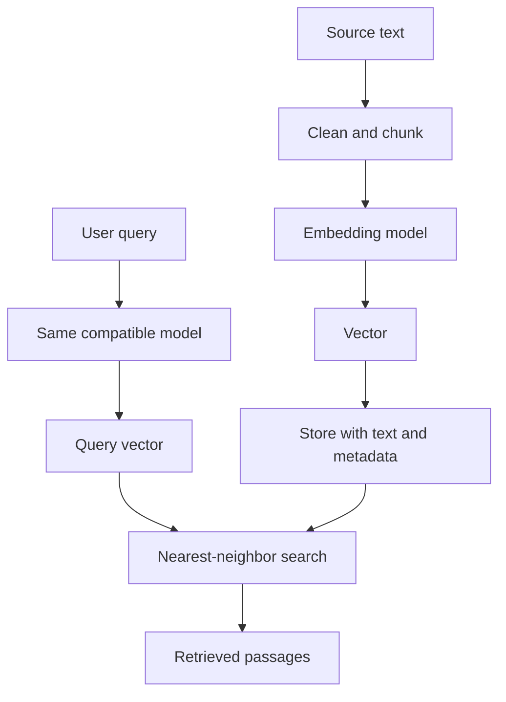

# Embeddings

## 1. What are embeddings?

An embedding is a numeric vector that represents information such as text, images, or other data. Embedding models map semantically related inputs to vectors that are close under a chosen similarity or distance measure.

In RAG, embeddings allow a system to retrieve passages related to a question even when the wording differs.

## 2. Conceptual example

A runbook passage saying "The container was terminated after exceeding its memory limit" may be semantically close to a question such as "Why did my pod get OOMKilled?"

The vectors do not contain a human-readable explanation. They provide a representation that a search system can compare.

## 3. Similarity measures

- **Cosine similarity:** compares vector direction.
- **Dot product:** compares vector alignment and magnitude.
- **Euclidean distance:** measures straight-line distance.

Use the similarity measure expected by the embedding model and vector index. Do not mix assumptions across models or indexes.

## 4. Embedding pipeline



The document and query embeddings must be compatible. Changing the embedding model or dimensions generally requires re-embedding the corpus and rebuilding the index.

## 5. Python example

Illustrative example using Sentence Transformers:

```bash
python -m venv .venv
source .venv/bin/activate
pip install sentence-transformers
```

```python
from sentence_transformers import SentenceTransformer

model = SentenceTransformer("all-MiniLM-L6-v2")

documents = [
    "Investigate OOMKilled pods by checking memory usage and container limits.",
    "Use kubectl describe pod to inspect scheduling and lifecycle events.",
    "Check imagePullSecrets when a container image cannot be downloaded.",
]

vectors = model.encode(
    documents,
    normalize_embeddings=True,
)

query = "How do I troubleshoot a pod killed for memory usage?"
query_vector = model.encode(query, normalize_embeddings=True)

scores = vectors @ query_vector
for index in scores.argsort()[::-1]:
    print(float(scores[index]), documents[index])
```

For production, pin model versions, record model identifiers and dimensions, batch requests, and benchmark retrieval quality on your own corpus.

## 6. Choosing an embedding model

Evaluate:
- Retrieval quality on your language and domain.
- Vector dimensions and storage requirements.
- Context length and chunk size compatibility.
- Throughput, latency, and hardware needs.
- Commercial licensing and data-processing terms.
- Multilingual support.
- Model update and versioning policy.

A larger model is not automatically better for a specialized runbook corpus. Test with representative questions.

## 7. Metadata matters

Store metadata alongside each vector:

```json
{
  "document_id": "runbook-k8s-oom-001",
  "chunk_id": "chunk-04",
  "title": "Kubernetes OOMKilled Runbook",
  "service": "checkout",
  "environment": "production",
  "version": "3",
  "owner": "platform-team",
  "source": "internal-runbooks"
}
```

Metadata enables filtering, access control, traceability, and targeted retrieval. The example values are illustrative.

## 8. Common problems

| Problem | Likely cause | Improvement |
|---|---|---|
| Relevant content is missed | Poor chunking or model mismatch | Tune chunking and evaluate another model |
| Similar but wrong documents appear | Dense search alone is insufficient | Add lexical search and metadata filters |
| Results are repetitive | Duplicate chunks or overlapping content | Deduplicate and tune overlap |
| Retrieval quality degrades | Model or corpus changed | Version embeddings and re-index |
| High latency | Large batches or inefficient index | Batch, cache carefully, tune index |

## 9. Hands-on lab

1. Collect sanitized Kubernetes runbook passages.
2. Chunk by headings and paragraphs.
3. Generate embeddings with a selected model.
4. Compare cosine similarity for 10–20 test questions.
5. Try different chunk sizes and overlap values.
6. Record Recall@5 and inspect failure cases.

## Further reading

- [Sentence Transformers](https://www.sbert.net/)
- [OpenAI embeddings guide](https://platform.openai.com/docs/guides/embeddings)
- [Hugging Face model hub](https://huggingface.co/models)
