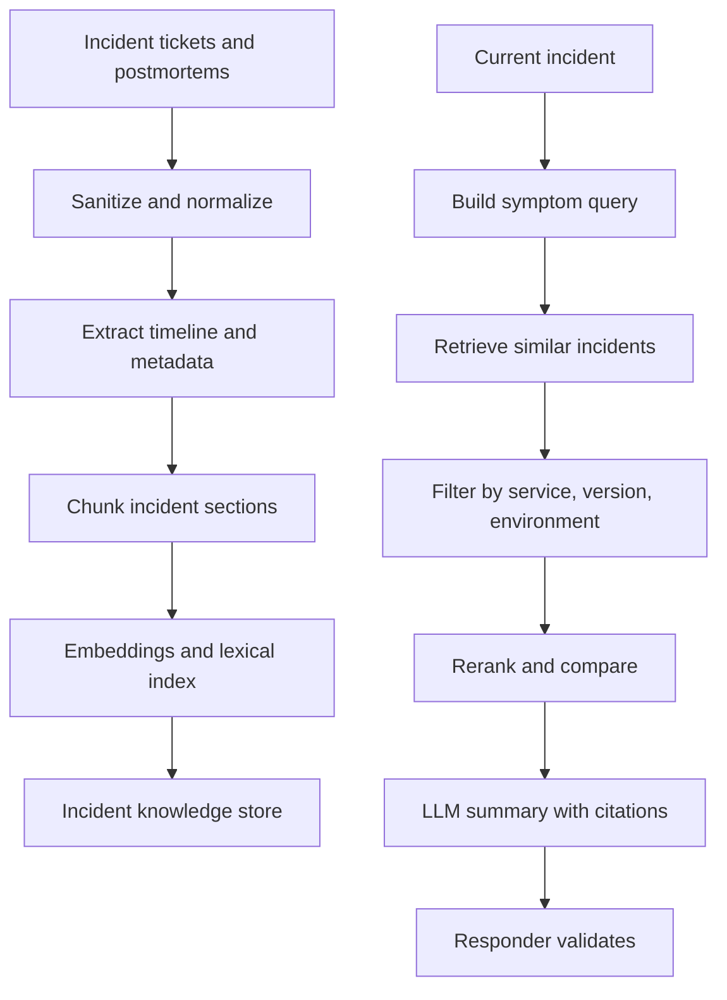

# Incident History RAG

## 1. Purpose

Incident History RAG retrieves relevant past incidents to help responders compare symptoms, identify recurring patterns, and find previously successful mitigations.

It should support investigation, not assume that two incidents with similar text have the same root cause. Historical records may be incomplete, environment-specific, or no longer applicable.

## 2. Data sources

- Incident tickets and postmortems.
- Alert timelines and event records.
- Sanitized logs, metrics, and trace summaries.
- Deployment and infrastructure change history.
- Service ownership and dependency metadata.
- Corrective and preventive action records.

Avoid ingesting raw customer data, credentials, tokens, or unnecessary personal information.

## 3. Incident document schema

A normalized incident record can include:

```json
{
  "incident_id": "INC-2026-001",
  "title": "Checkout API latency increased",
  "service": "checkout",
  "environment": "production",
  "start_time": "2026-10-12T10:05:00Z",
  "end_time": "2026-10-12T10:42:00Z",
  "symptoms": ["high p95 latency", "dependency timeout"],
  "root_cause": "Verified cause recorded in postmortem",
  "mitigation": "Approved mitigation summary",
  "resolution": "Service health restored",
  "status": "reviewed",
  "owner": "platform-team",
  "source": "postmortem-system"
}
```

This is an illustrative schema. Store timestamps consistently and preserve the original incident source.

## 4. Architecture



## 5. Retrieval strategy

Use hybrid retrieval:
- Semantic similarity for symptom descriptions.
- Keyword search for exact error codes and alert names.
- Metadata filters for service, environment, cluster, version, and incident date.
- Reranking based on symptom and context relevance.

Similarity is not causality. Prefer incidents with matching technical context and verified postmortems.

## 6. Example query

Current incident:
- Service: checkout
- Symptom: p95 latency increased
- Error: database connection timeout
- Recent change: new application release

Useful retrieval filters:
- Same service or dependency.
- Similar application version or infrastructure.
- Production environment.
- Reviewed postmortems.
- Recent enough to reflect current architecture.

## 7. Answer format

```text
Current incident summary:
Relevant historical incidents:
1. Incident ID and title
   - Similarities:
   - Differences:
   - Verified root cause:
   - Mitigation used:
   - Source reference:

Recommended checks:
- Compare current database connection metrics.
- Inspect traces for connection-pool wait time.
- Review release changes.

Caution:
Historical similarity does not prove the same root cause.
```

## 8. Prompt template

```text
Compare the current incident with retrieved historical incidents.
Use only the supplied records.

For each historical incident:
- identify matching symptoms and technical context
- identify important differences
- quote the recorded, verified root cause accurately
- state whether the mitigation is still applicable
- cite incident ID and source section

Do not transfer a past root cause to the current incident without new evidence.
Do not recommend risky actions without approval.
```

## 9. Evaluation

Create a test set of current incidents with known related and unrelated historical cases. Measure:
- Recall@k for relevant incidents.
- Precision and ranking quality.
- Correctness of incident metadata filters.
- Accuracy of similarities and differences.
- Citation correctness.
- Whether the system avoids treating similarity as proof.
- Responder usefulness and time saved.

## 10. Privacy and lifecycle

- Sanitize incident records before embedding.
- Apply access controls based on incident confidentiality.
- Support retention, deletion, and re-indexing.
- Version the source and embedding model.
- Mark unreviewed or superseded incidents clearly.
- Keep audit records for retrieval and answer generation.

## 11. Hands-on lab

1. Collect 10–20 sanitized incident reports.
2. Normalize them into a common schema.
3. Chunk each incident into symptoms, timeline, root cause, and resolution.
4. Generate embeddings and build hybrid search.
5. Query with a new incident description.
6. Compare retrieved cases and validate the citations.
7. Add a new postmortem and test incremental indexing.

## Further reading

- [Google SRE postmortem culture](https://sre.google/sre-book/postmortem-culture/)
- [RAG paper](https://arxiv.org/abs/2005.11401)
- [OpenTelemetry](https://opentelemetry.io/docs/)
