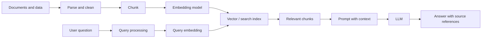

# RAG Fundamentals

## 1. What is Retrieval-Augmented Generation?

Retrieval-Augmented Generation (RAG) is an architecture that retrieves relevant information from an external knowledge source and supplies it to a language model when generating an answer.

RAG helps ground responses in organization-specific or frequently updated material without requiring the model to memorize that information during training. It does not guarantee correctness: retrieval can miss relevant content, and the model can still misinterpret evidence.

## 2. Basic architecture

## 3. Ingestion pipeline

1. Collect approved documents: runbooks, architecture notes, incident reports, and operational procedures.
2. Parse formats such as Markdown, PDF, HTML, and DOCX.
3. Normalize text and preserve useful metadata.
4. Split documents into chunks.
5. Generate embeddings for chunks.
6. Store vectors, text, and metadata in a searchable index.
7. Record source, version, owner, access policy, and ingestion time.

## 4. Query pipeline

1. Authenticate the user and determine access scope.
2. Normalize or rewrite the question if needed.
3. Retrieve candidate chunks using vector, keyword, or hybrid search.
4. Apply metadata filters and authorization checks.
5. Rerank candidates when useful.
6. Construct a bounded prompt with source references.
7. Generate an answer constrained to the retrieved evidence.
8. Return citations and state when evidence is insufficient.

## 5. Chunking strategies

| Strategy | Description | Useful for |
|---|---|---|
| Fixed-size | Split by token or character count | Simple baseline |
| Recursive | Split on headings, paragraphs, then sentences | General documentation |
| Semantic | Split by topic or meaning | Long-form content |
| Structure-aware | Preserve Markdown headings, code blocks, tables | Runbooks and technical docs |
| Parent-child | Retrieve small chunks with larger parent context | Precise retrieval with context |

There is no universal chunk size. Evaluate chunk size and overlap using representative questions and retrieval metrics.

## 6. Retrieval methods

- **Dense retrieval:** semantic similarity using embeddings.
- **Keyword retrieval:** exact terms, identifiers, error messages, and BM25-style search.
- **Hybrid retrieval:** combines dense and lexical results.
- **Metadata filtering:** restrict by service, environment, version, owner, or document type.
- **Reranking:** reorder candidates using a relevance model.

For DevOps knowledge, hybrid retrieval is often useful because exact error strings, Kubernetes resource names, and semantic descriptions all matter.

## 7. Example DevOps RAG use cases

- Search deployment and rollback runbooks.
- Retrieve prior incidents with similar symptoms.
- Explain CI/CD errors using internal troubleshooting guides.
- Find Kubernetes procedures by namespace or workload type.
- Answer questions about architecture decisions and service ownership.

## 8. Evaluation

Measure:
- Recall@k: whether relevant evidence appears in the top k results.
- Precision@k: how many retrieved results are relevant.
- MRR / nDCG: ranking quality.
- Faithfulness: whether the answer is supported by retrieved context.
- Citation correctness: whether cited sources support the claim.
- Answer usefulness and abstention quality.
- Latency, cost, and access-control correctness.

Build a small evaluation set of real, sanitized questions before tuning the system.

## 9. Security considerations

- Enforce document permissions at retrieval time.
- Do not rely on prompt instructions as the only access control.
- Treat retrieved content as untrusted data; documents may contain prompt injection.
- Keep secrets and sensitive incident details out of embeddings unless explicitly approved.
- Support deletion and re-indexing when documents change or access is revoked.
- Log queries and retrieval metadata according to privacy policy.

## Further reading

- [Retrieval-Augmented Generation for Knowledge-Intensive NLP Tasks](https://arxiv.org/abs/2005.11401)
- [Sentence Transformers documentation](https://www.sbert.net/)
- [OpenAI embeddings guide](https://platform.openai.com/docs/guides/embeddings)
