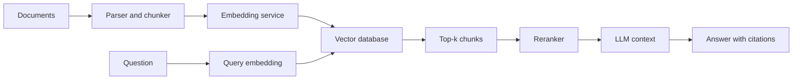

# Vector Databases

## 1. What is a vector database?

A vector database stores and searches vector embeddings, often with associated text and metadata. It supports nearest-neighbor retrieval and can combine vector similarity with filters or keyword search.

In a RAG system, it is one possible retrieval component. Some systems use a dedicated vector database; others use search engines or relational databases with vector extensions.

## 2. Common capabilities

- Vector similarity search.
- Metadata filtering.
- Approximate nearest-neighbor indexes.
- Hybrid keyword and vector retrieval.
- Namespace, collection, or tenant separation.
- Upsert, update, and delete operations.
- Replication, backup, and scaling options.

## 3. Technology landscape

| Technology | General positioning |
|---|---|
| pgvector | Vector similarity search in PostgreSQL |
| Qdrant | Dedicated vector search engine |
| Milvus | Scalable vector database |
| Weaviate | Vector database with search and schema features |
| Chroma | Developer-friendly vector store often used in prototypes |
| Elasticsearch / OpenSearch | Search engines with vector capabilities |

Choose based on operational maturity, scale, filtering, hybrid search, deployment model, backup, security, and cost. Features and licensing can change; validate current product documentation.

## 4. Reference architecture



## 5. Example with Chroma

Illustrative local development example; check current package APIs before using in production.

```bash
pip install chromadb sentence-transformers
```

```python
import chromadb
from sentence_transformers import SentenceTransformer

model = SentenceTransformer("all-MiniLM-L6-v2")
client = chromadb.PersistentClient(path="./chroma-data")
collection = client.get_or_create_collection("devops-runbooks")

texts = [
    "For OOMKilled pods, inspect memory working set and container limits.",
    "For ImagePullBackOff, verify image reference and pull secret configuration.",
]
vectors = model.encode(texts, normalize_embeddings=True).tolist()

collection.upsert(
    ids=["runbook-oom", "runbook-image-pull"],
    documents=texts,
    embeddings=vectors,
    metadatas=[
        {"service": "platform", "topic": "memory"},
        {"service": "platform", "topic": "image-pull"},
    ],
)

query = "Why does my pod fail to download its container image?"
query_vector = model.encode([query], normalize_embeddings=True).tolist()

result = collection.query(
    query_embeddings=query_vector,
    n_results=2,
)
print(result["documents"])
```

## 6. Index and retrieval considerations

- Exact search is simple but may become expensive at scale.
- Approximate indexes trade some recall for speed and lower resource use.
- Tune index parameters against a representative evaluation set.
- Filter by metadata before or during retrieval where supported.
- Use hybrid retrieval for exact error strings and semantic questions.
- Rerank candidates when top-k relevance is not sufficient.

## 7. Production operations

- Define collection and tenant boundaries.
- Enforce authorization before returning retrieved content.
- Encrypt data in transit and at rest.
- Configure backup, restore, retention, and deletion.
- Track embedding model and index versions.
- Monitor query latency, recall, storage, memory, and ingestion failures.
- Prevent unbounded metadata and excessive vector dimensions.
- Plan re-indexing for model or schema changes.

## 8. Hands-on lab

1. Load 20 sanitized DevOps runbook chunks.
2. Generate embeddings and insert them into a local vector store.
3. Query with exact error messages and paraphrased questions.
4. Add metadata filters for service and environment.
5. Compare dense search with keyword and hybrid search.
6. Evaluate Recall@5 and latency.
7. Delete a document and verify it can no longer be retrieved.

## Further reading

- [pgvector](https://github.com/pgvector/pgvector)
- [Qdrant documentation](https://qdrant.tech/documentation/)
- [Milvus documentation](https://milvus.io/docs)
- [Weaviate documentation](https://docs.weaviate.io/)
- [Chroma documentation](https://docs.trychroma.com/)
