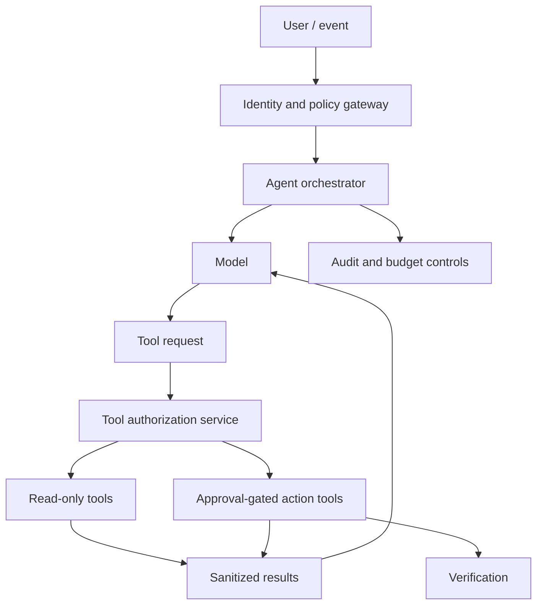

# AI Agent Security

## 1. Why agents need additional controls

AI agents can select tools, retrieve data, and coordinate multi-step workflows. This increases the impact of a model error or prompt injection, especially when an agent can modify infrastructure, deploy code, or access sensitive systems.

Treat an agent as an untrusted decision-making component operating inside a trusted security envelope.

## 2. Agent threat model

| Risk | Example | Control |
|---|---|---|
| Excessive agency | Agent deletes a production resource | Least privilege and approval gates |
| Tool abuse | Unexpected shell or API call | Tool allowlist and strict schemas |
| Data exfiltration | Agent sends secrets to an external endpoint | Data-loss controls and egress restrictions |
| Prompt injection | Malicious log content influences decisions | Untrusted-data handling and policy checks |
| Memory poisoning | Incorrect content persists as trusted context | Provenance, review, expiry, and deletion |
| Identity confusion | Agent acts as the wrong user | Delegated identity and authorization |
| Runaway loops | Repeated calls increase cost or cause damage | Step, time, and budget limits |

## 3. Secure agent architecture

## 4. Least-privilege design

- Use separate identities for each agent and environment.
- Start with read-only access.
- Scope Kubernetes permissions to required namespaces and resources.
- Use cloud IAM roles with narrowly scoped actions.
- Avoid shared administrator credentials.
- Prefer short-lived tokens and workload identity.
- Separate diagnostic tools from remediation tools.
- Enforce authorization at the tool service for every call.

## 5. Tool security

Each tool should have:
- A clear purpose and typed input schema.
- Server-side authentication and authorization.
- Strict argument validation and allowlists.
- Timeouts, rate limits, and result-size limits.
- Safe error messages that do not leak secrets.
- Audit logs and correlation IDs.
- Idempotency or concurrency controls for state changes.

Avoid unrestricted shell, arbitrary SQL, generic HTTP, or broad cloud API tools unless strongly sandboxed and explicitly justified.

## 6. Human approval

Require explicit approval for actions such as:
- Production deployments and rollbacks.
- Restarting or scaling critical workloads outside existing policy.
- Deleting resources or data.
- Changing IAM, network policy, or firewall rules.
- Rotating critical credentials.
- Modifying backups or retention settings.

Approval should identify the exact action, target, parameters, expected impact, and rollback plan.

## 7. Memory and context security

- Store provenance, owner, timestamp, and trust level with memory.
- Do not treat prior model-generated conclusions as verified facts.
- Expire stale operational context.
- Enforce access controls on memory retrieval.
- Support correction and deletion.
- Keep secrets out of long-term agent memory.

## 8. Hands-on lab

Build a Kubernetes investigation agent:
1. Give it read-only pod, event, and deployment tools.
2. Add namespace-level authorization.
3. Add strict tool schemas and query limits.
4. Inject malicious text into a test log.
5. Verify that the agent cannot access Secrets or execute shell commands.
6. Add a simulated approval-gated restart tool.
7. Test audit logging, timeouts, and runaway-call limits.

## 9. Security evaluation

Measure unauthorized tool-call attempts, policy bypass rate, sensitive-data leakage, tool argument validity, approval correctness, runaway execution, and audit completeness.

## Further reading

- [OWASP Top 10 for LLM Applications](https://genai.owasp.org/llm-top-10/)
- [NIST AI RMF](https://www.nist.gov/itl/ai-risk-management-framework)
- [Kubernetes RBAC](https://kubernetes.io/docs/reference/access-authn-authz/rbac/)
