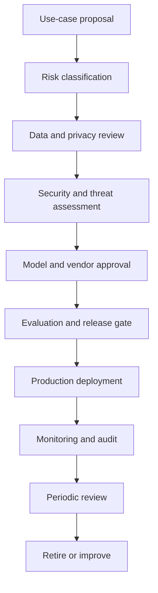

# AI Governance

## 1. What is AI governance?

AI governance is the set of policies, roles, controls, and processes used to ensure AI systems are developed and operated responsibly, securely, transparently, and in compliance with applicable requirements.

For DevOps and AIOps, governance covers model selection, data use, access, evaluation, deployment, monitoring, human oversight, and retirement.

## 2. Governance lifecycle

## 3. Governance domains

| Domain | Questions |
|---|---|
| Ownership | Who owns the system and its outcomes? |
| Purpose | Is the use case approved and clearly scoped? |
| Data | What data is collected, retained, and shared? |
| Privacy | Is personal or confidential data processed appropriately? |
| Security | Are tools, identities, models, and integrations protected? |
| Quality | Is performance evaluated against representative tasks? |
| Human oversight | Which decisions require human review? |
| Transparency | Can users understand limitations and sources? |
| Monitoring | Are drift, failures, abuse, and incidents tracked? |
| Compliance | Which laws, contracts, and policies apply? |

## 4. Risk classification for DevOps agents

Example internal classification; adapt it to organizational policy.

- **Low risk:** summarize public documentation or explain non-sensitive metrics.
- **Moderate risk:** access internal runbooks or read production telemetry.
- **High risk:** recommend or initiate production changes.
- **Critical risk:** modify identity, security controls, backups, or destructive infrastructure.

Higher-risk systems need stronger validation, approval, audit, and rollback requirements.

## 5. Model and vendor review

Review:
- Data retention and provider training-use terms.
- Data residency and subprocessors.
- Encryption and access controls.
- Availability, incident notification, and support commitments.
- Model versioning and change notification.
- Output limitations and evaluation evidence.
- Licensing and intellectual property terms.
- Exit strategy and portability.

## 6. AI system documentation

Maintain:
- System purpose and intended users.
- Model/provider and version.
- Data sources and classifications.
- Retrieval and tool integrations.
- Permissions and trust boundaries.
- Evaluation results and known limitations.
- Human approval points.
- Monitoring, incident, and rollback procedures.
- Owner, review date, and change history.

## 7. Operational controls

- Use pre-production evaluations and release gates.
- Monitor accuracy, latency, cost, and policy violations.
- Track prompt, model, retrieval index, and tool versions.
- Keep an audit trail of high-impact decisions.
- Define incident response for data leakage and unsafe actions.
- Review access and vendor posture periodically.
- Provide a way to disable or roll back the AI feature.

## 8. Human oversight

Human review is particularly important when AI outputs affect:
- Production deployments or rollback.
- Security findings and risk acceptance.
- Access control and credential changes.
- Deletion, backup, or retention.
- Customer-impacting incident communications.
- Financial commitments or cost changes.

The approver must see the proposed action, target, evidence, risks, and rollback path—not just a generic "approve" button.

## 9. Standards and frameworks

Useful references include:
- NIST AI Risk Management Framework.
- ISO/IEC 42001 AI management systems.
- ISO/IEC 23894 AI risk management guidance.
- OWASP Top 10 for LLM Applications.
- Organization-specific privacy, security, and change-management policies.

Applicability depends on jurisdiction, sector, and organizational obligations. This note is not legal advice.

## 10. Hands-on governance exercise

For an AI Kubernetes incident assistant:
1. Write its purpose and out-of-scope actions.
2. Classify data handled by the assistant.
3. Document all tools and permissions.
4. Perform a prompt-injection and data-leakage threat assessment.
5. Define evaluation datasets and release thresholds.
6. Specify which actions require approval.
7. Create monitoring and incident-response procedures.
8. Schedule periodic review of models, prompts, indexes, and access.

## Further reading

- [NIST AI Risk Management Framework](https://www.nist.gov/itl/ai-risk-management-framework)
- [ISO/IEC 42001 overview](https://www.iso.org/standard/81230.html)
- [OWASP GenAI Security Project](https://genai.owasp.org/)
- [Google Secure AI Framework](https://saif.google/)
