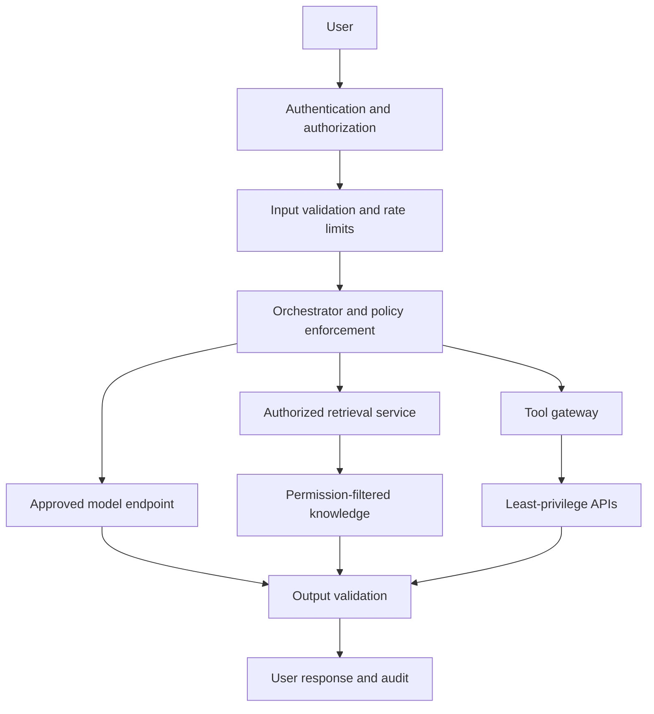

# LLM Security

## 1. Why LLM security matters

LLM applications introduce risks beyond traditional application security: prompt injection, sensitive-data disclosure, unsafe output handling, insecure tool use, model supply-chain risks, and abuse of inference endpoints.

Security must cover the complete application: user interface, orchestration, model provider, retrieval layer, tools, data stores, logs, and deployment infrastructure.

## 2. Threat model

| Asset | Threat | Example control |
|---|---|---|
| Prompts and system instructions | Extraction or manipulation | Keep secrets out of prompts; enforce policy in code |
| User and business data | Unauthorized disclosure | Authentication, authorization, redaction |
| Retrieved documents | Indirect prompt injection | Treat retrieved content as untrusted data |
| Tools and APIs | Unauthorized action | Tool allowlists and server-side authorization |
| Model endpoint | Abuse or denial of service | Rate limits, quotas, abuse monitoring |
| Model and dependencies | Supply-chain compromise | Pin versions, verify provenance, scan dependencies |
| Outputs | Unsafe content or code execution | Validate, encode, sandbox, and review |

## 3. Secure LLM application architecture

## 4. Core security controls

- Authenticate users and services; authorize every data and tool request.
- Keep API keys and credentials in a secrets manager, never in prompts or source code.
- Apply input size limits, rate limits, quotas, and abuse detection.
- Treat user input, retrieved documents, logs, and tool output as untrusted.
- Validate model output before using it in SQL, shell commands, HTML, or APIs.
- Use structured output schemas and reject invalid responses.
- Isolate code execution and file processing in hardened sandboxes.
- Apply data minimization, retention limits, and encryption.
- Log security-relevant events without storing unnecessary sensitive prompt content.

## 5. Model and supply-chain security

- Use approved model providers and models.
- Pin SDK, model, and dependency versions where possible.
- Review model licenses, provenance, and provider data-handling terms.
- Scan container images and application dependencies.
- Protect model configuration and deployment pipelines.
- Evaluate third-party model artifacts before use.
- Maintain rollback procedures for model or prompt changes.

## 6. Security testing

Test:
- Prompt injection and instruction-conflict handling.
- Cross-user and cross-tenant data access.
- Sensitive-data leakage in responses and logs.
- Tool authorization bypass attempts.
- Malformed and oversized inputs.
- Unsafe output rendering and generated code handling.
- Rate-limit and denial-of-service behavior.
- Retrieval permission filtering and stale document removal.

## 7. DevSecOps integration

Add security checks to the AI application lifecycle:
1. Secret scanning and dependency scanning in pull requests.
2. SAST and IaC scanning.
3. Container image scanning and signing.
4. Unit tests for authorization and output validation.
5. AI-specific adversarial evaluations before release.
6. Runtime monitoring for abuse, policy violations, and unusual tool calls.

## 8. Hands-on lab

Build a small RAG assistant and:
1. Add user authentication.
2. Restrict retrieval to documents the user can access.
3. Add a tool that reads deployment status, with read-only permissions.
4. Test malicious instructions embedded in retrieved documents.
5. Validate structured output before displaying it.
6. Add rate limits, audit events, and secret redaction.

## Further reading

- [OWASP Top 10 for LLM Applications](https://genai.owasp.org/llm-top-10/)
- [NIST AI Risk Management Framework](https://www.nist.gov/itl/ai-risk-management-framework)
- [Google Secure AI Framework](https://saif.google/)
