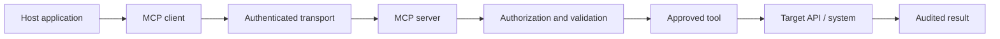

# MCP Security

## 1. Overview

The Model Context Protocol (MCP) standardizes how AI applications connect to tools and contextual data through MCP servers. MCP expands an agent's capabilities, so server identity, authorization, transport security, and tool design are critical.

MCP does not automatically make a tool safe. Every server and tool must enforce its own security boundaries.

## 2. MCP security model



## 3. Main risks

- Connecting to an untrusted or impersonated MCP server.
- Exposing tools with excessive permissions.
- Confused-deputy behavior where a server uses its own authority on behalf of a user without checking user permissions.
- Credential leakage through tool arguments, logs, or responses.
- Prompt injection in resources and tool results.
- Unsafe local stdio server execution.
- Insecure remote transport or token handling.
- Tool name or description manipulation.

## 4. Secure server design

- Authenticate clients and authorize each operation.
- Use TLS for remote connections.
- Follow the current MCP authorization specification for supported remote transports.
- Validate every argument with a strict schema.
- Apply least-privilege credentials to downstream systems.
- Separate read-only tools from state-changing tools.
- Avoid returning secrets or unnecessary personal data.
- Set timeouts, quotas, and response-size limits.
- Log security events without logging credential values.
- Treat tool output and resource content as untrusted.

## 5. Local stdio server considerations

A local stdio server may execute as the user's operating-system identity. Therefore:
- Review server source and dependencies before running it.
- Pin package versions and verify publisher/source.
- Restrict file-system and network access.
- Do not pass secrets in command-line arguments.
- Run in a dedicated low-privilege account or sandbox where practical.
- Review environment variables inherited by the process.

## 6. Remote server considerations

- Use authenticated TLS endpoints.
- Validate issuer, audience, scopes, and token expiry.
- Do not accept arbitrary bearer tokens or forward tokens blindly.
- Bind user identity and authorization context to each request.
- Prevent cross-tenant access.
- Rotate credentials and revoke compromised tokens.
- Avoid exposing internal MCP endpoints directly to the public internet.

Exact transport and authorization requirements can evolve; follow the current official MCP specification and SDK guidance.

## 7. Tool design example

Prefer a narrow tool:

```text
get_pod_status(namespace, pod_name)
```

over a broad tool:

```text
execute_any_kubectl_command(command)
```

The narrow tool can enforce namespace allowlists, read-only behavior, output filtering, and audit logging.

## 8. Security checklist

- [ ] Server source and publisher reviewed.
- [ ] Dependencies pinned and scanned.
- [ ] Transport authenticated and encrypted.
- [ ] User identity and authorization enforced.
- [ ] Tool permissions are least privilege.
- [ ] Inputs and outputs are validated.
- [ ] Secrets are redacted.
- [ ] Resource and tool outputs treated as untrusted.
- [ ] Rate, time, and result limits configured.
- [ ] Audit logs and incident response process enabled.
- [ ] Destructive actions require explicit approval.

## 9. Hands-on lab

1. Build a read-only MCP server for Kubernetes pod status.
2. Run it locally using stdio.
3. Restrict it to an allowlisted namespace.
4. Attempt an unauthorized namespace query and confirm denial.
5. Add a remote deployment only in a test environment with authenticated transport.
6. Test malicious tool output and ensure it cannot grant additional permissions.

## Further reading

- [MCP official documentation](https://modelcontextprotocol.io/docs/)
- [MCP security best practices](https://modelcontextprotocol.io/specification/)
- [OWASP GenAI Security Project](https://genai.owasp.org/)
