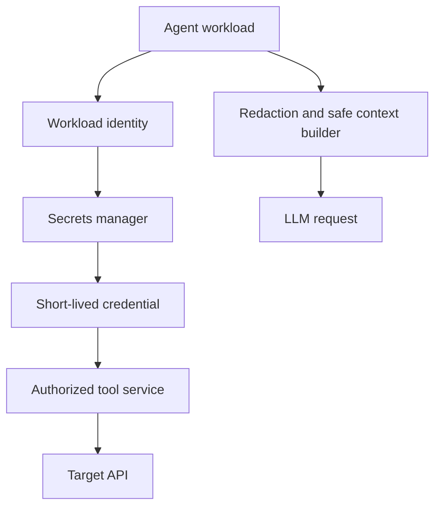

# Secrets Management for AI Applications and Agents

## 1. What counts as a secret?

Secrets include API keys, model-provider credentials, OAuth tokens, database passwords, cloud credentials, signing keys, certificates, and private keys.

Prompts, logs, embeddings, vector stores, agent memory, and tool outputs can accidentally become secret storage if sensitive values are copied into them.

## 2. Core principles

- Never hardcode secrets in source code, prompts, notebooks, container images, or Git repositories.
- Use a dedicated secrets manager or platform-native secret store.
- Apply least privilege and separate credentials by workload and environment.
- Prefer workload identity and short-lived credentials over static keys.
- Rotate credentials and revoke them when exposure is suspected.
- Redact secrets before sending telemetry or context to an LLM.
- Audit secret access and alert on unusual patterns.

## 3. Reference architecture

The model should generally receive task context, not credentials. A tool service can authenticate to a target system without exposing its credential to the model.

## 4. Common options

| Platform | Example service |
|---|---|
| AWS | AWS Secrets Manager, Systems Manager Parameter Store, IAM roles |
| Azure | Azure Key Vault, Managed Identities |
| Kubernetes | External Secrets Operator with a cloud secrets backend; Kubernetes Secrets with encryption and RBAC |
| HashiCorp | Vault |
| CI/CD | OIDC federation to cloud IAM; protected CI secret store for unavoidable credentials |

Select based on identity integration, rotation, audit, availability, and operational requirements.

## 5. Kubernetes considerations

- Enable encryption at rest for Kubernetes Secrets in the API datastore.
- Restrict Secret access through RBAC.
- Avoid mounting secrets into containers that do not need them.
- Prefer external secret managers and workload identity where appropriate.
- Do not print Secret objects or environment values in troubleshooting logs.
- Rotate credentials and restart/reload consumers safely.
- Remember that base64 encoding is not encryption.

## 6. CI/CD considerations

- Prefer GitHub Actions or other CI OIDC federation to static cloud access keys.
- Scope roles to repository, branch, environment, and audience.
- Protect production environments with approvals.
- Mask sensitive values, but do not rely on masking as the only protection.
- Never dump all environment variables in debug logs.
- Avoid passing secrets as command-line arguments where process listings may expose them.

## 7. AI-specific controls

- Do not put API keys in system prompts or retrieved documents.
- Do not include raw credentials in RAG ingestion.
- Redact secrets from logs before LLM analysis.
- Prevent agents from returning secret values through tools.
- Avoid persistent memory of credentials.
- Use tool-side credential injection and scoped identities.
- Test prompt-injection attempts that request secret disclosure.

## 8. Incident response for secret exposure

1. Identify the exposed credential and affected systems.
2. Revoke or rotate it using the approved process.
3. Review access logs for misuse.
4. Remove the secret from active storage and stop further propagation.
5. Address copies in logs, artifacts, prompts, and indexes according to retention policy.
6. Rebuild affected images or indexes if necessary.
7. Document the incident and improve controls.

Deleting a value from one location does not guarantee it has disappeared from backups, logs, caches, or model-provider records; follow the relevant retention and deletion procedures.

## 9. Hands-on lab

1. Configure a workload identity for a test agent.
2. Grant access to one secret in a development vault.
3. Have a tool service retrieve the secret without returning it to the model.
4. Confirm the agent can call the target API but cannot read unrelated secrets.
5. Add redaction to logs and test prompt-injection requests for credentials.

## Further reading

- [OWASP Secrets Management Cheat Sheet](https://cheatsheetseries.owasp.org/cheatsheets/Secrets_Management_Cheat_Sheet.html)
- [AWS Secrets Manager](https://docs.aws.amazon.com/secretsmanager/)
- [Azure Key Vault](https://learn.microsoft.com/azure/key-vault/)
- [HashiCorp Vault](https://developer.hashicorp.com/vault/docs)
