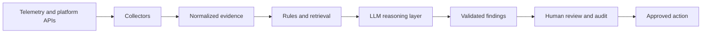

# 12 — AIOps Projects

A hands-on portfolio module for building practical AI-assisted operations systems. The projects progress from read-only investigation to controlled remediation.

## Projects

| Project | Goal | Core integrations |
|---|---|---|
| [01 — Kubernetes Incident Agent](01-kubernetes-incident-agent/README.md) | Investigate cluster incidents and produce evidence-backed RCA | Kubernetes API, Prometheus, Loki, LLM, MCP |
| [02 — CI/CD Failure Agent](02-cicd-failure-agent/README.md) | Diagnose failed pipeline runs and recommend fixes | GitHub Actions, logs, LLM, GitHub API |
| [03 — AI Log Analyzer](03-ai-log-analyzer/README.md) | Cluster, summarize, and explain application logs | OpenTelemetry, Loki, embeddings, LLM |
| [04 — Cloud Cost Agent](04-cloud-cost-agent/README.md) | Explain spend changes and recommend FinOps actions | AWS Cost Explorer, Azure Cost Management |
| [05 — Self-Healing Kubernetes](05-self-healing-kubernetes/README.md) | Safely automate narrowly scoped Kubernetes remediation | Kubernetes, Prometheus, policy engine, approval workflow |

## Recommended build order

1. Start with the Kubernetes Incident Agent. Build a read-only evidence collector before adding an LLM.
2. Build the CI/CD Failure Agent using structured workflow-run metadata and bounded log excerpts.
3. Build the AI Log Analyzer as a reusable service for the first two projects.
4. Add cost analysis using read-only billing APIs and explicit savings calculations.
5. Only then introduce self-healing. Keep remediation deterministic, policy-controlled, auditable, and approval-gated.

## Shared reference architecture



## Shared engineering standards

- Treat model output as an untrusted proposal, never as executable authority.
- Prefer read-only credentials for investigation projects.
- Minimize and redact logs, events, manifests, and metadata before sending them to a model.
- Use structured output schemas, input limits, timeouts, retries, and request IDs.
- Cite evidence for every finding: source, timestamp, resource, query, and relevant excerpt.
- Separate detection, diagnosis, recommendation, approval, and execution.
- Make actions idempotent where possible; define rollback and stop conditions.
- Record who approved an action, what changed, why, and the result.
- Test against synthetic incidents and known-answer datasets before production use.

## Suggested repository layout

```text
12-aiops-projects/
├── README.md
├── 01-kubernetes-incident-agent/
├── 02-cicd-failure-agent/
├── 03-ai-log-analyzer/
├── 04-cloud-cost-agent/
└── 05-self-healing-kubernetes/
```

Each project README defines a scope, architecture, implementation plan, API contract, tests, security controls, and acceptance criteria. Add source code in `src/`, tests in `tests/`, deployment manifests in `deploy/`, and sample sanitized data in `samples/`.

## Definition of done

A project is portfolio-ready when another engineer can run it from a clean environment, reproduce a sample scenario, inspect the evidence behind its conclusion, understand its permissions, and verify that unsafe actions are blocked.

## Official references

- Kubernetes documentation: https://kubernetes.io/docs/
- Prometheus documentation: https://prometheus.io/docs/
- OpenTelemetry documentation: https://opentelemetry.io/docs/
- Model Context Protocol: https://modelcontextprotocol.io/
- GitHub Actions: https://docs.github.com/actions
- AWS Cost Explorer: https://docs.aws.amazon.com/cost-management/latest/userguide/ce-what-is.html
- Azure Cost Management: https://learn.microsoft.com/azure/cost-management-billing/
