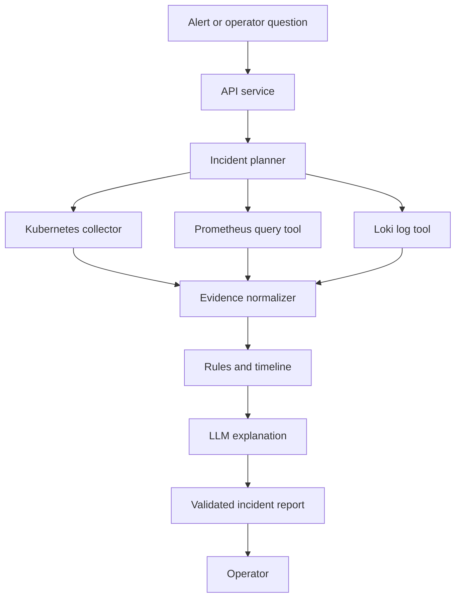

# Project 01 — Kubernetes Incident Agent

## Objective

Build an AI-assisted investigator that accepts a Kubernetes symptom or alert, gathers relevant read-only evidence, correlates events and metrics, and produces a concise, evidence-backed incident report. The first release must not modify the cluster.

## Example user request

> Investigate why `checkout` pods in namespace `production` are restarting.

## Architecture



## Suggested stack

- Python 3.11+, FastAPI, Pydantic
- Kubernetes Python client or a constrained MCP server
- Prometheus HTTP API; Loki HTTP API
- LLM provider behind a small model-adapter interface
- SQLite/PostgreSQL for incident records
- OpenTelemetry for the agent service's own traces and metrics

## Investigation workflow

1. Parse the target namespace, workload, symptom, and time window.
2. Validate the requested scope against an allowlist.
3. Collect Deployment, ReplicaSet, Pod, Node, Events, and container status.
4. Collect relevant metrics: restarts, CPU/memory, throttling, readiness, node pressure.
5. Retrieve bounded log excerpts around the incident window.
6. Build a timestamped evidence timeline.
7. Apply deterministic checks before asking the model to explain evidence.
8. Return likely causes, confidence, supporting evidence, missing data, and safe next steps.

## Tool contract

Expose narrow functions rather than arbitrary shell access:

```python
from datetime import datetime
from typing import Literal
from pydantic import BaseModel, Field

class InvestigationRequest(BaseModel):
    namespace: str = Field(pattern=r"^[a-z0-9]([-a-z0-9]*[a-z0-9])?$")
    workload: str = Field(min_length=1, max_length=100)
    kind: Literal["Deployment", "StatefulSet", "DaemonSet"] = "Deployment"
    since_minutes: int = Field(default=30, ge=5, le=1440)

class Evidence(BaseModel):
    source: str
    observed_at: datetime
    resource: str
    summary: str
    raw_excerpt: str | None = None
```

Implement collectors with explicit namespace and time bounds. Do not expose a generic `kubectl` command runner to the model.

## Example checks

```bash
kubectl -n production get deploy,rs,pods -o wide
kubectl -n production get events --sort-by=.lastTimestamp
kubectl -n production describe pod <pod-name>
kubectl -n production logs <pod-name> --all-containers --since=30m --tail=300
kubectl top pods -n production
kubectl top nodes
```

Prometheus query examples:

```promql
sum by (namespace, pod) (increase(kube_pod_container_status_restarts_total{namespace="production"}[30m]))
```

```promql
container_memory_working_set_bytes{namespace="production",pod=~"checkout-.*"}
```

## Example report schema

```json
{
  "incident_id": "inc-2026-001",
  "summary": "Checkout containers are restarting after repeated OOM kills.",
  "likely_causes": [
    {
      "cause": "Memory limit is insufficient for observed workload",
      "confidence": "medium",
      "evidence_ids": ["ev-12", "ev-18"]
    }
  ],
  "timeline": [],
  "missing_evidence": [],
  "recommended_checks": [
    "Compare memory working set with the configured container limit",
    "Review recent release changes"
  ],
  "remediation_requires_approval": true
}
```

## RBAC: read-only starting point

Create a dedicated ServiceAccount and namespace-scoped Role. Grant only the resources and verbs required by the collectors. Typical investigation verbs are `get`, `list`, and `watch` on Pods, Events, Deployments, ReplicaSets, StatefulSets, and Nodes only if cluster-scoped node inspection is required. Avoid `secrets`, `exec`, `delete`, `patch`, and `update`.

Validate permissions:

```bash
kubectl auth can-i list pods -n production --as=system:serviceaccount:aiops:incident-agent
kubectl auth can-i delete pods -n production --as=system:serviceaccount:aiops:incident-agent
```

The second command should return `no`.

## Hands-on lab

1. Deploy a sample app with a deliberately low memory limit.
2. Generate load until the container is OOMKilled.
3. Trigger an investigation for the workload.
4. Verify the agent retrieves Pod status, events, and memory metrics.
5. Check that each conclusion references evidence IDs.
6. Remove model access and confirm deterministic collectors still work.

## Testing and acceptance criteria

- Unit-test each collector with mocked API responses.
- Integration-test against a disposable kind or k3d cluster.
- Include fixtures for `CrashLoopBackOff`, `ImagePullBackOff`, `Pending`, OOMKilled, failed probes, and node pressure.
- Reject cross-namespace requests outside the configured allowlist.
- Truncate and redact logs; test prompt-injection strings inside log content.
- A human operator can reproduce every reported fact from the cited evidence.

## Production hardening

Use workload identity, TLS, secret manager integration, request quotas, audit logs, bounded concurrency, and retention limits. Treat Kubernetes annotations, labels, logs, events, and image metadata as untrusted input. The LLM must not be able to broaden tool permissions or execute a suggested command.

## Next enhancements

Add incident-history RAG, change correlation with GitOps deployment events, Slack/Teams notifications, and a separate approval-gated remediation service.

## References

- https://kubernetes.io/docs/concepts/overview/working-with-objects/
- https://kubernetes.io/docs/reference/access-authn-authz/rbac/
- https://prometheus.io/docs/prometheus/latest/querying/api/
- https://grafana.com/docs/loki/latest/
