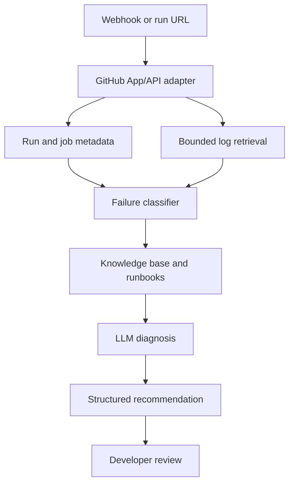

# Project 02 — CI/CD Failure Agent

## Objective

Build an agent that explains failed CI/CD runs using workflow metadata, job/step outcomes, and bounded log excerpts. It should suggest a repair and a verification plan; it must not push commits, change workflow files, or rerun production deployments without explicit approval.

## Architecture



## Suggested stack

- Python + FastAPI
- GitHub App with least-privilege repository permissions
- GitHub Actions REST API
- PostgreSQL or SQLite for run history
- Optional RAG index for approved internal runbooks
- LLM adapter with structured JSON output

## Workflow

1. Receive a repository and workflow-run identifier.
2. Confirm repository access and ensure the run belongs to an allowed repository.
3. Fetch run metadata, failed jobs, failed steps, and a bounded log excerpt.
4. Detect common failure classes: dependency installation, test failure, lint, build, Docker, registry authentication, cloud OIDC, deployment, timeout, and runner capacity.
5. Retrieve relevant runbooks and known incidents.
6. Ask the model to explain only the supplied evidence.
7. Return root-cause hypothesis, confidence, evidence, suggested fix, and verification steps.
8. Require a developer to apply and review any code or workflow change.

## GitHub permissions

Prefer a GitHub App over a long-lived personal access token. Start with read-only Actions and repository metadata access for diagnosis. Add write permissions only if a separately reviewed feature genuinely requires them. Store credentials in a secret manager and rotate them.

## Example diagnosis contract

```json
{
  "run_id": 123456,
  "failure_category": "cloud-authentication",
  "summary": "The deploy job could not assume the AWS role using GitHub OIDC.",
  "evidence": [
    "STS returned AccessDenied for AssumeRoleWithWebIdentity."
  ],
  "likely_causes": [
    "The IAM role trust policy subject does not match the repository/ref."
  ],
  "recommended_fix": [
    "Compare the token's aud and sub claims with the role trust policy."
  ],
  "verification": [
    "Run the workflow in a non-production environment and confirm GetCallerIdentity."
  ],
  "confidence": "medium",
  "requires_human_review": true
}
```

## Useful diagnostic commands

For a self-hosted reproduction environment:

```bash
git status --short
git rev-parse --short HEAD
docker version
docker build --no-cache -t app:test .
```

For AWS OIDC, verify the IAM OIDC provider, role trust policy, audience, and subject condition. Never print or store the raw OIDC token in agent logs.

## Hands-on lab

1. Create a demo GitHub Actions workflow with separate lint, test, build, scan, and deploy jobs.
2. Introduce a controlled failure, such as a missing environment variable or failing unit test.
3. Trigger the agent with the workflow-run ID.
4. Verify that it identifies the failing step and quotes only a short sanitized excerpt.
5. Compare its diagnosis with a human-written expected answer.
6. Confirm the agent cannot modify repository contents or trigger deployment.

## Evaluation

Create a labelled test set of at least 30 sanitized failures. Track:
- Failure-category accuracy
- Top-1 root-cause accuracy
- Evidence citation precision
- Unsupported-claim rate
- Mean time to useful diagnosis
- Cost and latency per run

## Safety and security

Workflow logs may contain secrets, malicious strings, or attacker-controlled output. Redact credentials before model submission, limit log size, treat logs as data rather than instructions, and prevent prompt content from selecting arbitrary URLs or repositories. Never execute commands copied from logs. Use allowlisted repositories, API rate limits, audit events, and a human approval boundary for write operations.

## Acceptance criteria

- A run can be diagnosed from its ID without manually copying logs.
- Each diagnosis links to a run, job, step, and evidence excerpt.
- The agent distinguishes observed facts from hypotheses.
- The agent has no default write permission.
- Tests cover expired credentials, missing secrets, OIDC trust mismatch, test failures, dependency failures, Docker build errors, and deployment timeouts.

## References

- https://docs.github.com/en/rest/actions
- https://docs.github.com/en/actions
- https://docs.github.com/en/apps/creating-github-apps
