# Project 03 — AI Log Analyzer

## Objective

Create a service that ingests application and infrastructure logs, detects recurring patterns, groups related events, and produces concise explanations with links to source records. The analyzer should complement—not replace—metrics, traces, alerting, and deterministic parsing.

## Architecture

```mermaid
flowchart LR
  A[Applications and services] --> B[OpenTelemetry Collector]
  B --> C[Log backend: Loki or Elasticsearch]
  C --> D[Query and sampling service]
  D --> E[Redaction and normalization]
  E --> F[Pattern clustering]
  F --> G[LLM summary and explanation]
  G --> H[Findings with source links]
  H --> I[Dashboard or incident channel]
```



## Suggested stack

- OpenTelemetry Collector for collection and processing
- Loki with LogQL, or Elasticsearch/OpenSearch
- Python, FastAPI, Pydantic
- Optional embeddings and vector store for historical error retrieval
- Grafana for exploration and dashboards

## Data model

Normalize records into a common shape:

```json
{
  "timestamp": "2026-11-18T12:00:00Z",
  "service": "checkout",
  "environment": "staging",
  "severity": "ERROR",
  "trace_id": "optional-trace-id",
  "resource": "pod/checkout-7d8f",
  "message": "database connection timeout",
  "attributes": {
    "namespace": "staging",
    "container": "api"
  }
}
```

Do not assume every log source provides all fields. Preserve source identifiers and original timestamps.

## Analysis pipeline

1. Query a narrow service, environment, and time range.
2. Enforce maximum record count and maximum bytes.
3. Redact secrets, tokens, personal data, and sensitive headers.
4. Normalize timestamps, severity, service names, and trace identifiers.
5. Group duplicate messages using templates or fingerprints.
6. Detect spikes relative to a baseline; show the baseline window.
7. Correlate groups by time, service, deployment, and trace ID where available.
8. Ask the model to summarize representative samples, not an unbounded raw stream.
9. Return findings with links or stable IDs to source logs.

## Example LogQL

```logql
{namespace="production", app="checkout"} |= "ERROR"
```

```logql
sum by (pod) (count_over_time({namespace="production", app="checkout"} |= "timeout" [5m]))
```

## Simple Python fingerprinting

```python
import re
import hashlib

def fingerprint(message: str) -> str:
    normalized = re.sub(r"\b[0-9a-fA-F-]{8,}\b", "<ID>", message)
    normalized = re.sub(r"\b\d+\b", "<N>", normalized)
    normalized = re.sub(r"\s+", " ", normalized).strip().lower()
    return hashlib.sha256(normalized.encode()).hexdigest()[:16]
```

Use fingerprints for grouping, not as proof that two events have the same cause.

## Example output

```json
{
  "window": "last 15 minutes",
  "top_patterns": [
    {
      "pattern": "database connection timeout",
      "count": 184,
      "first_seen": "2026-11-18T11:48:00Z",
      "last_seen": "2026-11-18T12:02:00Z",
      "sample_record_ids": ["log-101", "log-119"]
    }
  ],
  "correlations": [
    "The increase began shortly after deployment release-42."
  ],
  "hypotheses": [
    {
      "statement": "Database connection pool saturation may be contributing.",
      "confidence": "low",
      "evidence_ids": ["log-101", "metric-77"]
    }
  ],
  "recommended_checks": [
    "Inspect active connection count and pool wait time."
  ]
}
```

## Hands-on lab

1. Generate sample application logs with normal traffic and a simulated database outage.
2. Ingest them through an OpenTelemetry Collector.
3. Query the incident window from Loki.
4. Compare exact-message grouping with normalized fingerprint grouping.
5. Ask the model to summarize only the top patterns and representative samples.
6. Verify that secrets and malicious prompt-like log messages are removed or treated as untrusted data.

## Evaluation

Measure pattern grouping precision/recall, anomaly detection false-positive rate, summary factuality, evidence-link coverage, ingestion delay, query latency, token usage, and cost. Maintain a labelled dataset with normal periods and known incidents.

## Security and operations

Use tenant and environment boundaries in queries. Apply redaction before storage where feasible and again before model calls. Set retention policies, access controls, query limits, and model timeouts. Avoid sending full logs to external models. Logs are untrusted input: do not follow instructions embedded in messages.

## Acceptance criteria

- A user can select a service and time window and receive a bounded analysis.
- Findings link to source records and show counts and timestamps.
- The analyzer distinguishes correlation from causation.
- Redaction tests pass and oversized queries are rejected.
- The service exposes its own health, latency, error, and token/cost metrics.

## References

- https://opentelemetry.io/docs/
- https://grafana.com/docs/loki/latest/
- https://grafana.com/docs/loki/latest/query/
