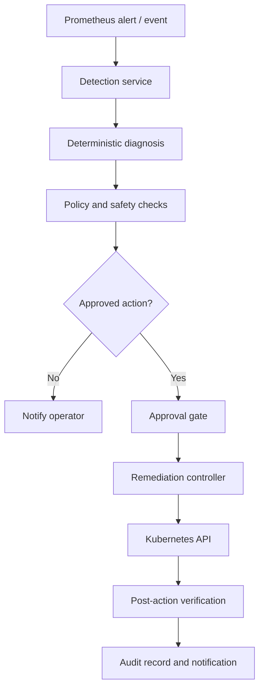

# Project 05 — Self-Healing Kubernetes

## Objective

Build a controlled remediation system for a small set of well-understood Kubernetes failure modes. The system detects a condition, verifies preconditions, selects an approved deterministic action, obtains approval where required, executes with a narrow identity, and verifies the result.

This project is deliberately last in the learning path. Do not begin with an autonomous agent that can run arbitrary `kubectl` commands.

## Architecture



## Safe initial use cases

Start with actions that are reversible and tightly scoped:

- Restart a known Deployment only after confirming rollout health criteria and a documented runbook.
- Roll back a Deployment to a known previous revision after an approved release-related failure.
- Scale a workload within explicit minimum and maximum replica bounds.
- Cordon a node only with an operator-approved policy and a tested capacity plan.

Do not automate deletion of PVCs, Secrets, namespaces, databases, or arbitrary workloads. Avoid automatic node drains and cluster-wide changes until the operational risks are fully modelled.

## Remediation policy

A policy should define:
- Trigger and evidence requirements
- Allowed namespaces and workload names
- Permitted action and parameter bounds
- Cooldown and maximum attempts
- Required approval level
- Health checks and success criteria
- Rollback or escalation procedure

Example policy:

```yaml
name: checkout-scale-out
scope:
  namespaces: ["production"]
  deployments: ["checkout"]
trigger:
  metric: "checkout_queue_depth"
  operator: ">"
  threshold: 100
  duration: "5m"
action:
  type: "scale"
  min_replicas: 3
  max_replicas: 8
safety:
  cooldown: "15m"
  max_actions_per_hour: 2
  require_human_approval: true
verification:
  ready_replicas_must_equal_desired: true
  timeout: "5m"
```

This is an illustrative application policy, not a native Kubernetes resource.

## Implementation stages

### Stage 1 — Observe

Consume alerts and Kubernetes events. Store normalized incident records. No write permissions.

### Stage 2 — Recommend

Map known symptoms to runbook actions. Generate a recommendation with evidence and risk. An operator executes it manually.

### Stage 3 — Approval-gated execution

Create a separate remediation controller with its own ServiceAccount. Accept only signed or authenticated action requests matching a policy. Never pass free-form model-generated shell commands to the controller.

### Stage 4 — Verify and learn

Check rollout status, readiness, error rates, saturation, and alert state. If verification fails, stop further actions and escalate. Record outcome for later policy tuning.

## Example safe command sequence

For a controlled staging exercise:

```bash
kubectl -n staging get deployment checkout
kubectl -n staging rollout status deployment/checkout --timeout=120s
kubectl -n staging rollout history deployment/checkout
```

A rollback should be a separately approved action:

```bash
kubectl -n staging rollout undo deployment/checkout
kubectl -n staging rollout status deployment/checkout --timeout=120s
```

Do not expose these commands as unrestricted LLM tools. Implement a typed API that checks the policy and target before calling the Kubernetes client.

## Separation of duties

Use separate identities:
- Detector: read-only access to alerts and Kubernetes state.
- Planner: no cluster write access; produces a proposed action.
- Approver: authenticated human or approved change-management system.
- Executor: narrowly scoped write permissions for explicitly allowed resources and verbs.
- Auditor: append-only access to action records.

## Failure handling

- Use idempotency keys to prevent duplicate actions.
- Enforce per-workload cooldowns and global rate limits.
- Set execution deadlines and cancellation handling.
- Re-check preconditions immediately before mutation.
- Verify the postcondition after mutation.
- Stop on unexpected state changes, repeated failures, or missing telemetry.
- Escalate rather than repeatedly retrying a failed remediation.

## Hands-on lab

1. Create a staging Deployment and expose a health metric.
2. Simulate a known failure, such as a bad rollout or a workload constrained by a test resource limit.
3. Confirm the detector identifies the condition.
4. Review the proposed action and evidence.
5. Approve the action through a separate authenticated endpoint.
6. Execute using a restricted ServiceAccount.
7. Verify recovery and inspect the immutable audit record.
8. Test denied actions: wrong namespace, unknown Deployment, excessive replicas, repeated action, expired approval, and missing evidence.

## Security checklist

- No arbitrary command execution.
- Strict namespace and resource allowlists.
- Narrow RBAC verbs and resource names where practical.
- Human approval for disruptive operations.
- Signed/authenticated action requests.
- Secretless workload identity where supported.
- Audit logs with actor, approver, policy version, evidence, request ID, and result.
- Prompt-injection defenses for all logs, annotations, events, and model outputs.
- Emergency kill switch and documented manual operations path.

## Acceptance criteria

- The detector and planner work with read-only permissions.
- The executor cannot act outside its policy.
- Invalid and expired approvals are rejected.
- Repeated triggers do not cause remediation loops.
- Every action has a before/after snapshot and verification result.
- A failed remediation stops and escalates safely.

## References

- https://kubernetes.io/docs/concepts/workloads/controllers/deployment/
- https://kubernetes.io/docs/reference/access-authn-authz/rbac/
- https://kubernetes.io/docs/concepts/cluster-administration/cluster-administration-overview/
- https://prometheus.io/docs/alerting/latest/overview/
