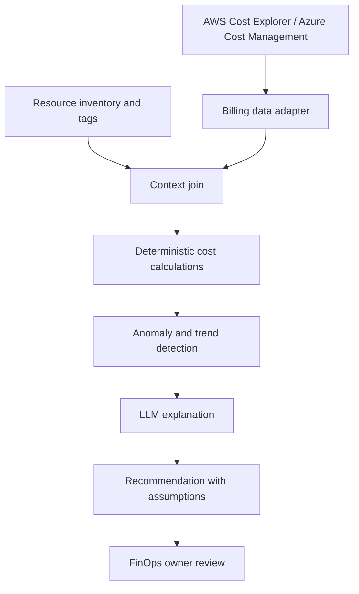

# Project 04 — Cloud Cost Agent

## Objective

Build a read-only FinOps assistant that explains cloud spend, detects meaningful cost changes, identifies likely cost drivers, and recommends actions with estimated impact and operational risk. Recommendations must be based on billing data and resource context; do not let the model invent savings.

## Architecture



## Suggested stack

- Python + FastAPI
- AWS Cost Explorer API and/or Azure Cost Management exports/API
- Cloud resource inventory APIs
- PostgreSQL for normalized daily cost snapshots
- Grafana or a lightweight dashboard
- LLM for explanation, not arithmetic authority

## Core capabilities

1. Spend summary by account/subscription, service, region, environment, and tag.
2. Period-over-period comparison with explicit date ranges.
3. Detection of unusual daily or weekly spend changes.
4. Mapping spend to owners and workloads using tags.
5. Recommendations such as rightsizing, idle-resource review, storage lifecycle policies, and schedule-based shutdown.
6. Tracking of accepted recommendations and realized savings.

## Data contract

```json
{
  "provider": "aws",
  "billing_period": "2026-11",
  "currency": "USD",
  "dimensions": {
    "account": "shared-services",
    "service": "Amazon EC2",
    "region": "ap-south-1",
    "environment": "staging"
  },
  "actual_cost": 1250.45,
  "comparison_cost": 980.10,
  "source": "cost-explorer",
  "retrieved_at": "2026-11-18T10:00:00Z"
}
```

Preserve currency, billing granularity, usage type, credits, discounts, taxes, and amortization assumptions. Never compare incompatible cost views without explaining the difference.

## Deterministic calculations

```python
def percent_change(current: float, previous: float) -> float | None:
    if previous == 0:
        return None
    return ((current - previous) / previous) * 100

def estimated_monthly_savings(current_monthly_cost: float,
                              reduction_fraction: float) -> float:
    if not 0 <= reduction_fraction <= 1:
        raise ValueError("reduction_fraction must be between 0 and 1")
    return current_monthly_cost * reduction_fraction
```

The model may explain calculated results, but code should calculate amounts and percentages. Label savings as estimates until verified against actual billing.

## AWS starting point

Use a dedicated read-only role for Cost Explorer and the minimum resource inventory permissions required. Example CLI query:

```bash
aws ce get-cost-and-usage \
  --time-period Start=2026-11-01,End=2026-11-18 \
  --granularity DAILY \
  --metrics UnblendedCost \
  --group-by Type=DIMENSION,Key=SERVICE
```

The end date in Cost Explorer is exclusive. Adjust dates and metrics to match the billing question.

## Azure starting point

Use Azure Cost Management exports or query APIs with read-only access scoped to the intended management group, subscription, or resource group. Normalize currency, billing period, and amortization consistently before comparing.

## Example recommendation

```json
{
  "title": "Review underutilized staging compute",
  "observed_fact": "Average CPU utilization was below the configured threshold during the sampled period.",
  "estimated_monthly_savings": 145.00,
  "currency": "USD",
  "assumptions": [
    "Estimate uses current on-demand rate and observed runtime."
  ],
  "risk": "medium",
  "recommended_validation": [
    "Check memory, network, and business-hour traffic before resizing."
  ],
  "action": "recommendation_only",
  "approval_required": true
}
```

## Hands-on lab

1. Enable a Cost Explorer export or use a sanitized sample dataset.
2. Group spend by service, region, and environment.
3. Calculate daily deltas and flag changes above a configurable threshold.
4. Join resource tags and inventory metadata.
5. Generate recommendations with explicit assumptions and estimated impact.
6. Compare estimates with a later billing period and record realized savings.

## Security and governance

Never give the agent permissions to stop, resize, delete, or purchase resources in the initial version. Protect billing data as sensitive business information. Require owner mapping, change windows, impact review, and approval for any future execution capability. Keep a full audit trail.

## Acceptance criteria

- Every spend number traces to a billing source and time range.
- All calculations are deterministic and unit-tested.
- Recommendations include assumptions, risk, owner, and validation steps.
- Missing tags and incomplete billing data are surfaced.
- The service has read-only cloud permissions and cannot mutate resources.

## References

- https://docs.aws.amazon.com/cost-management/latest/userguide/ce-what-is.html
- https://docs.aws.amazon.com/aws-cost-management/latest/APIReference/Welcome.html
- https://learn.microsoft.com/azure/cost-management-billing/
