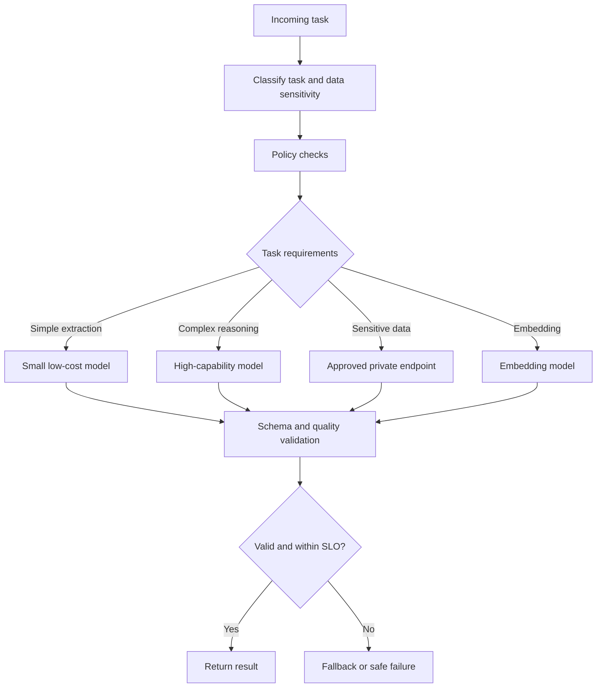

# Model Routing for Production AI Systems

## Purpose

Model routing selects an approved model for each task using capability, quality, latency, availability, privacy, and cost constraints. Routing should be implemented in deterministic gateway code, not delegated entirely to an LLM.

## Routing architecture



## Routing signals

| Signal | Example use |
|---|---|
| Task class | Summarization, extraction, code diagnosis, planning |
| Quality requirement | Complex incident reasoning needs stronger evaluation |
| Data sensitivity | Restricted data may require a specific approved endpoint |
| Context length | Route long-context tasks to models with sufficient capacity |
| Latency SLO | Interactive request versus background analysis |
| Budget | Per-request and per-tenant cost ceiling |
| Availability | Provider health and current error rate |
| Output format | JSON/schema reliability and tool-calling support |
| Region/residency | Contractual or regulatory processing constraints |

## Example routing policy

```yaml
routes:
  - task: log_classification
    sensitivity: internal
    model_profile: economical
    max_latency_ms: 5000
    max_cost_usd: 0.01
  - task: incident_root_cause
    sensitivity: confidential
    model_profile: reasoning
    max_latency_ms: 20000
    max_cost_usd: 0.15
  - task: pii_extraction
    sensitivity: restricted
    model_profile: approved_private
    external_processing: false
```

This is an illustrative application policy. Validate provider capabilities, contractual terms, and regional availability before configuring actual model identifiers.

## Simple router example

```python
from dataclasses import dataclass

@dataclass(frozen=True)
class Task:
    kind: str
    sensitivity: str
    max_cost_usd: float
    latency_budget_ms: int

@dataclass(frozen=True)
class ModelProfile:
    name: str
    allowed_sensitivity: set[str]
    estimated_cost_usd: float
    estimated_latency_ms: int

def choose_model(task: Task, profiles: list[ModelProfile]) -> ModelProfile:
    candidates = [
        p for p in profiles
        if task.sensitivity in p.allowed_sensitivity
        and p.estimated_cost_usd <= task.max_cost_usd
        and p.estimated_latency_ms <= task.latency_budget_ms
    ]
    if not candidates:
        raise RuntimeError("No model satisfies task policy")
    return min(candidates, key=lambda p: p.estimated_cost_usd)
```

In production, estimates should be updated from measured telemetry, and selection should consider quality scores from task-specific evaluations.

## Fallback strategy

Fallback should be bounded and explicit:
1. Retry transient errors with exponential backoff and jitter.
2. Switch to an approved equivalent model if the primary provider is unavailable.
3. Reduce optional context or use a simpler task path if quality remains acceptable.
4. Return a safe, transparent failure if no compliant model is available.

Do not silently route restricted data to a provider that is not approved for that data class.

## Evaluation before routing

Build a representative dataset for each task class. Measure:
- Task accuracy and groundedness
- Structured output validity
- Tool-call correctness
- Refusal and policy adherence
- Latency percentiles
- Input/output tokens and cost
- Performance across languages and noisy inputs

Use a weighted score only after setting minimum safety and quality thresholds. A cheap model that fails the task is not an optimization.

## Cost estimation

A basic request estimate is:

```text
estimated_cost =
  input_tokens / 1,000,000 * input_price_per_million
  + output_tokens / 1,000,000 * output_price_per_million
```

Include tool, embedding, reranking, storage, and network costs in the full service cost model. Prices and model capabilities change; fetch current values from official provider pricing pages rather than hard-coding assumptions.

## Operational metrics

Track route selection count, provider error rate, timeout rate, latency p50/p95/p99, token usage, cost per successful task, fallback frequency, schema validation failures, and quality evaluation score.

## Security

Maintain an explicit model/provider allowlist. Enforce data classification before routing. Avoid sending secrets or unnecessary personal data. Keep API keys in a secret manager, rotate them, and do not expose provider credentials to clients or agent prompts.

## References

- https://platform.openai.com/docs/
- https://docs.anthropic.com/
- https://ai.google.dev/gemini-api/docs
