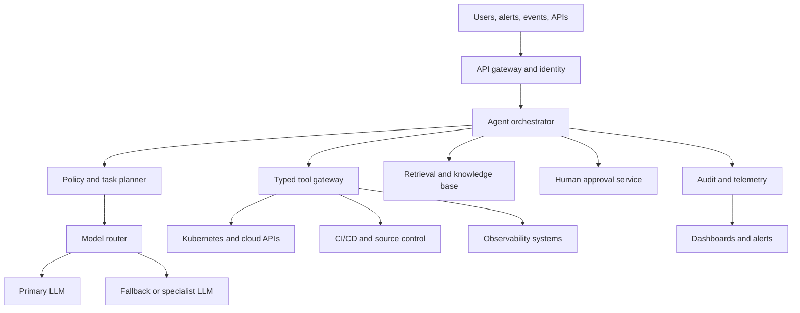

# Production AI Agent Architecture

## Purpose

This note describes a production-ready architecture for AI agents used in DevOps, AIOps, platform engineering, and enterprise workflows. The design separates deterministic software from probabilistic model reasoning, limits tool authority, and makes every decision observable and auditable.

## Reference architecture



## Core layers

| Layer | Responsibility | Key controls |
|---|---|---|
| Experience/API | Authenticates users and receives tasks | OIDC, RBAC, quotas, request validation |
| Orchestration | Manages task state, retries, deadlines, and workflow | Durable state, idempotency, bounded loops |
| Model gateway | Selects model/provider and enforces budgets | Allowlist, timeouts, rate limits, fallback |
| Tool gateway | Exposes typed operations | Least privilege, schema validation, egress controls |
| Retrieval | Supplies approved runbooks and context | ACL-aware retrieval, provenance, freshness |
| Approval | Authorizes sensitive actions | Human identity, expiry, separation of duties |
| Data and audit | Stores tasks, evidence, and decisions | Encryption, retention, append-only audit |
| Observability | Measures service and model quality | Traces, metrics, token/cost telemetry |

## Request lifecycle

1. Authenticate the caller and authorize the requested operation.
2. Create a request ID and enforce tenant, rate, and size limits.
3. Classify the task and select an approved workflow.
4. Retrieve only the context the caller is permitted to access.
5. Select a model based on task requirements, policy, latency, and budget.
6. Call the model with structured instructions and bounded context.
7. Validate model output against a strict schema.
8. If tools are required, validate every tool name and argument independently.
9. Require approval for actions classified as sensitive or disruptive.
10. Execute through a separate service identity and verify postconditions.
11. Persist evidence, decisions, approvals, and outcomes.
12. Return a concise result with source references and uncertainty.

## Recommended service boundaries

- `agent-api`: authentication, request validation, task creation.
- `orchestrator`: workflow state machine and execution deadlines.
- `model-gateway`: provider abstraction, routing, budgets, retries.
- `tool-gateway`: typed and allowlisted tool execution.
- `retrieval-service`: document ingestion, search, access filtering.
- `approval-service`: approval requests and signed decisions.
- `audit-service`: immutable event trail.
- `telemetry`: traces, metrics, logs, cost and quality dashboards.

Begin as a modular monolith if the team is small. Split services when independent scaling, security boundaries, or release cadence justify the operational overhead.

## Example API contract

```json
{
  "request_id": "req-01J...",
  "task_type": "kubernetes_incident_investigation",
  "scope": {
    "cluster": "staging",
    "namespace": "checkout"
  },
  "question": "Why are checkout pods restarting?",
  "limits": {
    "max_tool_calls": 12,
    "deadline_seconds": 90,
    "max_cost_usd": 0.10
  }
}
```

Never let a client choose arbitrary model endpoints, tool names, filesystem paths, or cloud accounts.

## State management

Persist workflow state outside the model context. Store:
- Request and tenant identifiers
- Workflow version and current step
- Tool calls, validated arguments, and results
- Evidence references and timestamps
- Model/provider/version and token usage
- Approval status and approver identity
- Retry count, deadline, and final outcome

Keep prompts and model context small. Retrieve evidence on demand instead of repeatedly sending the entire history.

## Deployment topology

A common Kubernetes deployment includes stateless API and worker Deployments, a durable queue, relational database, cache where useful, secrets integration, and telemetry collectors. Scale workers independently from API replicas. Use network policies, pod security controls, resource requests/limits, disruption budgets, and workload identity.

## Design principles

- Deterministic code owns authorization, arithmetic, policy, and execution.
- LLMs interpret and explain; they do not become the policy engine.
- Every tool call is independently authorized.
- Use asynchronous jobs for long-running tasks.
- Bound loops, tool calls, context size, concurrency, and spend.
- Keep model/provider adapters replaceable.
- Provide graceful degradation when a model or retrieval system is unavailable.

## Production readiness checklist

- [ ] Threat model and data classification completed
- [ ] Authentication and tenant isolation tested
- [ ] Tool permissions reviewed and least-privilege
- [ ] Structured outputs validated
- [ ] Human approval implemented for sensitive actions
- [ ] Timeouts, retries, cancellation, and idempotency implemented
- [ ] Cost and token budgets enforced
- [ ] Traces connect user request, model calls, and tool calls
- [ ] Redaction, retention, and deletion policies defined
- [ ] Load, failure, and recovery tests passed

## References

- https://12factor.net/
- https://opentelemetry.io/docs/
- https://kubernetes.io/docs/concepts/security/
- https://owasp.org/www-project-top-10-for-large-language-model-applications/
